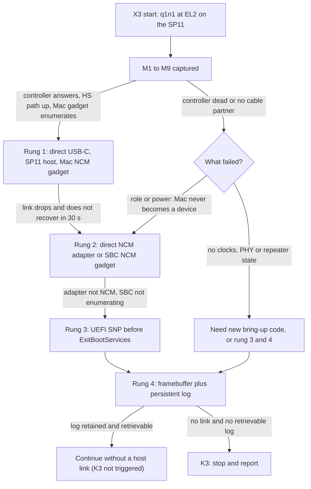

# Surface Pro 11 host link: A16 inventory, Hamoa USB facts, fallback ladder and persistent log

**Study and host tooling. UNIMPLEMENTED on hardware. Hardware status: NOT RUN.** Nothing here ran on a Surface Pro.
It answers WS-B items B2 and B3 of [SURFACE-PRO-11.md](SURFACE-PRO-11.md) as far as public sources and a host can: what
in q1n1's USB host link is A16-specific, what the public Hamoa and Denali device trees say about the USB path, how the
D5 ladder and kill criterion K3 decide, and a design for a persistent log. It also records the host tool
`tools/sp11_usb_ports.py`, its tests, and a default-off q1n1 patch that removes the A16 hard-coding from the SP11 path.
**The q1n1 patch is now applied and pushed** (independently re-verified, 2026-11-11: dry-run, apply, full suite 12/12
plus the board-info carrier's own 41/41, all with `Q1N1_BASE_DIR` set to a pristine copy of the same pinned commit;
the default build is still byte-identical) to [sa3eedo12/q1n1](https://github.com/sa3eedo12/q1n1) branch
`sa3eedo12-sp11-host-link`, two commits on top of the pinned commit (section 10): the board-info carrier, then the
USB host-link gate. Not yet merged to `Snapintosh/q1n1` main, and still host-only: nothing below changes that.

| Label | Meaning in this study |
| --- | --- |
| VERIFIED | Read in a pinned source (section 10) or in the q1n1 tree, or checked by a host test that ran. It says what the source says, never that the unit behaves so. |
| OBSERVED | Reported by a third party on real hardware, or recorded in q1n1's own A16 documents. Not re-measured. |
| INFERRED | Reasoned from the above and not checked. Every statement that the SP11 unit behaves as a Linux device tree describes is INFERRED. |
| UNKNOWN | Not established; a named measurement settles it (section 4). |
| EXPERIMENTAL / UNIMPLEMENTED | Code exists and passes host tests only / no code exists. |

## 1. Result in brief

1. **The A16 host link depends on firmware for everything below the controller.** q1n1 owns xHCI, CDC-NCM and the proxy,
   and it reads and writes only the DWC3 core and the Qualcomm glue block. It programs no PHY, clock, GDSC, regulator,
   repeater, retimer, GPIO or I2C controller (VERIFIED by a search of the pinned tree, N01 below; the code says so at
   `qcom-dwc3.c:541`). It works on the A16 because ASUS firmware leaves a powered, trained, role-resolved controller
   behind. The SP11 has no such guarantee. This is the central risk of B2.
2. **A16-specific parts are few and listed.** Two controller bases, the glue offset, three identity equalities, the
   firmware role-change path keyed to the ASUS BIOS image, the SoCCP-side Type-C path and the stage addresses (section 2).
   The xHCI driver, the CDC-NCM host and the proxy are generic, with one structural limit: devices are addressed on a root
   port only, so **a USB hub is not supported** (`xhci.c:409`). That bears on the D5 ladder (section 7).
3. **The Denali device tree enables two controllers, `usb_1_ss0` at `0x0a600000` and `usb_1_ss1` at `0x0a800000`, host only,
   one per Left-side USB-C connector.** Each connector has an eUSB2 repeater on the high-speed pair, a Parade PS8830
   retimer on the SuperSpeed pair, and Type-C role and power delivery handled by the ADSP through PMIC-GLINK (INFERRED
   for the unit; VERIFIED as to what the device tree says). A16 bases match by coincidence of the Qualcomm layout and
   are not trusted for that reason (section 3, section 5).
4. **What firmware leaves configured after a USB-stick boot, and what survives slbounce and ExitBootServices, is UNKNOWN.**
   Section 4 lists ten measurements that settle it, the first three of them register reads only.
5. **`tools/sp11_usb_ports.py` derives the table from the descriptor and refuses everything else.** The shipped
   `config/boards/sp11.json` now lists the two controllers (`usb-host` is `present`, INFERRED from the pinned device
   tree). An earlier revision listed none (`usb-host` was `unknown`), so the table was null and the tool exited 1. Today
   the table derives, and `emit-c` still refuses to write it until the DWC3 core id is measured (X2), unless
   `--allow-unmeasured-id` is given. Section 5 gives the descriptor change that made it derivable, including the rounding
   decision for the non-page-aligned window `0xfc100`.
6. **q1n1 gains a default-off `SNAP_PLATFORM_SP11` path** that takes the base and glue offset from a generated table,
   judges a controller by IP family and xHCI limits, never takes the device role on a host-only port, and refuses any table
   that fails its own rules before a register is read. With the gate off, the default build is byte-identical (section 6).
7. **Link ladder.** Rung 2 (an adapter) must be a direct USB-C CDC-NCM adapter or an NCM-gadget SBC, never a hub, until hub
   support exists. Rung 3 (UEFI SNP) ends at ExitBootServices by construction. Rung 4 needs a persistent log whose
   backbone is a DRAM-retention test nobody has run (sections 7 and 8).

## 2. The A16 inventory

### 2.1 The A16 flow in four lines

`q1n1.efi --boot` runs a boot window over the firmware's USB Function driver (`main.c:1161`, FIRMWARE-COUPLED), snapshots
the DWC3 and glue registers, leaves firmware, and `q1n1_usb_ports_init()` (`main.c:983`) then discovers host/NCM or
device/CDC on each controller independently (see `docs/A16-USB-PORT-INDEPENDENCE.md` in q1n1). The Mac enumerates as a CDC-NCM
gadget `05ac:1905` and the proxy rides UDP over it (OBSERVED on the A16; `docs/A16-Q1N1-PROXY.md`).

### 2.2 Inventory

Every row cites the pinned q1n1 commit (`7872398694ca8322e9cdebcc4ca2380491295f24`, section 10) and is checked by
`python3 tools/sp11_usb_ports.py inventory` and by `tools/test-sp11-usb-ports.py` against that commit.
Classes: **A16-SPECIFIC** (a number or name that is the A16's), **FIRMWARE-COUPLED** (needs the ASUS UEFI image or its
drivers), **GENERIC** (carries over unchanged, with the caveat stated).

| ID | Class | Where | What it is | Consequence for the SP11 |
| --- | --- | --- | --- | --- |
| I01 | A16-SPECIFIC | `usb-ports.c:367` | `i ? 0x0a800000u : 0x0a600000u`, the two DWC3 bases | Replaced under the gate by the table (section 6). |
| I02 | A16-SPECIFIC | `usb-ports.c:382` | `base + 0xf8800`, the glue ("qscratch") offset | Table field `qscratch_offset`. The value is the SDM845-family offset Linux uses (`dwc3-qcom.c:41`); the same number on the A16 is not evidence. INFERRED. |
| I03 | A16-SPECIFIC | `usb-ports.c:108` | GSNPSID must equal `0x33313130` (IP family `0x3331`, release `0x3130`) | The SP11 release is UNKNOWN. Gated path: family check, exact id only when measured. |
| I04 | A16-SPECIFIC | `usb-ports.c:109` | xHCI CAPLENGTH must be `0x30` | Gated path: at least `0x20`, a multiple of 4 (xHCI limits). |
| I05 | A16-SPECIFIC | `usb-ports.c:110` | HCSPARAMS1.MaxPorts must be 2 | Gated path: 1 to 16. |
| I06 | A16-SPECIFIC | `usb-ports.h:6` | `Q1N1_USB_PORTS 2`, sized into the shared state | The Denali board has two enabled controllers; kept, with a static assert tying the table to it. |
| I07 | A16-SPECIFIC | `usb-ebs.h:9` | `USB_EBS_DWC3_BASE` `0x0a600000` | Boot-window and takeover path; not used by the SP11 path. |
| I08 | A16-SPECIFIC | `usb-ebs.h:10` | `USB_EBS_QSCRATCH_BASE` `0x0a6f8800` | As I07. |
| I09 | FIRMWARE-COUPLED | `usb-ebs.h:11` | RVA into the ASUS BIOS312 `UsbConfigDxe` image | Meaningless on a Microsoft image. |
| I10 | A16-SPECIFIC | `usb1-device.c:4` | USB1 core `0x0a800000` for the CDC fallback | Device-mode fallback; not used on a host-only SP11 port. |
| I11 | A16-SPECIFIC | `usb1-device.c:5` | USB1 glue `0x0a8f8800` | As I10. |
| I12 | A16-SPECIFIC | `qcom-dwc3.c:244` | Serial string chosen when `regs == 0x0a800000` | Cosmetic and device-mode only; left alone (it would say "A16" on an SP11 device-mode attempt). |
| I13 | A16-SPECIFIC | `main.c:1182` | bootinfo carries `USB_EBS_DWC3_BASE` | Part of the A16 boot window path (B1's). |
| I14 | FIRMWARE-COUPLED | `usb-role-change.c:13` | FNV fingerprint of the BIOS312 `UsbConfigDxe` code | The role-change path refuses anything else; it cannot run on the SP11. |
| I15 | FIRMWARE-COUPLED | `usb-role-change.c:21` | `EXPECTED_USB0_BASE` `0x0a600000` | As I14. |
| I16 | FIRMWARE-COUPLED | `boot-window.c:17` | The boot window rides the firmware USB Function driver | No such driver is known on Surface firmware; B1 must replace the window. |
| I17 | FIRMWARE-COUPLED | `ucsi-console.c:3` | UCSI through the A16 firmware's `PmicGlinkDxe` | Boot-services only; the SP11 firmware equivalent is UNKNOWN. |
| I18 | A16-SPECIFIC | `live-battery.h:50` | GLINK client opens `PMIC_RTR_SOCCP_APPS` | Hamoa uses `PMIC_RTR_ADSP_APPS` (section 3.5). |
| I19 | A16-SPECIFIC | `smem.h:41` | SMEM base `0xffe00000` | Hamoa's SMEM is at the same address (`hamoa.dtsi:662`); the parser may carry over (INFERRED), the host pair and channel do not. |
| I20 | A16-SPECIFIC | `main.c:1205` | Stage addresses `0xb0000000`, `0x4c000000`, `0xa0000000` | Chosen for the A16 memory map; the SP11 DRAM map is UNKNOWN (X2 item 8). B1's. |
| I21 | A16-SPECIFIC | `qcom-dwc3.c:541` | "firmware owns PHY power, clocks, and PHY tuning" | The contract the whole path relies on (section 1, point 1). |
| I22 | A16-SPECIFIC | `usb-ports.c:3` | "No PD commands" are sent; direction is discovered, not negotiated | Same policy is kept; on the SP11 PD belongs to the ADSP. |
| I23 | FIRMWARE-COUPLED | `main.c:1161` | `Q1N1_BOOT_PROXY_NCM`: NCM-only boot, no dock | The A16 boot window's choice; the SP11 flow has no boot window yet (B1). |
| I24 | FIRMWARE-COUPLED | `usb-typec-probe.c:147` | Orientation read out of the firmware driver's memory (a diagnostic) | Not a pin and not a q1n1 driver; no SP11 equivalent. |
| N02 | GENERIC | `qcom-dwc3.c:417` | The one token hit of the search below: a comment about a USB event type | None. |
| G01 | GENERIC | `xhci.c:262` | Port count read from HCSPARAMS1 | Carries over. |
| G02 | GENERIC | `xhci.c:263` | Context size read from HCCPARAMS1 | Carries over. |
| G03 | GENERIC | `xhci.c:409` | Slot context holds the root hub port number only | **No hub, route string or transaction translator.** A hub in front of an adapter does not work. VERIFIED by search (no `hub`, `route` or `TT` in `xhci.c`, `xhci.h`, `ncm.c`). |
| G04 | GENERIC | `xhci.h:13` | "DMA is identity-mapped and cache-coherent on this SoC" | The Hamoa nodes say `dma-coherent` (`hamoa.dtsi:5320`, `:5411`; INFERRED for the unit). Behind an SMMU the claim also needs the stream state (M6). |
| G05 | GENERIC | `ncm.c:89` | The NCM function is found by class `0x02`/`0x0d`, not by vendor or product id | Carries over. Only the Mac gadget has been tried (E19). |
| G06 | GENERIC | `usb-ports.c:11` | DWC3 global offsets `GCTL 0xc110` | Match Linux (`core.h:102`, `:106`). |
| G07 | GENERIC | `qcom-dwc3.c:537` | Glue VBUS override (`QSCRATCH_SS_PHY_CTRL`, `QSCRATCH_HS_PHY_CTRL`) | Matches Linux (`dwc3-qcom.c:119-121`). Linux applies it only for device mode; a host-only port never needs it. |
| G08 | GENERIC | `q1n1-proxy.c:8` | Proxy wire format | Transport independent. |
| G09 | GENERIC | `main.c:983` | The only caller of the port manager | One place to hand the table over (it needs none: the gated manager reads it itself). |
| G10 | GENERIC | `usb-ports.c:17` | Dwell and disconnect times (`HOST_DWELL_US` and its neighbours) | Policy tuned on one A16 and one Mac (OBSERVED). Not hardware facts. |
| G11 | GENERIC | `usb-ports.c:70` | The host is halted before any role change | Keeps firmware-era rings from being written after reuse; keep on the SP11. |
| G12 | GENERIC | `a16xhci.py:331` | The host-side driver checks DMA with a No-Op command | The C driver has no such checkpoint (VERIFIED by search); M6 relies on it. |
| G13 | GENERIC | `usb-probe.c:2` | The passive protocol inventory (`make usb-probe`): its header promises no controller methods, no MMIO, no device connection, no NVRAM change and no ExitBootServices, and it lists the USB FUNCTION, USB2 HOST and SERIAL IO protocols | Reusable as it is on the SP11 and the zero-risk first look at what Surface firmware publishes (section 4). Whether it loads there is B1's question. Its `A16_USB_ROLE_PROBE` variant is A16-specific (I14 to I16). |
| G14 | GENERIC | `Makefile:185` | m1n1's Apple-silicon USB stack (`src/usb.c`, `src/usb_dwc3.c`: ADT, DART, TPS6598x) is built by q1n1's top-level Makefile for the Apple target; `platform/uefi/Makefile` names no `src/` path | Not part of the Qualcomm link: nothing to port or gate. The second half is VERIFIED by search and re-run by `test_the_uefi_makefile_names_no_apple_usb_stack_file`. |

### 2.3 What q1n1 does not do (N01)

A regex search over every `.c`, `.h` and `.S` file in `platform/uefi` for `gpio`, `tlmm`, `i2c`, `retimer`, `ps883`,
`repeater`, `gdsc`, `gcc_`, `rpmh`, `spmi`, `regulator`, `eusb2` and `qmp` has exactly one hit: a comment about a USB
event type (`qcom-dwc3.c:417`, N02). The test `test_q1n1_programs_no_phy_clock_gdsc_regulator_retimer_gpio_or_i2c` re-runs it
and fails on any other hit. Consequences:

- **PHY and retimer setup:** none in q1n1. Everything the A16 needs was done by firmware (I21).
- **GPIOs:** none. The only orientation read is a diagnostic probe of the firmware driver's memory, not a pin
  (`usb-typec-probe.c:147`, I24).
- **Role change:** only through the firmware driver (I14 to I16), or by trying host then device on the controller itself
  with no PD command (I22).
- **Interrupts:** none; everything is polled (`docs/A16-Q1N1-PROXY.md`, "Limits").

### 2.4 Assumptions inside the generic code

- Identity-mapped, cache-coherent DMA with only a `dsb sy` (`xhci.c:54`, G04). The first command after reset is the
  only check; without a No-Op checkpoint (G12) an SMMU that eats DMA looks like a generic failure.
- Root-port devices only (G03). The NCM host opens the first NCM function of the device on a root port.
- A cycle of 1.5 s of host dwell and 3 s of device dwell (G10) was tuned against one Mac. On a host-only SP11 port the
  gated manager does not alternate (section 6.2).

## 3. Hamoa and Denali facts

All values are from Linux `7475ea8b58616b33c04afb976cf0fbaad9dd63fb` (section 10). "Denali" means
`x1-microsoft-denali.dtsi`. Everything in this section is VERIFIED as to what the file says and INFERRED as to the unit.

### 3.1 Controllers

| Range name (descriptor) | Node | Base, window | IOMMU stream | PHYs | Denali |
| --- | --- | --- | --- | --- | --- |
| `usb-1-ss2` | `usb_1_ss2` | `0x0a000000`, `0xfc100` (`hamoa.dtsi:5016-5018`) | `0x14a0` (`:5069`) | eUSB2 + QMP combo | not referenced |
| `usb-2` | `usb_2` | `0x0a200000`, `0xfc100` (`hamoa.dtsi:5107-5109`) | `0x14e0` (`:5158`) | one eUSB2, `maximum-speed = "high-speed"` (`:5161`) | not referenced |
| `usb-mp` | `usb_mp` | `0x0a400000`, `0xfc100` (`hamoa.dtsi:5175-5177`) | `0x1400` (`:5235`) | two eUSB2 + two QMP uni; `dr_mode = "host"` at SoC level (`:5241`) | not referenced |
| `usb-1-ss0` | `usb_1_ss0` | `0x0a600000`, `0xfc100` (`hamoa.dtsi:5254-5256`) | `0x1420` (`:5307`) | eUSB2 + QMP combo | **enabled, host** (`denali:1364-1367`) |
| `usb-1-ss1` | `usb_1_ss1` | `0x0a800000`, `0xfc100` (`hamoa.dtsi:5345-5347`) | `0x1460` (`:5398`) | eUSB2 + QMP combo | **enabled, host** (`denali:1394-1397`) |

Four of the five are `qcom,x1e80100-dwc3` nodes and `usb_mp` is `qcom,x1e80100-dwc3-mp`. All are `status = "disabled"` until a
board enables them (for example `hamoa.dtsi:5322`,
`:5413`), `dma-coherent` (`:5320`, `:5411`), 2 MiB apart. The Denali file references no other USB controller. **The A16's two
bases equal the two enabled Denali controllers.** That is a property of the shared Qualcomm layout, not a reason to trust
the A16 constants: a copy would be right here and wrong on the next SoC, and the SP11 path never reads them (section 5).

### 3.2 The window, the glue block and the core id

- One `reg` entry of size `0xfc100` covers the DWC3 core and the Qualcomm glue block (the "flattened" binding). It is
  not a multiple of a page, which is why schema v1 could not hold it (section 5.2).
- Linux maps the glue at `reg base + 0xf8800`, size `0x400` (`dwc3-qcom.c:41-42`, `:662-664`), and treats the DWC3 core
  as `0xcd00` bytes (`:43`). `0xf8800 + 0x400` ends at `0xf8c00`, inside the window. INFERRED for the unit.
- VBUS override bits: `QSCRATCH_HS_PHY_CTRL` at `0x10` and `QSCRATCH_SS_PHY_CTRL` at `0x30` (`dwc3-qcom.c:26`, `:30`).
- The core id register is at `+0xc120` and its high half is the IP family: `0x5533`, `0x3331` or `0x3332`
  (`core.h:81`, `:106`, `:1293-1295`). The release is not in any public source for this SoC: `gsnpsid`, UNKNOWN.

### 3.3 What Linux turns on per controller (what q1n1 would have to replicate if firmware has not)

For `usb_1_ss0` (the others differ only in names): nine clocks from GCC starting at `GCC_CFG_NOC_USB3_PRIM_AXI_CLK`
(`hamoa.dtsi:5258`), the `GCC_USB30_PRIM_GDSC` power domain at the NOM performance state (`:5293-5294`), the
`GCC_USB30_PRIM_BCR` reset (`:5296`), interconnect votes (`usb-ddr` and `apps-usb`), the `apps_smmu` stream `0x1420`
(`:5307`), and the interrupts `dwc_usb3` (SPI 355, `:5282`) and a power event. Linux's glue driver asserts and releases the
reset, enables every clock, then maps the glue block (`dwc3-qcom.c:662-664`). None of this is q1n1 code today (N01); the SP11
path assumes firmware did it and fails closed when the controller does not answer as a DWC3 (section 6).

### 3.4 PHYs, repeaters, retimers and connectors

- **High-speed pair:** an eUSB2 PHY (`usb_1_ss0_hsphy` at `0x00fd3000`, `hamoa.dtsi:2819-2822`; `usb_1_ss1_hsphy` at
  `0x00fd9000`, `:2892-2895`) feeds an SMB2360 eUSB2 repeater, an SPMI PMIC function
  (`hamoa-pmics.dtsi:669-678` and `:684-693`; chosen by Denali at `denali:1352` and `:1382`). Linux enables the repeater with a
  register write before use (`phy-qcom-eusb2-repeater.c:156`). Whether firmware did, per port, is UNKNOWN (M4).
- **SuperSpeed pair:** a QMP USB3/DP combo PHY (`phy@fd5000`, `hamoa.dtsi:2833-2835`; `phy@fda000`, `:2906-2908`) feeds a
  Parade PS8830 retimer on an I2C bus: `i2c3` for `usb_1_ss0` and `i2c7` for `usb_1_ss1`, address `0x8`, reset GPIO
  `pm8550 gpio 10` and `tlmm 176`, a reference clock from the RF clock block (`denali:785-797`, `:851-863`). The driver
  needs six supplies, the reset line and the clock before it will answer (`ps883x.c:98`), and reports connection and
  orientation in registers `0x00` to `0x02` (`ps883x.c:26`).
- **Graph:** the high-speed endpoint goes straight to the connector (`denali:1370-1371`, `:1400-1401`); the QMP output
  goes through the retimer (`:1374-1375`, `:1404-1405`). A USB2-only link therefore needs neither the retimer nor the
  combo PHY (INFERRED from the graph; USB2-only enumeration is acceptable under B2).
- **Connectors:** two `usb-c-connector` nodes under `pmic-glink`, `power-role = "dual"`, `data-role = "dual"`:
  connector 0 "Left-side bottom port" (`denali:62-67`) wired to `usb_1_ss0`, connector 1 "Left-side top port"
  (`denali:99-104`) to `usb_1_ss1`. Orientation comes from two TLMM GPIOs (`denali:59`), read by Linux when UCSI reports
  a connection (`ucsi_glink.c:221`).

### 3.5 Type-C role, power delivery and the ADSP

Role, power contract and altmode are not the SoC's: the ADSP runs them and Linux reaches them through PMIC-GLINK.
Linux's `pmic_glink` driver has two rpmsg channels in its id table, `PMIC_RTR_ADSP_APPS` (with a protection-domain layer)
and `PMIC_RTR_SOCCP_APPS` (without), and picks the ADSP data for the generic `qcom,pmic-glink` compatible that the Denali
tree uses (`denali:53`) and the SoCCP data for `qcom,glymur-pmic-glink`, the A16's family (`pmic_glink.c:285-286`,
`:408-410`). The ADSP path also waits for the charger protection domain `tms/servreg` / `msm/adsp/charger_pd`
(`pmic_glink.c:397-398`). UCSI travels as GLINK messages `0x11` read, `0x12` write and `0x13` notify
(`ucsi_glink.c:25-27`). So the A16's GLINK client (I18, I19) is the wrong peer for the SP11: same SMEM address, different
host pair (the ADSP is remote pid 2 on an IPCC LPASS client, `hamoa.dtsi:4334-4342`), plus a protection-domain layer.
The Denali tree has Linux start the ADSP itself (`denali:1104`); the plan's R19 case is the other one, firmware's ADSP left
running. Whether PMIC-GLINK is alive at handoff is UNKNOWN (`adsp_pmic_glink_alive`).

### 3.6 What a third party saw (OBSERVED, one unit, R20)

The single-unit community report (commit in section 10) lists a setup "EL2, UEFI-left ADSP attached" with audio and NPU
off (its table, lines 15-16). Its findings mention a USB-C hub that works from a cold boot with a patched `ps883x` and
`xhci-hcd` (lines 118-121) and a series of `usb_1_ss0` NOC-clock patches (line 142). It does not say that USB works with
the UEFI-left ADSP specifically, and the clock patches hint that controller clocks and interconnect votes are not simply
left up (INFERRED). Neither statement is evidence for this unit.

## 4. What firmware leaves behind: UNKNOWN, and the measurements that settle it

Nothing public says what Surface UEFI leaves configured after a USB-stick boot, what the slbounce hand-off preserves, or
what the ExitBootServices handlers change. Each measurement below is read-only unless stated, runs from the X2 probe with
exception guards (a read of an unclocked block can abort), and is taken at three points: (P1) boot services, before any
USB I/O; (P2) just before ExitBootServices; (P3) at EL2 after slbounce. Differences between P1, P2 and P3 are themselves
the answer to "what survives".

One zero-risk step comes before M1 and needs no probe code: the existing passive inventory `q1n1-usb-probe.efi` (G13) lists
which USB protocols Surface firmware publishes (USB FUNCTION, USB2 HOST, SERIAL IO) without touching MMIO. It is not given an M
number because it observes firmware protocols, not hardware state. A USB FUNCTION protocol is what the A16 boot window rides
(I16), and a USB2 HOST protocol would mean firmware's own host stack owns a controller at P1.

| M | Measurement | Settles |
| --- | --- | --- |
| M1 | Per controller base: xHCI `CAPLENGTH`/`HCIVERSION` (`+0`), `HCSPARAMS1` (`+4`), `USBCMD`, `USBSTS`, `CRCR`, `DCBAAP`, every `PORTSC`; DWC3 `GSNPSID` (`+0xc120`), `GCTL` (`+0xc110`, PRTCAPDIR), `GSTS.CURMOD`, `GUSB2PHYCFG`, `GUSB3PIPECTL`; glue `+0x10`, `+0x30` | `gsnpsid`, `xhci_caplength_hciversion_maxports`; whether the controller answers at all; its role; whether UEFI's xHC still runs |
| M2 | GCC clock and GDSC status for each controller and its PHY domain; TCSR reference clocks (register offsets come from the Linux GCC driver and are pinned when the probe is written: UNIMPLEMENTED) | `uefi_leftover_state` (power and clocks) |
| M3 | PHY lock and status for the eUSB2 and QMP PHYs (offsets from the Linux PHY drivers, pinned when the probe is written: UNIMPLEMENTED) | `uefi_leftover_state` (PHY) |
| M4 | SMB2360 repeater enable and tuning registers over SPMI | `uefi_leftover_state` (high-speed path) |
| M5 | PS8830 connection status registers over I2C, after the I2C controller is brought up (only if the SuperSpeed path matters) | `uefi_leftover_state` (retimer) |
| M6 | A No-Op command through q1n1's own xHCI rings on each controller (G12), and the `apps_smmu` state of streams `0x1420` and `0x1460` | whether DMA reaches DRAM |
| M7 | UCSI `VERSION` over the ADSP channel (what the A16 did over the SoCCP, `docs/A16-LIVE-BATTERY.md`) | `adsp_pmic_glink_alive` |
| M8 | UCSI `GET_CONNECTOR_STATUS` for both connectors with and without the Mac attached: partner type, power direction, data role | `data_role_outcome` (SoC side) |
| M9 | On the Mac: which USB device tree appears, and whether a CDC-NCM gadget `05ac:1905` enumerates | `data_role_outcome` (Mac side) |
| M10 | The DRAM-retention experiment of section 8.3 | R5, rung 4 |

M1 to M3 read registers only, from the X2 probe. M4 and M5 need an SPMI or an I2C controller brought up first, which is
itself a write to controller registers and is UNIMPLEMENTED, so they wait for their own authorization (`AGENTS.md`,
section 5). M6 writes only to q1n1's own arena.

## 5. The descriptor-driven port table

### 5.1 What the tool does

`python3 tools/sp11_usb_ports.py table [DESCRIPTOR]` reads a descriptor with `tools/board_descriptor.py`, derives the
two Denali controllers from its `usb-host` ranges, and prints each value with its evidence label. Everything beyond the
descriptor (glue offset, host-only mode, connector, PHYs, retimer, IOMMU stream, `dma-coherent`) comes from the pinned device
tree and is labelled INFERRED. `emit-c` writes the table as C for q1n1 (never committed) and refuses to do so until the
DWC3 core id is measured (X2): every port carries `expect_gsnpsid = 0`, which q1n1 reads as "accept any of the DWC3
families 0x5533, 0x3331, 0x3332". `emit-c --allow-unmeasured-id` writes it anyway, and the generated C says UNMEASURED;
`table` still derives and prints a `core id: UNMEASURED` line. `propose` prints the descriptor
that makes the table derivable; `inventory` checks section 2 against a q1n1 tree. A refused table is never emitted.

The A16 constants are used in exactly one place: a refusal. An SP11 controller whose base equals `0x0a600000` or
`0x0a800000` is accepted only if the descriptor lists it with provenance that cites an independent source (the device
tree, an ACPI dump or a measurement) and none of the A16 sources (`q1n1`, `A16`, `usb-ports.c`, the BIOS image names).
In the tool, a source is independent when it cites a device-tree line (`hamoa.dtsi:NNNN`), names an ACPI dump, or claims
a measurement with VERIFIED or OBSERVED evidence; a negation (an "unmeasured guess", "not measured on any unit") voids it.
That proves the value did not arrive by copy; it does not prove the value is right.

### 5.2 The rounding decision

The device-tree window is `0xfc100`; schema v1 needs a 4 KiB multiple (`board_descriptor.py`, `_check_window`). The
tightest page-aligned claim is `0xfd000`, which overshoots by `0xf00` bytes and ends `0x103000` bytes before the next
controller (nodes are `0x200000` apart). The proposal uses `0xfd000`. The tool refuses a window below `0xf8c00` (the glue block would be outside it,
`window-too-small`) or above `0xfd000` (`window-exceeds-dt`), and a unit test pins that `0xfc100` itself is a loader
error. The alternative, relaxing the schema to allow byte-exact sizes, is a project decision (section 11).

### 5.3 Refusals

| Code | Provoked by |
| --- | --- |
| `descriptor-invalid` | The loader refuses the file (malformed JSON, unknown key, unaligned or overlapping window, bad provenance). Never repaired. |
| `not-sp11` | The SoC is not X1E80100 / hamoa, for example the A16 descriptor. |
| `usb-host-not-present` | `devices.usb-host` is `unknown` or `absent`. An earlier revision of the shipped file was in this state; it now lists the controllers. |
| `usb-host-no-mmio` | `usb-host` is present but lists no windows. |
| `no-usb-ranges` | `usb-host` owns no controller window. |
| `unknown-range` | A `usb-host` range is not one of the five Hamoa controllers. |
| `bad-range` | A controller range is not an `mmio` range with a known base (unreachable through the loader; guards hand-built boards). |
| `foreign-owner` | A range named like a Hamoa controller belongs to another device. |
| `missing-controller` | A controller the Denali tree enables is not listed. Both connectors must be known before X3 can say which carries the Mac. |
| `controller-not-enabled` | A controller the Denali tree leaves disabled is listed. |
| `base-mismatch` | The base differs from the pinned device tree. A measured value needs a reviewed reference update, not a silent override. |
| `a16-base-not-independent` | An A16 base without independent provenance. |
| `window-too-small` | The window does not cover the glue block. |
| `window-exceeds-dt` | The window claims more than the device-tree window rounded to a page. |
| `controller-overlap` | The exact device-tree windows overlap each other or any other Hamoa controller's, listed or not. |

### 5.4 The unknowns the table carries as nulls

`gsnpsid`, `xhci_caplength_hciversion_maxports`, `uefi_leftover_state`, `adsp_pmic_glink_alive`, `data_role_outcome`:
printed with the measurement that settles them (M1 to M9). The emitted table sets `expect_gsnpsid` to 0 (unknown); q1n1
then accepts any DWC3 family and logs the exact id. `emit-c` writes that table only with `--allow-unmeasured-id`.

### 5.5 The descriptor change this needs (a proposal; `config/boards/sp11.json` is not edited here)

**Status: applied.** The change below is now in the shipped `config/boards/sp11.json` (with the matching expectation edits
in `tools/test-board-descriptor.py`), and the descriptor lists the two controllers as INFERRED. The heading keeps its original
wording so that links to it still work; the text below is the change as it was proposed.

`python3 tools/sp11_usb_ports.py propose` prints the full descriptor; the change relative to the earlier shipped file is:

- `ranges`: append `{"name": "usb-1-ss0", "kind": "mmio", "base": "0x0a600000", "size": "0xfd000", "device": "usb-host"}` and the
  same for `usb-1-ss1` at `0x0a800000`.
- `devices.usb-host`: `{"state": "present", "mmio": true, "ranges": ["usb-1-ss0", "usb-1-ss1"]}`.
- `provenance`: `ranges.usb-1-ss0`, `ranges.usb-1-ss1` (INFERRED, source `hamoa.dtsi` lines of the node) and
  `devices.usb-host` (INFERRED, source the Denali enable lines).

The proposal passes the loader and derives a clean table; `board.status` stays `UNIMPLEMENTED` and the descriptor stays
not boot-ready for the other unknowns (MIDR, GIC version, timer, ECAM, DRAM).

## 6. q1n1: the default-off `SNAP_PLATFORM_SP11` path

The gate is the project-wide `SNAP_PLATFORM_SP11` (`compat/platform.h`). The earlier q1n1 board-info patch
(`docs/BOARD-INFO.md`, `tools/q1n1_boardinfo.py`) added no C gate, so this patch introduces the macro in q1n1 with the same
name and default 0.

### 6.1 Files

New: `platform/uefi/sp11-usb-ports.{h,c}` (table ABI, validators, no allocation, no I/O),
`tools/test-q1n1-sp11-table.c`, `tools/test-q1n1-sp11-usb-ports.{c,py}`, `tools/testdata/sp11-usb-table-fixture.c`
(a test fixture with invented bases). Edited, all inside the gate: `platform/uefi/usb-ports.c` and
`platform/uefi/Makefile`. `main.c` is untouched.

### 6.2 What the gated manager does differently

1. **Table, not constants.** `q1n1_usb_ports_init()` validates the table first and returns NULL (the caller already
   halts on NULL) before reading a register or adopting state. Bases and glue offsets come from the table.
2. **Identity by family and limits (I03 to I05).** `q1n1_sp11_usb_controller_ok()` accepts a core whose GSNPSID high half
   is a DWC3 family, CAPLENGTH 0x20 or more and a multiple of 4, an xHCI 1.x version and 1 to 16 ports; with `expect_gsnpsid`
   set it demands that exact id. The relaxation is deliberate: the SP11 release is UNKNOWN. The price is a weaker guard
   against a wrong base, so X2 must pin `expect_gsnpsid` before the first takeover (M1).
3. **Host-only ports.** With `Q1N1_SP11_USB_PORT_HOST_ONLY` (set for both Denali controllers, from `dr_mode = "host"`) the
   manager never starts the device role, and a host that sees no cable keeps running instead of being reset every 1.5 s.
   Rationale: a device takeover forces a VBUS override the Type-C firmware did not ask for (`dwc3-qcom.c:119-121`), and the
   plan expects the SP11 as the host (D5). INFERRED; the flag is a table field, not code.
4. **Stale state.** Shared state carries `PORTS_VERSION 2` under the gate (1 is the A16's), so a stage built for the
   other platform is reset, not adopted. If a table changed between stages, the old controller is halted through the base
   its state recorded before the new one starts.
5. **Unused slots.** A one-controller table marks the second slot unsupported and touches nothing of it.

### 6.3 Default-off proof (host)

With the gate off, the Makefile command lines (`make -n`) match the pristine tree's, `usb-ports.o` is byte-identical for
the stage target, and a full default build matches a pristine copy artifact for artifact (56 files: every PE object, the PE
image, the stage objects, ELFs and the four stage binaries), with the COFF link timestamp disabled for both trees
(`-mno-incremental-linker-compatible`, plus `/Brepro` for the image). The gate
off also preprocesses `usb-ports.c` identically with `-DSNAP_PLATFORM_SP11=0`. With the gate on, the object has none of the
A16 immediates (`0xa600000`, `0xa800000`, `0x3331`, `0x3130`). These are host checks: they say nothing about an SP11.

### 6.4 Not done

PHY, clock, GDSC, repeater, retimer, I2C, GENI, PMIC-GLINK-over-ADSP and PD code (all UNIMPLEMENTED and each blocked on M2
to M8); an SP11 boot flow in place of the A16 boot window (B1); a No-Op DMA checkpoint in the C xHCI driver (G12); hub
support (G03); hostless operation. The SP11 build is compile and link checked only and has never run.

## 7. The fallback ladder (D5) and kill criterion K3

| Rung | Needs | What can go wrong | What decides it |
| --- | --- | --- | --- |
| 1. Direct USB-C, SP11 host, Mac NCM gadget | Controller powered and clocked, HS PHY and repeater up, role resolved so the SP11 is DFP and the Mac a device, q1n1's NCM host (G05) | UEFI left the controller dead; both ends DRP and PD picks the wrong data role (OBSERVED on the A16: the Mac also reported host); SMMU eats DMA; the Mac gadget needs the SP11 to be the power source | M1, M6, M8, M9; a No-Op command completing, then the Mac enumerating `05ac:1905` |
| 2a. Direct USB-C CDC-NCM Ethernet adapter on the SP11 | An adapter that presents class `0x02`/`0x0d` (many default to vendor or ECM mode; q1n1 has no ECM, RNDIS or vendor code, E19), a Mac-side interface on the same LAN or a cable | The adapter's NCM mode is not default; only the Mac gadget has ever been tried (E19); the host needs an address plan for the proxy's UDP | Descriptor dump of the adapter on the Mac first (read-only), then the same M1/M6 sequence |
| 2b. SBC in NCM-gadget mode, direct to the SP11 | A Linux SBC that enumerates as one CDC-NCM function with a USB-C or A-to-C cable, bridged to the Mac | The SBC may offer two functions (q1n1 opens the first, `ncm.h`); power direction; bridging adds a hop | As 2a |
| 2c. Hub with an adapter, or a hub with built-in Ethernet | A hub class driver in q1n1's xHCI host | **Not supported** (G03): route string and transaction translator absent. Not a rung until built. | Not decidable on the current code |
| 3. UEFI SNP before ExitBootServices | A NIC the Surface firmware drives (a USB NIC through its own stack), a q1n1 UEFI path that uses `EFI_SIMPLE_NETWORK_PROTOCOL` | Ends at ExitBootServices by construction, so it logs and loads pre-EBS only (it cannot carry the EL2 proxy); firmware may not bind any USB NIC | Whether the firmware exposes SNP on the adapter, in the UEFI shell, before any code is written |
| 4. Framebuffer plus a persistent log | The GOP framebuffer through EBS (the A16 does this, `fbcon`), and a log that survives the reset (section 8) | Retention is UNKNOWN (R5); firmware may scrub the region; reset may be unavailable (R18) | M10; a photographed screen is the floor |

### 7.1 K3

K3 stops the project when there is **no viable host link and no workable log strategy**. This study makes both
halves testable: a *viable link* is a bidirectional proxy session at EL2 that survives one cable move (the X3 exit); a
*workable log strategy* is a visible framebuffer console plus at least one of (a) a retained-DRAM log that a later boot
flushes to the USB stick before ExitBootServices, (b) a retained-DRAM log read back over a link that returned, or (c)
a pre-EBS-only log to the stick when retention fails. K3 is therefore reached only if rungs 1 to 3 fail and the framebuffer
is unusable or both retention and stick writes fail. Writing a log file to the stick is a D9-permitted write (not the
internal disk, not NVRAM). Raising a failure to K3 without M10 having run is not allowed: "no log" is a measurement, not a guess.

### 7.2 Exercising one link failure (B3)

The ladder has not been exercised on hardware (NOT RUN). The host model covers the manager's side: a host-only port that sees
its cable pulled is rediscovered as a host with no device attempt (`test_manager_follows_the_table`). The supervised X3
exercise, once authorized: with a session up, pull the cable for 5 s and replug (expect recovery inside the 0.5 s
disconnect debounce plus one host dwell); then pull it and leave it out and confirm the log shows the drop and rung 2 is
chosen by the decision tree, not by hand.

## 8. A persistent log: a design with unproven assumptions

**This is a design, EXPERIMENTAL at best and UNIMPLEMENTED today.** Its purpose is to make rung 4 of the ladder concrete.

### 8.1 Requirements

Survive a reset the guest or q1n1 causes; need no host; be written from hot paths without blocking or allocating
(`AGENTS.md`, sections 2 and 3); be retrievable by the operator with no tools (the screen) and by the host when a link
exists; never touch the internal disk or NVRAM (D9).

### 8.2 Layout

One reserved region of 64 KiB, 4 KiB aligned, in DRAM q1n1 owns: a 64-byte header, then a ring of fixed 64-byte records.
The header holds a magic, a layout version, a boot counter, the ring size and head, a CRC32 of the header, and the CRC of
the previous record. Each record holds a monotonic sequence number, a timestamp from the generic counter, a source id, and
48 bytes of text or a typed event; its own CRC makes torn writes detectable. The writer is a single-producer ring with
bounded work, no locks and no allocation: it writes the record, issues `dc cvac` over its cache line and `dsb ish`, then
publishes the head. **Placement is UNIMPLEMENTED:** the address must come from the measured DRAM map (X2 item 8, descriptor
`ranges.dram0`, currently null) and be a pure function of it, so the next boot finds it without help. A candidate rule, to
be checked against the real memory map, is "the top 1 MiB of the highest conventional region below 4 GiB that no firmware
phase has been seen to write".

### 8.3 Proving retention (M10)

Nothing here is assumed until this passes. Write a canary (an incrementing pattern with a CRC and a boot counter) to three
candidate 4 KiB pages; clean the cache; reset by each path in turn: the firmware warm reset, firmware cold reset, PSCI
`SYSTEM_RESET`, a forced hang left for the watchdog, and a long power-button reset; and read the pages back at the next
boot, both in the earliest UEFI application and at EL2. Record, per path and per page, whether the canary survived whole,
partly or not at all. **Pass:** at least one reset path preserves at least one page across ten consecutive trials with the
firmware's memory map unchanged. **Fail:** anything else; then rung 4 degrades to the stick log and the photographed screen.
All of it is read and write of q1n1-owned RAM and the stick; no flash, NVRAM or disk is written.

### 8.4 Retrieval

(a) The next boot's UEFI application finds the header, checks the CRCs, and writes `LOG-<boot counter>.TXT` to the FAT32
USB stick before ExitBootServices. (b) After a link returns, the proxy `MEMREAD` reads the same region. (c) The framebuffer
console re-prints the last records, so a photograph is the last resort. (d) The log is cleared only after (a) reports a
verified write.

### 8.5 Unproven assumptions, each with its measurement

| # | Assumption | Status |
| --- | --- | --- |
| A1 | DRAM contents survive a warm reset on this SoC | UNKNOWN (M10; R5) |
| A2 | Firmware does not scrub or reuse the chosen region before q1n1 reads it | UNKNOWN (M10, memory map comparison) |
| A3 | `ResetSystem` still works after slbounce | UNKNOWN (X1, R18); if not, only a power-button cold reset exists, where retention is least likely |
| A4 | A cache clean to the point of coherency is enough for the reader after reset | INFERRED (the same rule the board-info slot uses, q1n1 `docs/BOARD-INFO.md`) |
| A5 | No memory encryption or ECC initialization wipes the region | UNKNOWN |
| A6 | The USB stick is writable from UEFI after the previous boot ended in a reset | UNKNOWN (M10) |

## 9. Evidence summary

| Claim | Label | Where |
| --- | --- | --- |
| q1n1 programs no PHY, clock, GDSC, regulator, retimer, repeater, GPIO or I2C | VERIFIED (search, test) | N01, section 2.3 |
| The xHCI host cannot address a device behind a hub | VERIFIED (search) | G03 |
| Hamoa has five DWC3 controllers; Denali enables two, host only | VERIFIED (read) / INFERRED (unit) | section 3.1 |
| Glue block at `+0xf8800` inside the `0xfc100` window | VERIFIED (read) / INFERRED (unit) | section 3.2 |
| Type-C and PD run on the ADSP through PMIC-GLINK | VERIFIED (read) / INFERRED (unit) | section 3.5 |
| A USB2-only link needs neither retimer nor combo PHY | INFERRED | section 3.4 |
| What firmware leaves configured, what survives slbounce and ExitBootServices | UNKNOWN | section 4 |
| Descriptor-driven table, refusals, C and Python validators agree | EXPERIMENTAL (host tests) | sections 5 and 6 |
| q1n1 default build unchanged | VERIFIED (host comparison) | section 6.3 |
| Any behaviour of the SP11 SoC, link or log | not established | NOT RUN |

## 10. Pinned sources

| Source | Revision | Licence | Used for |
| --- | --- | --- | --- |
| Linux `arch/arm64/boot/dts/qcom/{hamoa.dtsi,x1-microsoft-denali.dtsi,hamoa-pmics.dtsi,x1-el2.dtso}` | `7475ea8b58616b33c04afb976cf0fbaad9dd63fb` | BSD-3-Clause (SPDX headers) | Section 3 |
| Linux `drivers/usb/dwc3/{dwc3-qcom.c,core.h}`, `drivers/soc/qcom/pmic_glink.c`, `drivers/usb/typec/ucsi/ucsi_glink.c`, `drivers/usb/typec/mux/ps883x.c`, `drivers/phy/qualcomm/phy-qcom-eusb2-repeater.c` | the same commit | GPL-2.0, GPL-2.0-only or GPL-2.0+ per file (read for facts: offsets, names, message ids; no text or code copied) | Sections 3.2 to 3.5 |
| q1n1 | `7872398694ca8322e9cdebcc4ca2380491295f24` | MIT | Section 2 (line numbers are for this commit) |
| Community SP11 EL2 report | `8f1726d49e57de97ac0a349a89ae894206f0fc12` | none stated in its README | Section 3.6, OBSERVED, one unit |

SHA-256 of the fetched device-tree files, with the git blob SHA-1 that GitHub reports for the same commit (they match
the downloaded bytes): `hamoa.dtsi` (233,339 bytes) `d5bb1f7ce37c721d75fb5b4cffc8f58bed4d3ef9786a231a0deca05e917529e0`,
blob `48f47aa6ba3c7a86b9746ccef05724529ea2cd02`; `x1-microsoft-denali.dtsi` (28,937 bytes)
`afbea2d7b48c1725b34a742b4c34432015ac237e6c390e94458551fb4213a239`, blob `a71c297627fe21c99e9b5548d319b6bad01d99ce`;
`x1e80100-microsoft-denali-oled.dts` (388 bytes) `d936576f711043f1407a5319bcfa9135d4e64b31fd64bed9d0d5b72443a40ed3`, blob
`07ce43ccf39430b89f881f86e629fe69ca9baefd`. A digest recorded elsewhere for these three files must be checked against the
blob SHA-1 values above before it is trusted.

## 11. Open questions

1. **Rounding.** Keep the 4 KiB-rounded `0xfd000` window (this study), or relax schema v1 to carry the exact `0xfc100`?
2. **Gate name.** `SNAP_PLATFORM_SP11` is reused in q1n1 because the earlier q1n1 board-info patch introduced no C gate.
3. **Identity.** Accept any DWC3 family until X2 pins `expect_gsnpsid` (this patch), or refuse every controller until it is
   pinned?
4. **Host-only.** Keep both Denali controllers host-only (this patch, from `dr_mode`), or allow device attempts?
5. **Descriptor.** The section 5.5 change was applied to `config/boards/sp11.json` (the alternative was to keep the
   template and the null table). What stays open is question 3: `emit-c` still needs `--allow-unmeasured-id` because no
   core id is measured.
6. **Hub support.** Is rung 2c worth building, or is "direct adapter or SBC" the rule?
