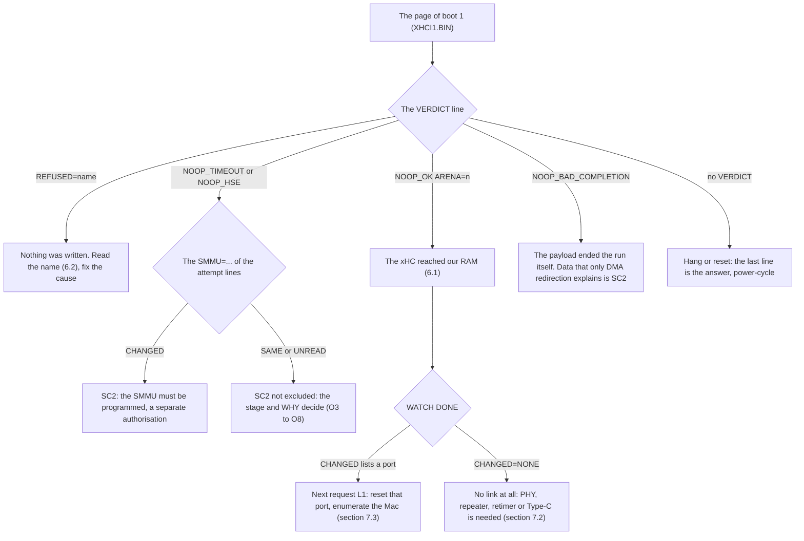

# Surface Pro 11 xHCI stage S1 (authorisation point A1): the No-Op DMA test, its runbook and outcome tree, and what the live link needs next

**EXPERIMENTAL. Host tests only. Hardware status: NOT RUN.** This document prepares the first write to an xHC register at EL2 on the
Surface Pro 11: stage S1 of [SP11-STICK-LOG.md](SP11-STICK-LOG.md) (section 6), authorisation point A1. The operator approved A1 in
principle on 2026-11-17 at 02:10 for one supervised test. **A2 (the first sector write to the stick) is NOT granted** and nothing here
asks for it. Nothing in this document, in the tools it names or in a file on a stick authorises a run: the operator approves the
record of section 3 by name, in writing, with the SHA-256 of its text and of the payload file. The payload `xhci` and its tests are
in the q1n1 fork (`payloads/xhci*.c`, and `docs/SP11-PAYLOAD-XHCI.md` there); the record, the plan, the Mac-side logger and this
runbook are in this repository.

| Label | Meaning in this document |
| --- | --- |
| VERIFIED | Read in a cited source, or measured by a host test that ran. It says what the source says, never that the unit behaves so. |
| OBSERVED | Seen on the unit in an earlier boot ([SP11-STICK-LOG.md](SP11-STICK-LOG.md) sections 12 and 13: one unit, one boot each) or on QEMU. Never a result of A1. |
| INFERRED | Reasoned from the above and not checked. The xHCI specification sections cited here are cited from memory and were not re-read: INFERRED. |
| EXPERIMENTAL / UNIMPLEMENTED | Code that exists and passed host tests only / code that does not exist. |
| UNKNOWN | Not established. A1 is built to settle some of these; section 10 lists them. |

## 1. Result in brief

1. **One question, asked of one controller per boot.** Can the xHC of `usb_1_ss1` (file `XHCI1.BIN`; `usb_1_ss0` is `XHCI0.BIN`, a
   second boot, only after the page of the first was read and the operator named the second file) read a Command TRB from RAM that
   q1n1 owns and write a Command Completion Event back? That is the SC2 question of the stick log (does the xHC's DMA reach our DRAM
   through the apps SMMU: streams `0x1420` and `0x1460` translate into context bank 3, nested, stage 1 off, and what stage 2 maps is
   UNKNOWN) and the G12 / M6b checkpoint of the [host-link study](SP11-HOST-LINK-STUDY.md).
2. **A second question, asked first and read only.** A 30 s plug watch of the PORTSC of both controllers, with the operator
   connecting the Mac's USB-C cable at an on-screen cue, tells which controller serves the connector in use and whether any link
   appears at all, before the first register is written. Nothing else in the stack is known to answer that.
3. **What the payload writes is a short list:** thirteen xHCI registers of the one controller and the words of one RAM arena
   (section 2). Everything else is read or untouched. A run that finds anything unexpected refuses by name and writes nothing.
4. **What is prepared:** the payload and its tests in the q1n1 fork (a native model of the page and of every refusal, the native
   xHCI simulator, QEMU's independently written xHC, a set of mutants, a source audit and a binary audit); the record text with its
   digest (section 3); the plan `a1-xhci-s1` (and `a1-xhci-s1-ss0`); this runbook (section 4), the expected page (section 5) and
   the outcome tree (section 6); the Mac-side logger (section 8); and the list of what the live link needs beyond A1 (section 7).
5. **What is not done:** any run on the unit, any staged authorised bundle (the coordinator builds it), any write to a port,
   the DWC3, the SMMU, a clock, a PHY or the stick. Every statement about the unit's behaviour under A1 is a prediction.

## 2. What A1 covers and what it does not

| | A1 covers (the payload writes it) | A1 does not cover (read only, or untouched) |
| --- | --- | --- |
| xHC registers, one controller per boot | USBCMD (RS and HCRST), CRCR, DCBAAP, CONFIG, interrupter 0 ERSTSZ, ERSTBA, ERDP and IMAN (IP, write 1 to clear), doorbell 0 | USBSTS (even its write-1-to-clear bits), every PORTSC (no port reset, no power change), IMOD, other interrupters, other doorbells, everything of the other controller |
| RAM | One arena at a time: one page of structures plus one page per scratchpad buffer, zeroed again at the end | Any other RAM |
| Everything below the xHC | nothing | DWC3 core and glue, the SMMU (not even a fault-status clear), clocks, GDSC, GCC, PHYs, repeater, retimer, I2C, SPMI, GPIO, UCSI, any SMC or HVC, the stick, any disk or NVMe, any UEFI variable |

The thirteen registers, as the record lists them (`tools/sp11_xhci_s1_record.py`, compared with the payload's header and with the audit
of the host harness by `tools/test-sp11-xhci-s1-record.py`). `op` is base + CAPLENGTH `0x20`, `ir0` is base + RTSOFF + `0x20`,
`db` is base + DBOFF. A 64-bit register is two 32-bit stores, the low word first. CONFIG, DCBAAP, ERSTSZ, ERSTBA and ERDP are read back
after the PROGRAM group; CRCR, the doorbell and IMAN are not. DBOFF and RTSOFF are read from the controller and printed in the `U<c>`
lines, which appear only when the reads and checks of the controller's own words pass; the unit's are not recorded (`0x2000` and `0x1000`,
which the simulator and QEMU use, are INFERRED). The payload refuses, with nothing written, a DBOFF or RTSOFF with reserved low bits, a
doorbell or interrupter outside the window or inside the operational registers, and any doorbell or interrupter that would put one of the
thirteen registers at or above `0xc100` (the DWC3 global registers): `OFFSET` in section 6.2, where the page is the VERDICT line alone.

| Register | Block | Offset | Written in |
| --- | --- | --- | --- |
| USBCMD | op | 0x00 | RESET (HCRST), RUN (RS), and the halt (RS clear) |
| CRCR_LO, CRCR_HI | op | 0x18, 0x1c | PROGRAM (with RCS = 1) |
| DCBAAP_LO, DCBAAP_HI | op | 0x30, 0x34 | PROGRAM |
| CONFIG | op | 0x38 | PROGRAM (MaxSlots, as read) |
| ERSTSZ | ir0 | 0x08 | PROGRAM (1) |
| ERSTBA_LO, ERSTBA_HI | ir0 | 0x10, 0x14 | PROGRAM, last of the group: it makes the xHC load the segment table |
| ERDP_LO, ERDP_HI | ir0 | 0x18, 0x1c | PROGRAM, and NOOP (with EHB) |
| IMAN | ir0 | 0x00 | NOOP (IP, write 1 to clear) |
| DB0 | db | 0x00 | NOOP (value 0) |

A nominal run makes 17 stores: HCRST, ten of PROGRAM, RS, the doorbell, ERDP twice and IMAN, then the halt. The order is xHCI 1.2
section 4.2 (INFERRED): halt, HCRST, CONFIG, DCBAAP, CRCR, ERSTSZ, ERDP, ERSTBA, RS, one No Op Command TRB (section 4.6.2), the
doorbell, the Command Completion Event (sections 4.9.4 and 6.4.2.2), ERDP with EHB, halt. The scratchpad array goes in DCBAA[0] when
HCSPARAMS2 asks for buffers (section 4.20, INFERRED); it is easy to forget and the count comes from the register. q1n1's own driver
(`platform/uefi/xhci.c`, `xhci_init`) writes the same registers in the same order (VERIFIED by reading); QEMU's xHC runs the
sequence to a Command Completion Event (OBSERVED on QEMU, not on the unit).

## 3. The files, the record and the plan

**Files of the plan `a1-xhci-s1`** (boot 1; `a1-xhci-s1-ss0` is the same with `XHCI0.BIN` for the optional second boot):
`SLBOUNCE-DEVHE-MARK.EFI`, `Q1N1-PAYLOAD.EFI`, `PAYLOAD.MAN` (it lists exactly one payload, the one of the boot) and `XHCI1.BIN`.
The first two are pinned as for the plan `timers` (boot 11, OBSERVED); the payload files are built from one source twice, one build
macro naming the controller, so the file name tells the operator which controller is under test.

**The record** is the text the operator approves. It is generated, not written by hand, and identical for identical inputs, which are the
payload files and this runbook: the record names the SHA-256 of this file's bytes in its section 1 (`--runbook` names the file; it
defaults to `docs/SP11-XHCI-S1.md`):

```text
python3 -B tools/sp11_xhci_s1_record.py --xhci1 <XHCI1.BIN> [--xhci0 <XHCI0.BIN>] [--runbook <file>]            # the text, on standard output
python3 -B tools/sp11_xhci_s1_record.py --xhci1 <XHCI1.BIN> [--xhci0 <XHCI0.BIN>] [--runbook <file>] --digest   # its size in bytes and its SHA-256
```

The operator approves by naming the SHA-256 of the record text and of the payload file, in writing. A digest that differs from the
staged file means no run, and so does a runbook whose bytes are not the ones the record names. Because the record names this file's
digest, this file cannot name the record's digest, its size or its line count (naming them would change the digest they name): the
operator reads them from the generator. `tools/test-sp11-xhci-s1-record.py` pins the digest of an example record, checks every number of the text
against the payload's header, and holds the phrases the record must carry: the registers, the arena, the reads, what is not written, the
hazards, the stop rules, the budget and the operator's actions.

**The plan** is built with the public functions of `tools/sp11_autorun.py` by `tools/sp11_xhci_s1_plan.py` (one autorun step: `load`
`SLBOUNCE-DEVHE-MARK.EFI`, then `Q1N1-PAYLOAD.EFI --el2`; the manifest; the data files). The argument vector that stages it is
`staging_command()` of the record module. Nothing here stages anything: a plan, a script and a staged tree authorise nothing.

## 4. The runbook

### 4.1 Before the boot

1. The operator has read the record and approved it by name, with its SHA-256, and this runbook is the file whose SHA-256 its section 1
   names. Without that, stop.
2. The stick is the one the record describes: `SP11\PLAN.TXT` of the plan `a1-xhci-s1`, the four files, no `SP11\DONE1.TXT`. The
   script writes that marker before the step runs, so a step that hangs is not repeated; to run again, delete the marker.
3. Power: AC connected, or the battery at 50 % or more. One hardware client: nothing else touches the unit, the stick or the Mac's
   USB while this runs.
4. The stick goes directly into one USB-C port of the unit, with no hub, as in the S0b boots ([SP11-STICK-LOG.md](SP11-STICK-LOG.md)
   section 13). The other USB-C port stays empty: it is the FREE port for the Mac's cable. The operator says on the video which
   physical port holds the stick. Which connector is which controller is UNKNOWN; the plug watch answers it.
5. The Mac's cable is NOT connected yet. It is connected only at the on-screen cue (section 4.2).
6. On the Mac, in a Terminal: `python3 tools/sp11_mac_usb_watch.py` (section 8; add `--allow-empty-usb` if the Mac has no other USB device
   attached, or the logger takes no baseline until the gadget itself appears). It prints its baseline and then one line per change.
7. The camera: ONE video, started before the Shell countdown and kept running until the first `UPTIME` heartbeat after the payload's
   lines, so that VERDICT, END and the runner's DONE line are in it (the stop rules read END too). The whole panel, with its
   right-hand column, is in frame: boot 4's photographs cut that column off and its payload text was lost.

### 4.2 The run

Offsets are from the payload's first line; every one is the payload's own timing and a nominal run takes about 71 s (30 s watch and
five waits of 8 s). The page shows the lines as they are emitted. `UPTIME` reads 0 S while the chain runs and its first heartbeat
includes the whole chain (INFERRED from [SP11-STICK-LOG.md](SP11-STICK-LOG.md) section 14), so the first heartbeat after a nominal
run reads about 72 to 80 S.

| When | The page shows | The operator |
| --- | --- | --- |
| Shell countdown, then the script | `Press ESC in N seconds ...`, `AUTORUN a1-xhci-s1 STEP 1 OF 1`, `CMD1`, `CMD2`, `Writing SP11\DONE1.TXT in 5 seconds ... Power off now to cancel.` | The last chance to cancel is ESC at the Shell countdown, or power off in those 5 s. Otherwise nothing. |
| Runner | `PAYLOAD LOADED ... SHA=<16 hex digits>`, `PAYLOAD VERIFY=OK`, `PAYLOAD CALL 0 <the same 16 digits>` | Compare the digits with the first 16 of the record's `XHCI1.BIN` digest (`XHCI0.BIN` in the second boot). A mismatch or no `VERIFY=OK`: power off; nothing of A1 has been written (the marker has; delete it to run again). |
| 0 s | `PAYLOAD XHCI U1 ...` (three lines), `SMMU`, `SMMU0`, `ARENAS` | Nothing. Reads only. A `VERDICT REFUSED=<name>` ends the run here (section 6). |
| 0 to 1 s | `WATCH 30 S: CONNECT THE MAC USB-C CABLE TO THE FREE PORT NOW`, `BASE ...` | Connect the Mac's cable to the free port now, once, firmly. Do not reseat it. |
| 10 s, 20 s | `WATCH 20 S LEFT`, `WATCH 10 S LEFT`, and up to four `CHG` lines | Watch. |
| 30 s | `WATCH DONE CHANGED=<ports or NONE> N=<n>` | Nothing. The read-only part is over. |
| 30 s | `NEXT ARENA <n> <name> <address> PAGES <p> AFTER 8 S` | Eight seconds later the first RAM is written. |
| 38 s, 46 s, 54 s, 62 s | `NEXT RESET`, `NEXT PROGRAM`, `NEXT RUN`, `NEXT NOOP`, each `AFTER 8 S` | Each is a warning, not a question: approval was given in writing before the boot. `NEXT RESET` is the first xHC register write. Power off during a wait only if the page itself is wrong (a refusal or a line the tree does not list). |
| 70 s | `R1 ...`, `VERDICT ...`, `END HALTED=... WRITES=... LOADS=...` | Read them first. Do not touch anything. |
| After | the runner's `DONE INDEX=0 RETURN=0X0 STACK=OK LOADS=<n> FAULTS=0 REFUSED=0 LINES=<n> DROPPED=0`, then `UPTIME` | `LOADS` should equal the payload's own; `DROPPED` must be 0. |

**If the first attempt does not complete.** At the RUN or NOOP stage, a silence, a Host System Error or Host Controller Error (HSE or HCE), or
a controller that does not start (O2, O3, O6,
O7), with or without a change of the SMMU's fault registers and the DWC3's bus-error address and valid bit, goes on to the next arena: that is the experiment. A failure at the RESET or PROGRAM
stage (O4, O5, and an HSE or HCE that the reset itself ends with, O7) ends the run, like a bad completion (O8). Every attempt announces all
five of its groups again, `NEXT RESET` included, each `AFTER 8 S` and with its own `R<k>` line, so the page keeps arriving every 8 s and the
offsets above repeat from `NEXT ARENA`. The worst case is therefore longer than the nominal 71 s: `XHCI1.BIN` (three arenas) takes 30 s + 15 x
8 s = 150 s plus at most 7.9 s of bounded waits (3 x 2.3 s, and 1 s for a CNR wait in the pre-flight), about 158 s; `XHCI0.BIN` (four arenas)
30 s + 20 x 8 s = 190 s plus at most 10.2 s, about 200 s. It is "about" because a wait polled every 10 ms may end up to 10 ms late (about
0.1 s over a run) and the time the runner takes to draw the lines is UNKNOWN. Keep filming for that long, and expect the first `UPTIME`
heartbeat to read up to about 160 S (`XHCI1.BIN`) or 210 S (`XHCI0.BIN`) after a run that used every arena. The two read-only control boots
of the restart probe ran to `UPTIME` 224 S and 268 S without a restart
([SP11-STICK-LOG.md](SP11-STICK-LOG.md) section 14.1).

### 4.3 After the run

1. Read the last lines (section 6) before anything else. Let the first `UPTIME` appear, then stop the video.
2. Stop the Mac logger with Ctrl-C. It prints a summary line and the name of its log under `build/`.
3. Disconnect the Mac's cable, then power the unit off (hold the power button) as after every earlier boot. The unit is power-cycled
   before any further boot, and one boot runs one payload: there is no retry in the same boot.
4. Keep for the report: the video, the logger's log, a transcription of the payload's lines, the physical port of the stick and of the
   cable. The Mac log may hold device names of the Mac's own accessories: sanitise it before it goes anywhere.
5. `XHCI0.BIN` (the plan `a1-xhci-s1-ss0`) is run only after the page of `XHCI1.BIN` was read and the operator named the second file.
6. A board restart is recorded with the `UPTIME` it happened at, and a restart alone is not an xHC result: a restart was reported after two of three
   `cpuon` runs, with no xHC in the story, and after none of the two read-only controls
   ([SP11-STICK-LOG.md](SP11-STICK-LOG.md) section 14.1; cause UNKNOWN). A restart right after a `NEXT <group> AFTER 8 S` line and its wait
   is the evidence O10 reads; one at another time is not.

### 4.4 Stop rules

The sequence stops, and the unit is power-cycled, on any of: a page that ends at a `NEXT` line, a fault page, a board restart,
`END HALTED=NO` or `HALTED=UNKNOWN`, `STORE_REFUSED` on the END line, a `WHY=` of `READ`, `CLOCK`, `BUDGET` or `LINES`, `LINES_CUT` on the END line after any verdict except `NOOP_OK`, a
`VERDICT NOOP_BAD_COMPLETION` (the payload has already ended its own run: it tries no other arena), any `REFUSED` that
section 6 does not list, and any line the tree does not list. SC2 and SC3 of the stick log also apply: SC3 stops after five S1 boots
without a No-Op completing, or two boots with an unexplained Host System Error, and this is boot 1 of that count.

**`LINES_CUT` after `VERDICT NOOP_OK`** does not stop the sequence when the note after the table of section 6.1 accounts for it (O11 says it
stops otherwise): it is read, recorded, and the page is kept. In the host model it can follow a success on `XHCI0.BIN` only, which is the
optional second boot; reading it that way is the operator's decision, taken by approving the record (its sections 7 and 9).

## 5. The expected page

The lines below are what the host model prints for the nominal run of `XHCI1.BIN` (the simulator's values: INFERRED for the unit
except where marked). A real page differs in values, never in the order or in the vocabulary, and has at most 40 payload lines (the
panel holds about 89 lines on the unit, [SP11-STICK-LOG.md](SP11-STICK-LOG.md) section 6 and Appendix D).

```text
PAYLOAD XHCI U1 ID=0X33313130 CAPL=0X20 VER=0X110 HCS1=0X2000840 HCS2=0X10000000 HCC1=0X110FFC5
PAYLOAD XHCI U1 SCRATCH=2 PAGESZ=0X1 AC64=1 CSZ=64 DBOFF=0X2000 RTSOFF=0X1000
PAYLOAD XHCI U1 CMD=0X0 STS=0X1:HCH CRCR=0X0 DCBAAP=0X0 CFG=0X0
PAYLOAD XHCI SMMU STREAM=0X1460 SMR=4 TRANS CB=3 NCB=0X5F
PAYLOAD XHCI SMMU0 GFSR=0X0 FSR=0X400 FAR=0X953FDF7CF7F7 FSYNR0=0X46005D
PAYLOAD XHCI ARENAS 2=OK 3=OK 4=OK
PAYLOAD XHCI WATCH 30 S: CONNECT THE MAC USB-C CABLE TO THE FREE PORT NOW
PAYLOAD XHCI BASE U0P1=0X20002A0 U0P2=0X20002A0 U1P1=0X20002A0 U1P2=0X20002A0
PAYLOAD XHCI WATCH 20 S LEFT
PAYLOAD XHCI WATCH 10 S LEFT
PAYLOAD XHCI WATCH DONE CHANGED=NONE N=0
PAYLOAD XHCI NEXT ARENA 2 STACK 0XCEC91000 PAGES 3 AFTER 8 S
PAYLOAD XHCI NEXT RESET AFTER 8 S
PAYLOAD XHCI NEXT PROGRAM AFTER 8 S
PAYLOAD XHCI NEXT RUN AFTER 8 S
PAYLOAD XHCI NEXT NOOP AFTER 8 S
PAYLOAD XHCI R1 ARENA=2 NOOP_OK STAGE=NOOP CC=1 STS=0X9:HCH.EINT EV=1 SMMU=SAME
PAYLOAD XHCI VERDICT NOOP_OK ARENA=2
PAYLOAD XHCI END HALTED=YES WRITES=17 LOADS=<n>
```

How to read it:

- **Identity (OBSERVED, S0 and S0b):** `ID=0X33313130`, `CAPL=0X20`, `VER=0X110`, 64 slots (`HCS1` low byte `0x40`), 2 ports (top byte), 64-byte
  contexts (`CSZ=64`). `SCRATCH=n` is whatever the unit reads (0 to 32; more refuses with `SCRATCHPADS`). `DBOFF` and `RTSOFF` are printed
  because the unit's are not recorded: the values above are the simulator's (INFERRED for the unit). They are printed only when the reads and
  checks of the controller's own words pass: a value with reserved low bits, a doorbell or interrupter outside the window, or one that puts a
  register at or above `0xc100`, refuses with `OFFSET`, and then the page is the VERDICT line alone, with no `U<c>` line (6.2 says what `VALUE=`
  is). The second and third lines are
  `U0` when the file is `XHCI0.BIN`. `STS=0X1:HCH` or `0X11:HCH.PCD` (OBSERVED in S0b) is a halted controller, as it must be.
- **SMMU:** `SMMU STREAM=... SMR=n TRANS CB=3` is the OBSERVED stream state of S0b. `SMMU0` is the BEFORE value of the fault registers: the
  OBSERVED context bank 3 values of S0b are `FSR=0X400` and the address and syndrome above; their meaning is UNKNOWN. A `BERR=<address>` field is the DWC3 bus-error
  address, printed only when the controller says it is valid.
- **ARENAS:** which of the four arenas may be tried and why not (`NO_MAP`, `NOT_FREE`, `NO_AC64`, `TOO_BIG`, `SMALL_STACK`; arena 1 exists
  for `XHCI0.BIN` only). Arena 1 is the firmware's own xHCI memory at `0xCF412000`, 2 the runner's payload stack (the only arena the runner owns), 3 the
  top of the highest free block below 4 GiB, 4 the 30 GiB bank at `0x880000000` (only with AC64). The order is fixed; section 6 says why.
- **Watch:** `BASE` is the first PORTSC of ports 1 and 2 of both controllers (`0X20002A0` is RxDetect with port power, nothing connected:
  OBSERVED in S0b). A `CHG T=<s> U1P1 FROM <old> TO <new>` line follows each change, with CCS, PED, the link state and the speed spelled out. The watch
  prints at most four `CHG` lines and only the optional lines that the attempts leave room for; `WATCH DONE` always names the ports that changed.
- **Attempt line:** `R<k> ARENA=<n> <verdict> STAGE=<stage> [WHY=<why>] [CC=<code>] STS=<raw:names> EV=<events> [PSC=<port events>] SMMU=SAME|CHANGED|UNREAD`,
  where `<stage>` is `ARENA`, `RESET`, `PROGRAM`, `RUN` or `NOOP`. `STS` is the last USBSTS read, after the halt: `EINT` stays set once the xHC posted
  an event (it is write-1-to-clear and the payload never writes USBSTS), so the nominal line reads `0X9:HCH.EINT`; a line with no event in the ring reads
  `0X1:HCH`. `SMMU` compares the SMMU's fault registers and the DWC3's bus-error address and valid bit with those at the end of the attempt before (`SMMU0` for the first), not with the start of the run:
  `SMMU=CHANGED` is followed by an `SMMU1 R<k>` line with the registers after attempt k (`XHCI0.BIN` drops it when the page is full, and END
  says `LINES_CUT`: the note after the table of 6.1), and a change is the SC2 evidence of that attempt whether or not that line is on the page.
  `SAME` does not prove that an attempt did not fault: the SMMU records only the first fault of a context bank until its FSR is cleared, which A1
  never does (INFERRED, ARM IHI 0062), and an `SMMU1` FAR or FSYNR0 may belong to an earlier fault. The line may take two lines (the second
  starts with `R<k>`).
- **END:** `HALTED=YES` is the only acceptable value. `WRITES` is the number of xHC register stores made, the RAM arena not counted. On
  a first attempt it says how far the run got: 1 is HCRST alone (a reset that did not clear, or one that ended with an HSE or HCE),
  11 is through PROGRAM (ten stores, in the order CONFIG, DCBAAP,
  CRCR, ERSTSZ, ERDP, ERSTBA), 13 is RS written and the halt made, 14 is the doorbell rung and the halt made after no event or a
  Host System Error, 17 is the whole sequence (a success, or an event with a wrong code or pointer: the VERDICT says which). More than that means
  an earlier attempt failed and a later arena was tried (14 more for each attempt that rang the doorbell, 13 for a failure at RUN before the
  doorbell, whatever its kind). A
  refusal prints its VERDICT and ends the
  page: there is no END line. `LINES_CUT` on the END line means that a line did not fit; it is read with the VERDICT. After `NOOP_OK`, on
  `XHCI0.BIN`, it means dropped `SMMU1` reports (an `R<k>` line that says `SMMU=CHANGED` has none after it) and the page is kept; after any other
  verdict it is a stop (4.4; the note after the table of 6.1 has the numbers).

## 6. The outcome tree



### 6.1 What the VERDICT means

Each outcome has two lines: what it means, then what comes next. Labels: everything here is INFERRED until the unit has run.

| # | The page | Means for SC2 and the live link | Next |
| --- | --- | --- | --- |
| O1 | `VERDICT NOOP_OK ARENA=n`, `END HALTED=YES WRITES=17` | The xHC read a TRB from our RAM and wrote the event back: DMA works for that arena, the sequence and the cache maintenance are right (EXPERIMENTAL becomes OBSERVED once). SC2 is not triggered for that memory class. `n` says which class: 1 firmware memory, 2 stack or image, 3 low RAM, 4 high bank. `WRITES` above 17 means an earlier arena failed first. | Read the watch (O12 to O15). The live link needs its own region proven too (section 7.3, L0), and a new authorisation for everything it writes beyond A1. |
| O2 | `NOOP_TIMEOUT STAGE=NOOP WHY=EVENT` with `SMMU=CHANGED` and an `SMMU1 R<k>` line (which `XHCI0.BIN` may drop: note below O11); `WRITES=14` for the one attempt (14 more for each arena tried after it) | The No Op was not completed in 200 ms and the SMMU's fault registers and the DWC3's bus-error address and valid bit changed since the attempt before: the xHC's DMA was faulted or redirected by the SMMU (SC2, INFERRED from the change). The payload went on to the next arena, which is the experiment: the `SMMU1 R<k>` lines hold the registers after each attempt, but the SMMU records only the first fault of a context bank until its FSR is cleared, which A1 never does (INFERRED): a `SAME` attempt may have faulted too, and the FAR and FSYNR0 of an `SMMU1 R<k>` line may belong to an earlier fault. | No SMMU write is authorised. The next step is read only: decode the `SMMU1` syndrome and address (stream, context bank), then a separate request to program the SMMU. |
| O3 | `NOOP_TIMEOUT STAGE=NOOP WHY=EVENT`, `SMMU=SAME`, `EV=0` | No event arrived and the SMMU's fault registers and the DWC3's bus-error address and valid bit did not move since the attempt before: the xHC did not fetch the TRB, the doorbell or RS did not take effect, the TRB was stale in a cache, the DMA faulted and the SMMU, which records only the first fault of a context bank until its FSR is cleared (INFERRED), recorded nothing new, or the DMA went somewhere else silently (the worst case, still SC2). A redirect is recognised only when `EINT` was clear before the doorbell (O8); with `EINT` already set it reads as this. | Stop. `PSC=` and `STS=` say whether the xHC ran. No retry in the boot; SC3 counts it. Compare the arena classes that were tried. |
| O4 | `NOOP_TIMEOUT STAGE=RESET WHY=HALT`, `HCRST`, `CNR` or `HCH`; `WRITES=1` | HCRST or CNR did not clear in 1 s (a slow reset gets that second, polled every 1 ms for 100 ms and every 10 ms after: it is not a verdict), the controller stayed not ready, or it did not read halted afterwards (`HALT`: it was found running and would not halt): the block does not behave as a running xHC (clock, power or PHY reference gone after the bounce). INFERRED: this is a new outcome of A1, not the SC1 of the stick log (section 4.7), which is a result of the read-only gate S0. | Stop. Only HCRST was written (`HALT` aside). Reads of the GCC gate and PHY status (M2, M3) come before any other write. |
| O5 | `NOOP_TIMEOUT STAGE=PROGRAM WHY=NOT_HELD`; `WRITES=11` | One of CONFIG, DCBAAP, ERSTSZ, ERSTBA or ERDP did not read back what was written (the page does not name which). The controller ignores or alters the write: power, or a bit that differs from the specification. | Stop. The cause is found by a read-only follow-up, not by a retry. |
| O6 | `NOOP_TIMEOUT STAGE=RUN WHY=HCH`; `WRITES=13` for the one attempt (13 more for each arena tried after it: the payload goes on to the next arena) | RS was set and HCH did not clear in 50 ms: the xHC refused to start with the programmed rings. | Stop. The halt followed; read `STS=`. |
| O7 | `NOOP_HSE` (`WHY=HSE` or `HCE`, at the RESET, RUN or NOOP stage) | A Host System Error (`HSE`) or a Host Controller Error (`HCE`). `HSE`: the xHC's DMA failed on the bus (SMMU fault, an address it cannot reach, an XPU); `HCE` is an error inside the xHC, not a failed access (INFERRED from memory of the xHCI specification). At the RUN or NOOP stage the payload went on to the next arena; at the RESET stage (`WRITES=1`: the reset itself ended with the error) it ended the run, because that is the controller's answer and not the arena's. | As O2: read `SMMU1` and its `BERR=`, the DWC3 bus-error address, which is printed when it is valid. SC3 counts two unexplained HSEs. |
| O8 | `NOOP_BAD_COMPLETION WHY=CODE`, `POINTER`, `CYCLE` or `REDIRECT`; `WRITES=17` for the first two, 14 for the others (more if an earlier arena failed first) | An event arrived and was wrong: a completion code other than 1 (printed as `CC=`), a pointer that is not the TRB's address, an event slot written with the wrong cycle, or a `REDIRECT`: the xHC says it posted an event (`USBSTS.EINT` set after the doorbell, clear before it) and the ring holds none, so the event or our view of it went elsewhere (INFERRED: it is the only signal the payload has). A pointer or data that only redirection explains is SC2. The payload ends the run itself, after the halt: it tries no other arena in this boot. | Stop and review the whole page; do not retry. |
| O9 | `VERDICT REFUSED=<name>` and no END line | Nothing was written. See 6.2 for each name. | Fix the cause (usually the wrong file or an unexpected controller state), then a new boot. |
| O10 | no VERDICT: the page stops, the board restarts, or it hangs | The last line is the answer: a stop right after `NEXT <group> AFTER 8 S` and the wait means the first store of that group hung the bus or reset the SoC (an unclocked block, an XPU or SMMU violation). SC1 candidate. A restart alone is not an xHC result: a restart was reported after two of three `cpuon` runs and after none of the read-only controls, with no xHC involved (cause UNKNOWN, [SP11-STICK-LOG.md](SP11-STICK-LOG.md) section 14.1), so a restart that does not follow such a `NEXT` line and its wait says nothing about the xHC. A store is not guarded (a fault or SError on it is an exception at EL2: a fault page or a hang), and the reads of S0 prove readability only. | Power-cycle. Report the last line, the `UPTIME` and the time in the video. No further xHC write until it is understood. |
| O11 | `END HALTED=NO` or `HALTED=UNKNOWN`, `STORE_REFUSED`, `LINES_CUT` after any verdict but `NOOP_OK` (or one that the note below does not account for), or a `WHY=` of `READ`, `CLOCK`, `STORE`, `BUDGET` or `LINES` | The controller may still own the arena (the arena is then not zeroed), the payload stopped itself (a read aborted, the counter failed, its own gate refused a store, a budget ran out) or the page was cut. | Power off at once; do not run the other file. Report the page. |

**`LINES_CUT` after `NOOP_OK`.** The page has 40 lines. Every attempt keeps its six lines (five `NEXT` lines and its `R<k>` line) and the verdict
and END keep two; what gives way to them is optional: the watch's `CHG` and countdown lines, and the `SMMU1 R<k>` report of an earlier attempt. A
report that does not fit is dropped and END says `LINES_CUT`; the `R<k>` line (`SMMU=CHANGED`) is still there, so a change is never lost, only the
registers after that attempt. A result of 100 characters or more takes a second line (it starts with `R<k>`), which no budget reserves: in an attempt
that starts with 32 lines on the page, the most with which one starts, it is dropped, END says `LINES_CUT` and the `R<k>` line ends before its `STS=`
field (host model: a bad completion in the last attempt of `XHCI0.BIN`). That is a visibly cut line: stop. In the host model's budget matrix
(EXPERIMENTAL; every result is one line, and `GFSR` is 0 before and after every attempt, so that a report is one line: S0b read `GFSR=0X0` on the
`SMMU0` line, OBSERVED): `XHCI1.BIN` (three arenas)
prints every report, whatever the number of port changes in the watch, and never says `LINES_CUT`. `XHCI0.BIN` (four arenas), when all four arenas fail
with `SMMU=CHANGED`, prints 3, 2, 1 or 0 of the four `SMMU1` reports after 0, 1, 2 or 3 or more `CHG` lines, and says `LINES_CUT` every time. A success
after earlier attempts that failed with `SMMU=CHANGED` says it too, on `XHCI0.BIN`: after a success at arena 4 from one `CHG` line on, at arena 3
from two, at arena 2 from three, never at arena 1. So `VERDICT NOOP_OK` may be followed by `END ... LINES_CUT`, and then the cut is accounted for
if an `R<k>` line that says `SMMU=CHANGED` has no `SMMU1 R<k>` line after it: the result is whole and the page is kept (4.4). If every such line
has its report, or a line is visibly cut or missing, nothing accounts for the cut: stop. With a non-zero `GFSR` already on the `SMMU0` line (not observed) a
report is two lines and more give way: `XHCI1.BIN` says `LINES_CUT` only when all three arenas fail and the watch printed three or more `CHG`
lines; `XHCI0.BIN` after a success at arena 3 or 4 always, and at arena 2 from one `CHG` line on.

### 6.2 The refusals (nothing written)

| Name | Means | Name | Means |
| --- | --- | --- | --- |
| `NO_COUNTER`, `NO_LOAD32`, `COUNTER_STUCK` | The runner gave no counter or guarded load, or the counter does not advance | `HCE` | Host Controller Error already set: the payload does not reset a controller found in error (S0 saw HCE on `usb_1_ss0` behind a hub); a variant that does needs a new record |
| `READ_FAULT AT=<reg>` | A guarded read of the named register aborted | `HSE` | Host System Error already set |
| `NOT_XHCI` | The window does not read as an xHC | `CNR` | Controller Not Ready after a bounded wait (1 s) |
| `CAPLENGTH` | CAPLENGTH is not `0x20` | `RUNNING` | RS is set or HCH is clear: do not touch a running controller |
| `HCIVERSION` | The version is not `0x110` | `PAGESIZE` | PAGESIZE does not offer 4 KiB |
| `DWC3_ID` | GSNPSID is not `0x33313130` | `SMMU_UNREADABLE` | An SMMU register could not be read |
| `OFFSET` | DBOFF or RTSOFF has reserved low bits or falls outside the window, or a doorbell or interrupter would put a register of the record at or above `0xc100` (the DWC3 global registers). The page is this one line, with no `U<c>` line. `VALUE=` is the DBOFF or RTSOFF that has reserved low bits; or DBOFF, whichever of the two is at fault, for a window failure; or the offset from the window base of the first register of the table of section 2 (in its order) that would be at or above `0xc100` (an RTSOFF of `0xc0e0` puts ERSTSZ at `0xc108`: `VALUE=0XC108`) | `SCRATCHPADS` | HCSPARAMS2 asks for more than 32 pages |
| `NO_ARENA` | None of the four arenas can be used | `SKIPPED_NOT_AT_EL2` | The payload runs below EL2: it does nothing |

`READ_FAULT`, `NOT_XHCI`, `CAPLENGTH`, `HCIVERSION`, `DWC3_ID` and `OFFSET` come from the first reads and checks of the target's own words,
before anything else is printed: the page is that `VERDICT REFUSED=...` line alone. The refusals after them (`HCE`, `HSE`, `CNR`, `RUNNING`,
`PAGESIZE`, `SMMU_UNREADABLE`, `SCRATCHPADS`, `NO_ARENA`) follow the `U<c>` lines.

### 6.3 The plug watch, and the two answers together

| # | `WATCH DONE` | Means | Next |
| --- | --- | --- | --- |
| O12 | `CHANGED=U1P1` (or `U1P2`) on the payload's own controller | The free port is on this controller and a connection appeared: some PHY, repeater and port power are up for it (INFERRED). Port 1 is the USB 2 port by the S0 reading (INFERRED); the A16 saw the Mac only on its USB 2 port. | With O1: request L1. With a dead No-Op (O2 to O8): the link is alive and the DMA is not: fix DMA first. |
| O13 | `CHANGED=U0P1` (the other controller) | The free port belongs to the other controller. | Run the other file in a second boot only if the operator names it. This boot's verdict is about this controller's DMA only. |
| O14 | `CHANGED=NONE N=0` | No PORTSC changed in 30 s. The page cannot say whether the cable was late, the roles did not resolve (both ends host: OBSERVED on the A16), or the PHY, repeater or Type-C path is not up. If `BASE` already shows CCS the connection existed before the watch. | With O1: the live link first needs the measurements M2 to M5, M7 and M8 (section 7.2): UNIMPLEMENTED. Do not guess at writes. |
| O15 | `FAULT=U0`, `U1` or `BOTH` | A PORTSC read aborted during the watch: the window stopped answering. | Stop (SC1). |

The Mac-side log adds one thing: whether anything appeared on the Mac (section 8). A quiet Mac log does not contradict O12, because
the SP11 as host presents no device to the Mac.

## 7. What the live link needs beyond A1

This section lists, register class by register class, what q1n1's SP11-gated USB path writes and A1 does not, from reading q1n1 at the fork commit `da8da3f`
(`platform/uefi/usb-ports.c`, `sp11-usb-ports.c`, `xhci.c`, `ncm.c`, `ncm-proxy.c`, `qcom-dwc3.c`) and section 6 of the
[host-link study](SP11-HOST-LINK-STUDY.md). It is VERIFIED as to what the source writes and says nothing of the unit (NOT RUN). The
point is that the next authorisation request can be exact.

### 7.1 What q1n1's SP11-gated link writes today, against A1

| Class | What is written, and where in the source | A1? |
| --- | --- | --- |
| xHC control | USBCMD: RS clear (`halt_host`, `xhci_stop`), HCRST, RS set; CRCR, DCBAAP, CONFIG (`xhci_init`) | Yes: the same registers in the same order |
| xHC runtime | ERSTSZ, ERDP, ERSTBA as in A1; **IMOD** written 0 (`xhci_init`); ERDP with EHB after every event (`xhci_poll`), without bound | Partly: A1 never writes IMOD and writes ERDP twice |
| xHC ports | **PORTSC**: clear the change bits (PRC, WRC, CSC, PEC, PLC), then **PR** (port reset), then clear again; read-modify-write that masks PED and every change bit and leaves PP as read (`xhci_wait_port`, `portsc_write`). USBSTS is never written | No: A1 reads PORTSC only |
| Doorbells | DB0 for commands; DB[slot] with the endpoint's DCI for EP0 (1) and the two bulk endpoints (`command`, `xhci_control`, `xhci_post`, `xhci_send`) | Partly: A1 rings DB0 once |
| xHC memory | DCBAA[slot], device and input contexts, the EP0 ring and two bulk rings, command and event rings, scratchpad pages, the NCM buffers (16 KiB in, 4 KiB out, a batch and a side buffer): a 256 KiB host arena in a 2 MiB slot per port, 4 MiB for two ports (`usb-ports.h`, `xhci_alloc`). Identity mapped and assumed coherent: only DSB SY, no cache maintenance in `xhci.c` | Partly: A1 uses at most 33 pages and cleans and invalidates both ways |
| USB traffic to the Mac | Enable Slot, Address Device, GET_DESCRIPTOR (device, configuration), SET_CONFIGURATION, Configure Endpoint, SET_INTERFACE alt 1, GET_NTB_PARAMETERS, SET_NTB_INPUT_SIZE, SET_ETHERNET_PACKET_FILTER, bulk NTB16 both ways; at close SET_INTERFACE alt 0, SET_CONFIGURATION 0, Disable Slot (`ncm_open`, `ncm_close`, `xhci_release`) | No |
| DWC3 core | **GCTL** (`+0xc110`): the PRTCAPDIR field set to host in a read-modify-write of the value saved at the snapshot, then a 50 ms wait (`start_port`). Nothing else in host role. All other DWC3 stores (DCTL, DCFG, DEVTEN, DALEPENA, GEVNT*, DEPCMD*, the GSBUSCFG, GUCTL, GUSB2PHYCFG, GUSB3PIPECTL, GFLADJ restores) belong to the device role, which a host-only port never starts (`qdwc3_takeover`) | No. OBSERVED `GCTL=0X101005` in S0b already reads host, so the store would change nothing; propose to skip it when the field reads host |
| Qualcomm glue | `+0x10` and `+0x30`: the VBUS override bits (UTMI_OTG_VBUS_VALID, SW_SESSVLD_SEL, LANE0_PWR_PRESENT), written only by the device role's takeover and stop | No, and not written in host role |
| SMMU | Nothing: q1n1 does not program the SMMU in this path | A1 reads it |
| Interrupts | Nothing for USB: the driver polls. Servicing the link between runner calls is the timer P_CALL (`call-service.c`) and its GIC and timer registers | Not USB: the GIC and timer stages have their own authorisation |

### 7.2 What the live link may need that q1n1 does not write at all

q1n1 programs no PHY, clock, GDSC, regulator, repeater, retimer, GPIO or I2C controller (VERIFIED by the host-link study's search). It
works on the A16 because firmware leaves a powered, trained, role-resolved controller behind. On the SP11 each class below is UNKNOWN
until a read-only measurement settles it, and each write is UNIMPLEMENTED and needs its own authorisation.

| Class | What Linux does for the unit (VERIFIED as to the device tree; INFERRED for the unit) | Settled by | What A1 says |
| --- | --- | --- | --- |
| Clocks, GDSC, resets | Nine GCC clocks, `GCC_USB30_PRIM_GDSC`, `GCC_USB30_PRIM_BCR`, TCSR reference clocks; interconnect votes (RPMh) | M2, read only. Both controllers read ON at EL2 (OBSERVED, S0) | O4 or O10 would reopen it (SC1) |
| eUSB2 and QMP PHYs | HS PHYs at `0x00fd3000` and `0x00fd9000`, QMP combo PHYs at `0x00fd5000` and `0x00fda000`: init and tuning writes | M3, read only (offsets from the Linux PHY drivers, not pinned yet) | A connection in the watch (O12) says the HS path is up for that port |
| eUSB2 repeater | SMB2360 on SPMI: an enable write before use | M4. Needs an SPMI controller brought up first: itself a write | O14 with a good cable makes M4 the next read |
| Retimer | Parade PS8830 on I2C (`i2c3` for ss0, `i2c7` for ss1), reset GPIO and reference clock; only the SuperSpeed path needs it | M5, after an I2C controller (GENI) is brought up: a write | USB 2 alone is enough for the Mac (A16: only the USB 2 port saw it) |
| GPIO and TLMM | Orientation GPIOs, the retimer reset GPIO | With M5 | None |
| Type-C, role, power | PMIC-GLINK to the ADSP (`PMIC_RTR_ADSP_APPS`, a protection-domain layer) and UCSI messages: writes into GLINK FIFOs in SMEM and an IPCC doorbell. The A16's GLINK client is the wrong peer | M7 (UCSI VERSION), M8 (GET_CONNECTOR_STATUS for both connectors, with and without the Mac) | O14 cannot separate "roles unresolved" from "PHY down": M8 does |
| SMMU stage 2 | Context bank 3 is nested with stage 1 off and no table base; what stage 2 maps is UNKNOWN. Programming means SMR, S2CR, CBAR, CBA2R, TTBR, TCR, SCTLR, a TLB invalidate and its sync, and fault clears: class named, registers not pinned | A1 itself (O1 clears it for the arena used; O2, O7 trigger SC2) | The reason A1 exists |

### 7.3 The next requests, proposed

- **L0 (optional, host-only list).** The same No-Op with the live link's own region as the arena. A1 proves only the memory it used,
  and the live link's 4 MiB is allocated elsewhere (UEFI memory, two 2 MiB slots). The registers are the A1 list; only the arena
  changes. One more boot, and it avoids finding an SMMU hole during enumeration.
- **L1 (the first contact with the Mac).** After O1 and an O12 watch: the A1 list plus IMOD, PORTSC of the one port that showed CCS
  (the six change-bit clears and PR), doorbells of the slot and its endpoints, ERDP per event, the contexts and rings in the proven
  region, and the USB requests of the `ncm_open` list above, with a maximum duration and the stop rules. No DWC3 and no glue store
  if the GCTL store is skipped when the field already reads host; no SMMU; no PHY.
- **Not needed for the first link (INFERRED):** a hub (the driver addresses root ports only: rung 2c of the study is not a rung),
  the SuperSpeed path, the device role, a USB interrupt, the glue block.

## 8. The Mac-side logger

`tools/sp11_mac_usb_watch.py` is read only and runs on the Mac during the test. It needs no sudo and opens no device, tty or socket:
it runs `ioreg -r -c IOUSBHostDevice -l -w0`, `ifconfig -l` and `networksetup -listallhardwareports` once per interval (1 s) and
writes only to a log under `build/sp11-mac-usb-watch/`.

```text
python3 -B tools/sp11_mac_usb_watch.py [--interval 1.0] [--duration SECONDS] [--log-dir DIR] [--allow-empty-usb]
```

Rules (each has a faulty case in `tools/test-sp11-mac-usb-watch.py`):

1. **Identity.** A USB device is its vendor id, product id and product name, nothing else: serial numbers, location IDs, registry IDs and
   MAC addresses are never read into the digest or the log. The digest of a snapshot is stable for an unchanged tree.
2. **The baseline is the first tick at which all three sources answered.** Nothing in it is a finding. A tick before that (a source
   failed, or answered with nothing) is logged as `baseline=pending` with its errors, and what is attached at the baseline is never
   reported as an addition. A baseline that is not the first tick's is printed as `BASELINE ... LATE after <n> pending ticks`, followed by
   one `BASELINE ... DEVICE <vid:pid> <name>` line per device, so that the screen shows what became the baseline. A run that never gets a
   baseline says `NO_BASELINE` in its summary.
3. **Every change is printed** and logged with a UTC timestamp: `USB_ADDED` and `USB_REMOVED` (vid:pid, name), `NET_ADDED` and `NET_REMOVED`
   (interface names from `ifconfig -l`).
4. **`APPLE_GADGET`:** an added device `05ac:1905` (the Mac's NCM gadget as the A16 sees it; q1n1's `docs/A16-DIRECT-USB-C.md` and
   `docs/A16-Q1N1-PROXY.md`), or a name that starts with one of the q1n1 prefixes.
5. **`USB_NET_DEVICE`:** an added device with a network class interface (CDC ECM or NCM, MBIM, RNDIS). **`USB_NET_IFACE`:** a new
   interface found below a USB device in the registry, or whose hardware port is labelled USB.
6. **A failing or hanging command** is logged as an `ERROR` of that source and skipped, never fatal; a repeated failure is warned once. A
   source that exits 0 with nothing printed, or with text it can read nothing from, has failed too: an empty answer is never "everything was
   removed", and a failure after the baseline keeps the source's previous value. A Mac with no USB device at all prints nothing for `ioreg`:
   start the logger with `--allow-empty-usb` there, which takes an empty `ioreg` as an empty tree (a text that is not empty and shows no
   device is still a failure); without it no baseline is taken until a device is attached, and that first device (the Mac's gadget itself,
   perhaps) is then the baseline and not a finding. The warning after three ticks with an empty `ioreg` names `--allow-empty-usb`, and the
   late baseline lists its devices (rule 2).
7. **The log** is one line per tick (`TICK` with the two digests) plus the change lines, and a `SUMMARY` at the end.

What the Mac shows when it is a gadget behind a host-only SP11 is UNKNOWN. The logger therefore records everything that changes and
flags the named things; a quiet log is a result, not a failure.

## 9. Tests and evidence

Host only. Every check below has a deliberately faulty case that fails it. Hardware: NOT RUN.

| Where | Command | What it shows |
| --- | --- | --- |
| q1n1 fork | `make -f platform/uefi/Makefile OUT=<dir> payloads`, then `python3 -B tools/test-q1n1-sp11-payload-xhci.py` | The payload's whole suite (classes: `docs/SP11-PAYLOAD-XHCI.md`, Tests), the default build and every existing payload byte for byte |
| q1n1 fork | `python3 -B tools/test-q1n1-sp11-payload-xhci-compiled.py` | The compiled code: the root of every pointer a store uses, and the depth of the payload's own frames |
| q1n1 fork | `python3 -B tools/test-q1n1-xhci.py` | The extended xHCI simulator: the old checks and the hooks the payload needs |
| q1n1 fork | `python3 -B tools/test-q1n1-sp11-payload-qemu-xhci.py` | The payload's sequence against QEMU's `qemu-xhci` (EXPERIMENTAL; needs a short worktree path) |
| q1n1 fork | `python3 -B tools/test-q1n1-sp11-payload-xhci-doc.py` | `docs/SP11-PAYLOAD-XHCI.md` against the payload |
| this repository | `python3 -B tools/test-sp11-xhci-s1-record.py`, `...-plan.py`, `...-doc.py`, `tools/test-sp11-mac-usb-watch.py` | The record, the plan, this document and the logger. Set `Q1N1_SP11_TREE` for the cross-checks with the payload; without it they SKIP and say so |

QEMU's xHC is an independent implementation, so a pass there is the strongest host evidence that the sequence works. It is not the
unit: QEMU ignores CRCR.RCS (a seeded fault the host model catches and QEMU does not), has no DWC3 core and no SMMU, and its DMA is
coherent. A pass on any host says nothing about the SMMU, the coherence or the PHY of the unit.

## 10. What stays UNKNOWN

- Which connector is which controller (the watch answers it). S0 observed the stick's controller as `usb_1_ss0`, with the stick in the port it was
  in that boot ([SP11-STICK-LOG.md](SP11-STICK-LOG.md) section 3.2 and section 12), behind a hub. S0b, the direct topology that A1 uses, read both
  controllers idle with nothing connected while the stick was in and the firmware had just booted from it (OBSERVED, one boot: section 13). That
  reading does not show where the stick was (the link was down at EL2, cause UNKNOWN); the device path of boot 3, a direct boot, carried S0's PCI
  node `Pci(0x80,0x0)`, which makes `usb_1_ss0` likely (INFERRED: section 13, last paragraph), so, if the stick is in the same port as in boot 3,
  `XHCI0.BIN` is the file that resets its controller; which connector it is on in this boot is not recorded, so the
  operator says on the video which port holds the stick, and whether `XHCI0.BIN` or `XHCI1.BIN` touches the stick's controller depends on where it is.
- What stage 2 of the apps SMMU maps for streams `0x1420` and `0x1460`; whether the xHC's DMA reaches DRAM (the question of A1).
- Whether the xHC is coherent with the CPU caches (the payload cleans and invalidates both ways, so a pass does not tell which).
- Whether firmware left the PHY, repeater, retimer and Type-C path up for the free connector, and whether the roles resolve to the SP11 as host.
- Every register behaviour of the unit's xHC under HCRST, CRCR, ERSTBA and the doorbell; the xHCI section numbers cited here; the unit's DBOFF, RTSOFF and
  HCCPARAMS1.PPC (not recorded), and so whether HCRST returns PORTSC.PP to 0 on the unit (hazard (f) of the record, INFERRED).
- Whether a REDIRECT is what a redirected event looks like: USBSTS.EINT is the only signal the payload has, and it cannot tell one from silence when EINT was set before the doorbell.
- What the Mac shows when the cable is connected.

## 11. Sources

| Source | Used for |
| --- | --- |
| [SP11-STICK-LOG.md](SP11-STICK-LOG.md) sections 4.7, 6, 11, 12, 13, 14 and Appendix D | SC1 to SC3, stage S1, the OBSERVED controller, SMMU and page facts, the panel |
| [SP11-HOST-LINK-STUDY.md](SP11-HOST-LINK-STUDY.md) sections 3, 4, 6 and 7 | Hamoa USB facts, M1 to M10, the gated path, the ladder |
| q1n1 fork `da8da3f`: `payloads/xhci*.c`, `platform/uefi/{usb-ports,sp11-usb-ports,xhci,ncm,ncm-proxy,qcom-dwc3}.c`, `docs/A16-DIRECT-USB-C.md` | The payload, section 7, the gadget's look |
| xHCI 1.2 specification, sections 4.2, 4.6.2, 4.9.4, 4.20 and 6.4.2.2 | The order of the sequence (cited, not quoted, INFERRED) |
| `tools/sp11_xhci_s1_record.py`, `tools/sp11_xhci_s1_plan.py`, `tools/sp11_mac_usb_watch.py` | The record, the plan, the logger |
