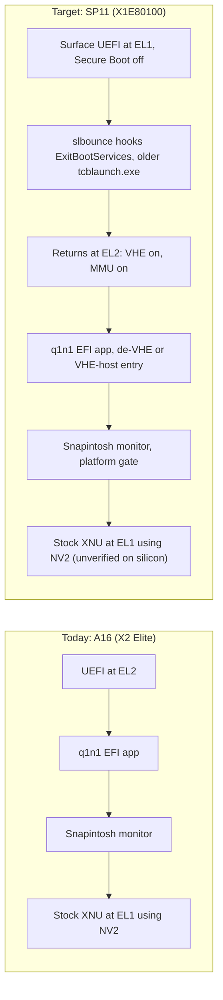
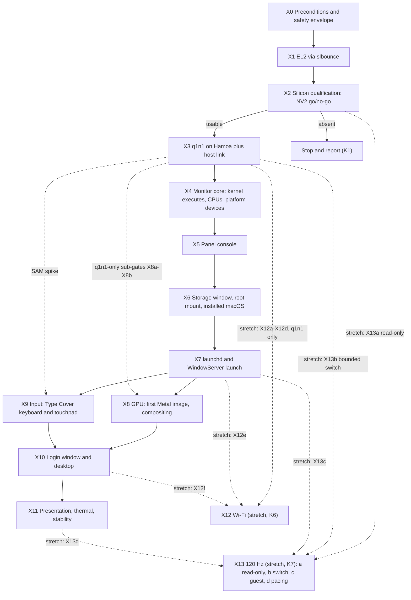

# Can Snapintosh run on a Surface Pro 11 (Snapdragon X Elite X1E80100)?

**The port: UNIMPLEMENTED. Host-side groundwork: EXPERIMENTAL. Hardware status:
gates X1 and X2 have run on a Surface Pro 11 (2026-11-11); K1 did not fire
(NV2 confirmed functionally usable, OBSERVED).** Everything else in this
document has not run on a Surface Pro. It records what the rest of a port
would need, in what order, and what would stop it. What exists today beyond
that one result is host-side only: the A16 regression baseline
([section 9.2](#92-reproducing-the-a16-baseline)), and a set of models,
validators, studies and an EFI probe. The SP11 code in `compat/` and `probes/`
builds only with `-DSNAP_PLATFORM_SP11=1`, and the A16 monitor stays
byte-identical without it. [Section 9.3](#93-host-tests-for-the-sp11-groundwork)
lists every host test and what it does not prove, and
[section 6.5](#65-where-each-gate-stands) states where each gate stands.

**Result: possible in principle, a large port, with the one silicon-level
go/no-go now decided.** The A16 model is an EL2 monitor that presents the
Apple platform contracts while the stock J700/T8140 kernel runs at EL1,
believing it is at EL2 through FEAT_NV2. That model carries over only if the
first-generation Oryon cores implement nested virtualization usably. A
functional test at gate X2 ([section 6.3](#63-x2-silicon-qualification))
answers that, before any of the large work (GPU, storage, input) starts: run
on the unit on 2026-11-11, it OBSERVED `ID_AA64MMFR2_EL1.NV` == 2 (NV_frac ==
0), an EL1 access to an EL2 register landing in the page named by `VNCR_EL2`
when NV2 is on, and the same access trapping with NV2 off. K1 did not fire.
The raw ID-register values and the indirect hints that made this UNKNOWN
beforehand are superseded by this direct, on-core measurement.

The target is the Surface Pro 11th Edition (OLED, codename Denali) with the
Snapdragon X Elite X1E80100 ("Hamoa", 12 Oryon v1 cores). The finish line is a
desktop with GPU acceleration, reached gate by gate.

## Reading this document

| Label | Meaning here |
| --- | --- |
| VERIFIED | Read in this repository, in a pinned upstream source ([section 12](#12-pinned-sources)), or a reproducible fact. It never means "ran on a Surface Pro". |
| OBSERVED | Reported by a third party on real hardware, usually one unit. |
| INFERRED | Reasoned from other evidence and not checked. |
| UNKNOWN | Not established. A named measurement resolves it. |
| EXPERIMENTAL / UNIMPLEMENTED | As in [AGENTS.md](../AGENTS.md): code exists but is unqualified / no code exists. |

The *operator* is whoever has hands on the Surface. The *project owner* makes
the decisions in [section 3](#3-objective-decisions-and-kill-criteria). Gates
are ordered by dependency and evidence, not by date.

## 1. What the port needs from the Surface

Everything in this section is private to one unit. It lives under the ignored
`downloads/sp11/` tree or on the operator's USB stick, and is never committed.
Only hashes, package versions and platform facts go into the local
`tools/cycle_lib/pins.json`. `.gitignore` covers `downloads/`, `*.mbn`, `*.fw`,
`*.bin`, `*.elf`, `*.inf`, `*.cat`, `*.msi`, `*.aml`, `*.jsn`,
`tcblaunch*.exe` and `TCBLAUNCH.EXE` (the upper-case name FAT media uses), and
the probe's `SP11DUMP/` directory.

Status of N1 to N9 at this revision: N1 has five candidate builds from the unit
and is not retired (K2); N2 to N4 are matched to Microsoft's public package;
N5 is partly recorded; N6 has an instrument (the EFI probe) that has only run
under QEMU; N7 and N8 are operator items (the owner waived the SSD backup of
N7 for X1 to X3 and requires it again before X6, see the row); N9 is a
conditional stretch-goal input that the project fetches itself. Hardware status
of everything below: NOT RUN.
[Section 1.5](#15-how-the-units-disk-was-read) records how the unit's disk facts
were read.

### 1.1 Items from the unit

| # | Item | Where it comes from | Needed by | Required? | Label |
| --- | --- | --- | --- | --- | --- |
| N1 | **`tcblaunch.exe`, an older build** | `C:\Windows\System32\tcblaunch.exe` on the unit is the first try. slbounce relies on error handling that recent builds removed, and its README names no good version. An older Microsoft-signed build from a Windows ARM64 image or update the operator is licensed to use is needed as well. Microsoft's public Surface Pro 11 driver and firmware package does not carry it ([section 1.2](#12-taking-the-firmware-files-safely)). **Provided from the unit, with the operator's authorization (recorded outside the repository as AUTH-3):** the unit's Windows component store holds five signed ARM64 builds, Windows versions 10.0.26100.28144, .28152, .28158, .28166 and .28179, extracted read-only into the git-ignored `downloads/sp11/` area. All five are newer builds in the sense of the slbounce README's warning, so none of them is the older build it asks for and none can be assumed to work. The operator can try them one after another with `sltest.efi` at X1. | X0; tested at X1 | **Required** (K2). The five builds are candidates, not a retirement of K2. | Need VERIFIED (slbounce README). Absence from the public package VERIFIED. The five builds on the unit VERIFIED (read from its disk). Which build slbounce accepts is UNKNOWN, settled at X1. |
| N2 | **Denali ZAP image** `qcdxkmsuc8380.mbn` | Windows driver store, or the public Surface Pro 11 package ([section 1.2](#12-taking-the-firmware-files-safely)); package `qcdx8380.inf`. The upstream Denali device tree expects `qcom/x1e80100/microsoft/qcdxkmsuc8380.mbn`; linux-firmware carries no Microsoft one. **Provided:** the unit's installed display package files (display driver 31.0.137.0, which carries this image) are byte-identical to the public package's, compared by hash on the unit's disk. The unit also keeps an older display package (31.0.96.0) whose files differ; it is not the active one as far as the INF versions show. | X8a | **Conditional.** The A16 path is zap-less: q1n1's `tools/a16gpu_stage3.py` (step C5) writes `RBBM_SECVID_TRUST_CNTL` as 0 once `CP_ME_INIT` has completed and stops if it still reads as secure (register table in q1n1's `tools/adreno_x2.py`), and the A16's firmware list is only GMU and SQE (the README's "Device firmware" paragraph). The upstream EL2 overlay `x1-el2.dtso` also disables `gpu_zap_shader`, with a comment that the zap shader is not needed at EL2 because Linux can zap the GPU itself. So EL2 may not need the image on the X1-85 either. linux-firmware `WHENCE` also lists a generic `qcom/x1e80100/gen70500_zap.mbn`; whether a Surface accepts it is UNKNOWN. Copy the Surface image anyway: it is device-bound and cheap. | File names VERIFIED (device tree, `WHENCE`); package name VERIFIED (public package). The unit's active display package being byte-identical to the public one VERIFIED (hash comparison); the older 31.0.96.0 package not being the active one INFERRED. A16 and upstream EL2 zap-less behaviour VERIFIED (read). Need on the X1-85 UNKNOWN, settled at F1/F2. |
| N3 | **ADSP set**: `qcadsp8380.mbn`, `adsp_dtbs.elf`, `adspr.jsn`, `adsps.jsn`, `adspua.jsn`, `battmgr.jsn` | Driver store, or the public Surface Pro 11 package; package `surfacepro_ext_adsp8380.inf`. The device tree maps them under `qcom/x1e80100/microsoft/Denali/`, with `adsp_dtbs.elf` becoming `adsp_dtb.mbn`. **Provided:** the unit's installed ADSP package files (ADSP 8100.1.1.139) are byte-identical to the public package's, compared by hash on the unit's disk. | X2/X3 | **Conditional, precautionary.** Needed only if the ADSP is not alive at handoff (R19) and a qebspil-style pre-boot is chosen. One community unit runs EL2 with the ADSP as the UEFI left it, so this is not expected. | Device-tree names and package name VERIFIED. The community result is OBSERVED (one unit). The unit's ADSP package being byte-identical to the public one VERIFIED (hash comparison). |
| N4 | CDSP set: `qccdsp8380.mbn`, `cdsp_dtbs.elf`, `cdspr.jsn` | Driver store, or the public Surface Pro 11 package; package `qcnspmcdm_ext_cdsp8380.inf`. **Provided:** the unit's installed CDSP package files (CDSP 30.0.0219.1000) are byte-identical to the public package's, compared by hash on the unit's disk. | none | **Optional.** NPU and compute are out of scope. The same community report saw Microsoft's CDSP image crash the CDSP and fell back to the generic linux-firmware one. | Package name VERIFIED. The CDSP crash report is OBSERVED (one unit). The unit's CDSP package being byte-identical to the public one VERIFIED (hash comparison). |
| N5 | **Platform facts** (no files) | The Surface UEFI menu and Windows: SoC SKU, RAM and SSD size, Surface UEFI version, Windows build, Secure Boot state, BitLocker or device-encryption state. **Partly recorded from the unit's disk (read-only, see [section 1.5](#15-how-the-units-disk-was-read)):** Windows 11 build 26100.28179, Enterprise edition; BitLocker is on, with TPM and recovery-password protectors and XTS-AES-128; the SSD is a 1 TB GPT disk holding a 272.6 MB EFI system partition at 1 MiB, a 16 MiB reserved partition, one Windows volume of about 952 GiB and a 1.2 GiB recovery partition at the very end, with no free space. S1 therefore needs the Windows volume shrunk, with Windows' own partition manager. The Surface UEFI version is not recoverable from the disk and stays an operator item, as do the Secure Boot state, the SoC SKU and the RAM size. | X0 | **Required** | The disk facts VERIFIED (read from the unit's disk). The remaining items are not recorded. |
| N6 | **ACPI tables, SMBIOS and the EFI memory map** | The agent-built EFI probe (`probes/uefi`, image `build/uefi/sp11-el2-probe.efi`) writes them to `\SP11DUMP\RUNnn\` on the USB stick it was started from, from the firmware's own tables and before ExitBootServices, so no Windows tool is needed: `RSDP.bin`, one `<SIG>.bin` per ACPI table (further copies as `<SIG>_<k>.bin`), `smbios-ep.raw`, `smbios-table.raw`, `memmap.raw`, `memmap.txt`, `tables.txt` and `summary.txt`. It refuses unless the volume's device path has a USB node and no other storage node, it never overwrites an earlier run, and it reads a firmware table only through the UEFI memory map (a range must lie wholly in loader, boot, runtime or ACPI descriptors, with no descriptor of another type overlapping it). Every file, then the run directory, `SP11DUMP` and the volume root, is flushed and closed before ExitBootServices; a failure of any of them makes the dump `PARTIAL` or `ERROR`, never `OK` (the `DUMP STATE=` row of the report). `memmap.txt` is also what the operator reads to choose the device-window policy of the X2 test image ([section 6.3](#63-x2-silicon-qualification)). The `smbios-*.raw` files can hold serial numbers and UUIDs: keep the dump out of version control and out of reports (`.gitignore` covers `SP11DUMP/`). `tools/check-hamoa-acpi.py` reads `RSDP.bin`, `XSDT.bin`, `APIC.bin` (the MADT) and `MCFG.bin` from one run (checked on a QEMU dump by `tools/test-sp11-integration.py`); a bridge from `memmap.txt` to the stage-2 map format is UNIMPLEMENTED. A Windows-side dump is an optional cross-check. | X1/X2 | **Required.** Addresses come from verified platform mappings ([AGENTS.md](../AGENTS.md), hardware register provenance; [Appendix A](#appendix-a-hamoa-and-surface-pro-11-constants)). | EXPERIMENTAL: the probe is built and tested under QEMU with EDK2 only. INFERRED to work on the unit; NOT RUN |
| N7 | **Recovery inputs** | Three parts, with the owner's decisions of 2026-11-10 ([section 11.2](#112-decisions-for-the-project-owner)). **SSD backup:** the owner declined it. It is WAIVED for X1 to X3, which boot from the USB stick and write nothing to the internal disk by default (D9; an ESP or NVRAM write at X3 is its own authorization checkpoint, [section 8](#8-hardware-safety-and-authorization)). It is REQUIRED again before X6, which shrinks the Windows volume and writes a window, unless the owner waives it again or macOS is installed on a spare SSD so that the Windows SSD is never written. **The BitLocker recovery key**, stored off the device: required from X0, because BitLocker is on for this unit (N5) and a Secure Boot change can ask for it ([section 8.1](#81-secure-boot-and-bitlocker)). **Windows recovery media:** not needed for X1 and X2; needed before X3 (which may write the ESP and NVRAM) and before X6. It reinstalls or repairs Windows; it does not restore data and is no remedy for a hardware failure. | X0 (the key); before X3 (the media); before X6 (the backup and the media) | **Required** as stated in the row: the key from X0, the media before X3, the backup before X6 | n/a (decisions, [section 11.2](#112-decisions-for-the-project-owner) rows 24 and 25) |
| N8 | **Hands-on operation** | The operator runs the USB-stick steps and relays what the panel shows (the green line, probe text, photos). The firmware shell takes typed commands (the stick has no `startup.nsh`), so a Type Cover or a USB keyboard is attached from X1 on; the Type Cover is also a device under test from X9 ([RUNNING.md](RUNNING.md#preparing-the-x0x1-boot-stick)). | X1 to X3, X9 | **Required** | n/a |
| N9 | **Wi-Fi firmware and board data** (stretch gate X12 only): `ath12k/WCN7850/hw2.0/amss.bin`, `m3.bin` and `board-2.bin` | **linux-firmware, not the unit.** Commit `69e51bb26f3fa3e118dd770f1962a93bed690dc1` ([section 12](#12-pinned-sources)); sizes 6090816, 299660 and 2431968 bytes and the SHA-256 values are in [SP11-WIFI-STUDY.md](SP11-WIFI-STUDY.md) section 1; licence `LICENSES/LICENSE.qcom` (redistributable; read it before staging). Kept in ignored local paths, never committed (`.gitignore` already covers `*.bin`). The regulatory database is the `bus=pci` element of the same `board-2.bin` (24,310 bytes), so no separate file is needed, and the A16's QCC2072 files are not interchangeable. Microsoft's `bdwlan_wcn785x_2p0_*.elf` board files are a fallback only: use one only if `tools/sp11_wifi_board.py find` finds no entry for the identifiers measured at X12a and the owner agrees. The package's `wlanfw20.mbn`, `phy_ucode20.elf`, `regdb.bin`, `Data20.msc` and tracing files are not needed. | X12c | **Conditional (stretch only).** Never blocks X0 to X11. Nothing from the unit's disk is needed. | File names, sizes, hashes and the board entries VERIFIED (read from the pinned files; `tools/test-sp11-wifi-study.py` with `SP11_WIFI_BOARD_DIR`). The Microsoft file names are relayed from the package listing, not re-read. Which board entry this unit needs is UNKNOWN until X12a measures its subsystem ids and X12c its QMI board id. |

### 1.2 Taking the firmware files safely

Copy the named files read-only from
`C:\Windows\System32\DriverStore\FileRepository\<package folder>\` to the USB
stick, in the layout `firmware/qcom/x1e80100/microsoft/...` that qebspil
expects. Do not run installers, change drivers or edit the registry. Write
down each package's folder name and driver version.

Microsoft's public *Surface Pro 11th Edition with Snapdragon* driver and
firmware package, a Download Center `.msi`, is an alternative source for N2 to
N4. Unpack it offline into `downloads/sp11/`, for example with `msiextract`
from `msitools`. Do not run it: it also carries Surface UEFI update packages
(R16). Its package folders `qcdx`, `proextadsp` and `qcnspmcdmextcdsp8380`
hold the INFs named in the table (VERIFIED, from
`SurfacePro11_ARM_Win11_26100_26.094.41119.0.msi`). What to expect:

- It can be newer than the unit's driver store. Record both versions (N5). If
  they differ, prefer the unit's own files and keep these as a fallback
  (INFERRED: the firmware is device-bound). On this unit the display (31.0.137.0),
  ADSP (8100.1.1.139) and CDSP (30.0.0219.1000) package files are byte-identical
  to the public package's (hash comparison on the unit's disk, VERIFIED), so the
  public package supplies the same bytes and nothing more needs to be copied
  off the unit for N2 to N4.
- The DTB images ship as `adsp_dtbs.elf` and `cdsp_dtbs.elf`. Stage
  byte-identical copies named `adsp_dtb.mbn` and `cdsp_dtb.mbn`, the names the
  device tree requests.
- `qcdx` also carries `qcdxkmsucpurwa.mbn`, which the upstream device trees
  request for X1P42100 (Purwa) devices. The X1E80100 image is
  `qcdxkmsuc8380.mbn`.
- The ADSP package registers one more file than N3 lists, `RADS.bin`. The
  upstream device tree does not request it.
- It contains no `tcblaunch.exe` (N1) and no GPU GMU or SQE image
  ([section 1.3](#13-inputs-the-project-fetches-itself)).

Community collection scripts exist. They need an elevated shell and stage the
files on the internal disk first, so the default is a manual read-only copy,
and any script is reviewed before it is run (OBSERVED; community-maintained,
R20).

Do not update the Surface UEFI or Windows firmware during the project (R16).
A new `tcblaunch.exe` or UEFI changes what X1 measured.

### 1.3 Inputs the project fetches itself

Nothing here is needed from the unit:

- GPU microcode `qcom/gen70500_gmu.bin` and `qcom/gen70500_sqe.fw` from
  linux-firmware (`WHENCE` lists both). Kept ignored, never committed.
- The slbounce and `sltest` sources, built by q1n1's `tools/build-slbounce.sh`.
- WLAN firmware for the stretch gate X12 (`ath12k/WCN7850/hw2.0/amss.bin`,
  `m3.bin` and `board-2.bin`) from linux-firmware at the pinned commit (N9),
  needed only if X12c is attempted. Kept ignored, never committed; the licence
  is `LICENSES/LICENSE.qcom`.
- The aarch64 UEFI shell, a pinned public release (`shellaa64.efi`, named in
  `tools/sp11-boot-media-pins.json`). It is not Microsoft-signed, which is one
  more reason Secure Boot must be off. `tools/stage-sp11-boot-media.py` stages
  it unmodified ([BUILDING.md](BUILDING.md#boot-media-for-the-surface-pro-11-x0-and-x1)).
- The qebspil source, if R19 forces a pre-boot. It is GPL-2.0-only, so it stays
  a separate binary with its own notice and is never merged into MIT files.
- The upstream Hamoa and Denali device trees, as read-only evidence.

### 1.4 Not needed

Bluetooth, audio and camera firmware; Wi-Fi firmware for the finish line (the
stretch gate X12 fetches its own from linux-firmware, N9); display or Type
Cover firmware (the panel mode comes from GOP/EDID at run time, and the
Surface Aggregator protocol is public; both INFERRED); a Windows image dump;
credentials.

### 1.5 How the unit's disk was read

The disk facts in N1 to N5 were read from the unit's own SSD with the SSD
attached to a Mac, through macOS `authopen`. `authopen` hands the caller a
read-only file handle after the user approves a system dialog, so the method
needs no `sudo`, changes no device permission and writes nothing. It is a
procedure option for other operators. The repository ships no block-device
reader (the reader tooling used here was scratch and is not part of it), so an
operator who uses the method brings a reader that opens the device read-only
and has been reviewed first. Labels for facts read this way: VERIFIED means
read directly from the unit's disk or compared by hash there. It never means
anything ran on the Surface, and it is not reproducible without that disk. The
method cannot give anything that is not on the disk, such as the Surface UEFI
version (N5).

A safety property of gate X1 (INFERRED; the operator decides): X1 boots from
the USB stick and does not need the internal SSD, so X1 can be run with the SSD
physically removed. Windows, BitLocker and the data then cannot be affected by
the Secure Boot change. Restore Secure Boot before the SSD goes back in, to
avoid a BitLocker recovery-key prompt. X2's T06 and T07 observe the NVMe and
PCIe SMMU state, so the NVMe half of T06 reads nothing with the SSD removed
([section 8.1](#81-secure-boot-and-bitlocker) compares the options).

## 2. What the port needs on the host side

| Need | Why | Needed by |
| --- | --- | --- |
| A q1n1 checkout at `../q1n1`, next to this repository. It is a sibling, not a submodule. | The monitor build and several host tests link `q1n1/platform/uefi`. q1n1's `tools/build-slbounce.sh` builds the X0 USB stick. Run reports and local pins record the q1n1 commit id. | A1, X0 |
| Submodules: `git submodule update --init` | The Adreno kext, the Metal plug-in, air2ir3 and two guest drivers (five paths; see [AGENTS.md](../AGENTS.md)). | F5 to F7 |
| Toolchain: Homebrew `llvm`, `lld`, `meson` and `ninja` | `tools/monitor_build_offline.py` looks for LLVM and LLD under `/opt/homebrew/opt`. `clang` and `lld-link` also build the EFI probe and the X2 test image (`probes/uefi`). The board-descriptor, boot-contract and ACPI-check suites need Python 3.10 or newer. See [BUILDING.md](BUILDING.md#prerequisites). | A1, X1, X2, F5 to F7 |
| Optional: Homebrew `msitools` | `msiextract` unpacks Microsoft's public Surface Pro 11 package without running it ([section 1.2](#12-taking-the-firmware-files-safely)). | X0 |
| Optional: `qemu-system-aarch64` with the EDK2 AArch64 firmware images | The emulator half of `tools/test-uefi-probe.py` and `tools/test-uefi-tests.py`. Without it those tests print SKIP, and a SKIP is not a pass. | X1, X2 (host tests only) |
| Apple inputs the operator is licensed to use: the J700 restore-image kernelcache and `KDK_27.0_26A428` | Guest-kernel and ABI checks. A Mac on another macOS build can run the host-only checks; the KDK, ABI and Metal-harness checks are then reported SKIP, never PASS. | X4 onward |
| Decisions: accept the D4 to D11 defaults or name changes, and answer the open decisions of [section 11.2](#112-decisions-for-the-project-owner); the input-path choice (G2) comes at X9 | Scope | X0, X9 |
| Per-gate authorizations ([section 8](#8-hardware-safety-and-authorization)) | [AGENTS.md](../AGENTS.md), section 5 | per gate |
| The hardware kit ([Appendix C](#appendix-c-hardware-kit)), including a second USB stick, a USB 3 data-rated USB-C cable, and AC power. A hub is not part of the host link: q1n1's xHCI host addresses root-port devices only ([SP11-HOST-LINK-STUDY.md](SP11-HOST-LINK-STUDY.md)) | Host link and recovery | X0, X3 |

## 3. Objective, decisions and kill criteria

### 3.1 Objective and finish line

Boot the stock macOS 27 (26A428) J700/T8140 kernel on a Surface Pro 11 with
the A16 mediation model: an EL2 monitor presents the Apple platform contracts,
the stock kernel runs at EL1 and believes it is at EL2 through FEAT_NV2 plus a
`VNCR_EL2` page, and macOS lives in a window of the internal NVMe.

- **In scope:** the OLED panel through the firmware display pipeline; the
  Adreno X1-85 GPU with Metal (AdrenoMetal plus air2ir3); Type Cover keyboard
  and touchpad; the internal NVMe as a virtual ANS2 window; the login window
  and desktop; presentation stability.
- **Stretch** (outside the finish line, worked on after it, each with its own
  gate, stop criterion, authorization and risks; none blocks or reorders X0 to
  X11): touchscreen and pen; **Wi-Fi** (WS-J, gate X12, kill criterion K6, D10;
  [SP11-WIFI-STUDY.md](SP11-WIFI-STUDY.md)); and **120 Hz** on the OLED (gate
  X13, kill criterion K7, D11; [SP11-120HZ-STUDY.md](SP11-120HZ-STUDY.md)),
  the last two added at the owner's request on 2026-11-10. The SP11 Wi-Fi
  device is a WCN7850-class chip, not the A16's QCC2072 (VERIFIED in the public
  device tree and Linux, INFERRED for the unit: E37), and the parity
  target is whatever the A16 does at the time. 120 Hz means only panel timings
  the panel itself advertises, with a revert to 60 Hz; it never changes the
  firmware's 60 Hz mode as the default and shares its guest-side code with the
  A16 roadmap item. The gates and stop criteria are in sections 3.3 and 6; they
  are UNIMPLEMENTED, the two studies are host-side only (EXPERIMENTAL), and
  nothing has run on a Surface.
- **Out of scope:** Bluetooth (it stays out although it shares the Wi-Fi
  module), audio, camera, NPU, sleep, external displays, USB4, the 10-core
  X1P64100 and LCD variants (descriptors must not preclude them), hostless boot
  (a direction only), and Linux.

### 3.2 Decisions

| # | Decision | Value | Source |
| --- | --- | --- | --- |
| D1 | Target | Surface Pro 11, Snapdragon X Elite X1E80100, OLED, one unit | Owner |
| D2 | Finish line | Desktop plus GPU (display, GPU, input, NVMe), gated per milestone | Owner |
| D3 | macOS storage | A window in the internal NVMe, not the spare SSD | Owner |
| D4 | NV2 absent on silicon | **Stop at X2 and report.** Any redesign is a separate design study that needs its own approval. Named candidates: UNDEF interposition and in-memory kernel patching per [KERNEL-PATCHES.md](KERNEL-PATCHES.md); and a UniXNU-style source-built XNU at EL1 under the firmware's hypervisor (Route B1 of [SP11-UNIXNU-STUDY.md](SP11-UNIXNU-STUDY.md) section 5, with B2 the same kernel under our own monitor without NV2). Route B gives up the stock-kernel principle; it is recorded, not recommended, and no Route B study is commissioned unless a kill criterion fires ([section 3.4](#34-alternatives-considered)). | Default |
| D5 | Host-link order | (1) direct USB-C with the SP11 as xHCI host and the Mac as the CDC-NCM gadget, as on the A16; (2) a CDC-NCM-class USB Ethernet adapter or an NCM-gadget SBC; (3) UEFI SNP before ExitBootServices; (4) framebuffer plus a persistent log | Default |
| D6 | Input scope | Type Cover keyboard and touchpad required; touchscreen and pen are a stretch | Default |
| D7 | Windows stays installed | It is the `tcblaunch.exe` source and the boot fallback | Default |
| D8 | Mac host dependency | Transitional, behind a versioned ABI, with a documented removal path (standalone-first rule) | Default |
| D9 | Early runs | X1 to X3 run from a USB stick, with no internal-disk or NVRAM writes until their own authorization checkpoint | Default |
| D10 | Wi-Fi | A stretch goal (WS-J, gate X12): not part of the finish line, it never blocks or reorders X0 to X11, and it takes a supervised session only when the owner spends one on it. The SP11's module is WCN7850-class, not the A16's QCC2072. Firmware comes from linux-firmware only; the first step is a read-only survey; nothing transmits before the regulatory database is loaded; K6 ends it. Bluetooth stays out of scope. A public Linux-on-XNU stack for this chip (UniXNU's Ath12kWifi) is compared in the study and is neither adopted nor rejected. | Owner (2026-11-10); the details are defaults |
| D11 | 120 Hz | A stretch goal, outside the finish line and worked on after it (gate X13, kill criterion K7). The firmware's 60 Hz pipeline stays the default and the fallback. The only timing ever programmed is one the unit's own EDID advertises. A mode switch at EL2 is a bounded step with a captured-state revert and its own per-run authorization (section 8). The guest side is the A16 roadmap item "120 Hz" ([STATUS.md](STATUS.md)), one shared implementation, not a second one. | Owner (2026-11-10); the details are defaults |

### 3.3 Kill criteria

Stop and report; do not improvise.

- **K1** NV2 is absent or functionally unusable on SP11 silicon (X2). The
  recorded alternative is the separate design study of D4; Route B is one
  candidate, not a fallback, and nothing is switched silently.
- **K2** No obtainable `tcblaunch.exe` build, together with this unit's
  firmware, reaches EL2 under slbounce (X1). Route B1 would not need EL2 at
  all, but it is a different project (D4), not a fallback.
- **K3** There is no viable host link and no workable log strategy (X3).
- **K4** The NVMe window cannot be proven safe (X6). The alternative is the
  spare SSD, but revisiting D3 needs the owner's explicit decision, never a
  silent switch.
- **K5** GPU bring-up is blocked at EL2 (X8). Report what works (a
  software-only macOS desktop is UNKNOWN) and ask whether to continue.
- **K6** (stretch goal only; it ends WS-J and never blocks X0 to X11). At X12a
  the Wi-Fi function is not readable at hand-off (its configuration space
  reads absent or all-ones, its link is down, or a read faults), or it is not
  the device the evidence names (vendor `0x17cb`, device `0x1107`, hardware
  version major 2), and the only way forward is for q1n1 or the monitor to
  power the module, train the PCIe link, or program the PCIe controller, its
  PHY, the SMMU or an RPMh rail itself; or no board-data entry matches the
  module's measured identifiers and the owner declines the Microsoft-package
  fallback; or the owner declines the RF-kill policy that X12d needs. Stop,
  keep the logs, report what was measured and ask the owner. Any EL2 power-up
  or link-training path is a separate design study with its own approval, as
  D4 does for NV2.
- **K7** (stretch goal only; it ends X13 and never blocks X0 to X11) 120 Hz
  needs more than a timing rewrite. If X13a finds that the EDID advertises no
  120 Hz progressive timing of the native size, or that the 120 Hz stream does
  not fit the link the firmware trained (so it would need link retraining, PHY
  re-initialization, DSC or a DPU clock or voltage change that cannot be proven
  safe at EL2), or if X13b cannot restore the captured 60 Hz state after its
  first anomaly, stop. The panel stays at the firmware's 60 Hz, the finish line
  is unaffected, and the report says which condition fired and the values read.

### 3.4 Alternatives considered

The plan keeps Apple's stock kernel at EL1 under our EL2 monitor (the premise of
D4). One public project, UniXNU, takes the opposite route: it builds XNU from
Apple's open source and boots it at EL1 through UEFI under whatever hypervisor
the device has (Route B; [SP11-UNIXNU-STUDY.md](SP11-UNIXNU-STUDY.md)). Its
evidence is third-party and OBSERVED: a macOS 26.5 Recovery environment
reaching `launchd` on one SM8550 tablet, iOS and iPadOS home screens on
Snapdragon phones, and no Surface or X1E record in its device catalog. Route B
would need no slbounce and no NV2, but every Hamoa driver, the root-volume
tooling and the GPU stack would be new work, it replaces Apple's SPTM and TXM
semantics with a different trust model, and it gives up the stock kernel. It is
recorded here so that the owner can decide on it separately if K1 or K2 fires.
It is not recommended and is not part of this plan; no Route B study is
commissioned unless a kill criterion fires ([section 11.2](#112-decisions-for-the-project-owner)
row 23).

## 4. What carries over and what is new

### 4.1 Layer by layer

| Layer | A16 (X2E-96-100, Oryon v3) | SP11 (X1E80100, Oryon v1) | Consequence |
| --- | --- | --- | --- |
| Firmware entry | UEFI enters at EL2 directly (OBSERVED: one boot, recorded in q1n1 `docs/A16-FIRST-EL2-BOOT.md`) | UEFI at EL1 under Gunyah. EL2 only through slbounce plus an older Microsoft-signed `tcblaunch.exe` (VERIFIED from slbounce's source and README; OBSERVED on one community unit) | New gate X1. Instrument: the EFI state probe (EXPERIMENTAL, QEMU-tested only). |
| EL2 regime on entry | Firmware-native; the monitor is a non-VHE host (VERIFIED) | slbounce returns with `HCR_EL2` = TGE+E2H (VHE), the MMU on and UEFI's tables reinterpreted (VERIFIED, slbounce source) | A VHE host or a de-VHE trampoline. Decision record and host model: [SP11-EL2-ENTRY.md](SP11-EL2-ENTRY.md) (EXPERIMENTAL, linked into no build). |
| FEAT_NV2 | Measured `NV` == 2 (VERIFIED, code comment) | Measured `NV` == 2, `NV_frac` == 0, `VNCR_EL2` redirect PASS and the NV2-off negative control PASS on the unit (OBSERVED, 2026-11-11; X2 item 2) | X2 stop gate, resolved: K1 did not fire. **Host groundwork (A3, EXPERIMENTAL):** an SP11 monitor build refuses to launch without an embedded functional record for this core, so NV and NV2 stay clear; the A16 build is unchanged. The record from this run is not yet embedded in a monitor build. |
| CPUs | 6 guest vCPUs; `GUEST_CPU_COUNT` is the literal `6U` on A16 (a `-D` override is a macro redefinition) and defaults to `6U` and is overridable on SP11 only (`GUEST_CPU_COUNT` in `compat/cpu.h`); the A16 build is byte-identical | 12 Oryon v1 in 3 clusters of 4, no E/P split (VERIFIED, device tree; the guest-visible affinities and MPIDR values are INFERRED until X2) | Placement and redistributor-discovery models exist (`compat/topology.c`, host-tested); a count other than 6 still needs the follow-ups listed under C2 |
| GIC | GICD `0x17000000`, GICR `0x17080000` stride `0x40000`, hard-coded | The same bases in `hamoa.dtsi`, with the GICR window sized for 12 redistributors (VERIFIED). An ITS node is present at `0x17040000`; the upstream EL2 overlay comments that Gunyah's ITS emulation seems broken (a developer's note, read but not measured). | Discover and cross-check; never assume |
| Timer | 19.2 MHz host counter. The guest's 24 MHz timebase comes from trapped counter reads, and the monitor refuses to start a vCPU without a non-zero `ID_AA64MMFR0_EL1.ECV` and a matching `CNTFRQ_EL0` (VERIFIED, read: `probes/xnuboot/prepare.c`, `docs/KERNEL-PATCHES.md`) | `ID_AA64MMFR0_EL1.ECV` reads 2 on this unit at EL2 (OBSERVED, 2026-11-11, X2 item 1), matching the third-party profile of another X1E80100 machine (E26). `CNTFRQ_EL0` itself is still unread: T03, the timer test, has not completed on this unit (a board reset a short, fixed time after T01, not yet explained; [SP11-X2-TESTS.md](SP11-X2-TESTS.md)). The pinned Hamoa device tree gives the architected timer no frequency. The MIDR is now read (`0x00000000512F0011`, OBSERVED): the Oryon X1 "Broken CNTVOFF_EL2" erratum workaround (E17) applies to this unit, no longer only INFERRED. | Functional tests; relocation risk (R6). Offset policy and model: [SP11-EL2-ENTRY.md](SP11-EL2-ENTRY.md) section 3 (EXPERIMENTAL). |
| PAuth | QARMA3 reported in ISAR2 | QARMA5 reported in ISAR1 (APA = 5, GPA = 1) with APA3 = GPA3 = 0 in the same third-party profile; confirmed on this unit (OBSERVED, 2026-11-11: APA=5/API=0/GPA=1/GPI=0, passive probe and X2 T01 agree) | ID-register normalization. **Host groundwork (C4, EXPERIMENTAL):** `compat/oryon-idregs.c`; an unrecorded MIDR refuses the launch. |
| Stage 2 | 36-bit IPA, 4K granule, 8-bit VMID (VERIFIED). The A16 also reports PARange 44 bits and no 16K granule ([FEASIBILITY.md](FEASIBILITY.md)), so 36 bits is a monitor choice. | PARange 44 bits and no 16K granule confirmed on this unit (OBSERVED, 2026-11-11, X2 item 1: `PARANGE=4` i.e. 44-bit, `TGRAN 16K=NO`), matching the third-party profile. VMIDBits reads 16 on this unit, not the 8 that profile reported (OBSERVED; a real difference, not yet explained) | Audit the DRAM and MMIO map. **Host groundwork (C5, EXPERIMENTAL):** the model `compat/ipa-geometry.c` and an SP11-gated check in `probes/xnuboot/stage2.c`. |
| Storage | Virtual ANS2 over the real NVMe, window design (VERIFIED) | NVMe on `pcie6a` behind a PCIe SMMUv3 (VERIFIED device tree). The SMMU state is UNKNOWN. | Port `compat/nvme-host.c`. **Host groundwork (S2/S3, EXPERIMENTAL):** an SP11 window contract in `compat/nvme-host.c` under `SNAP_PLATFORM_SP11`, not called by the monitor yet: an SP11 monitor refuses to adopt the SSD (prepare status -145) instead of falling back to the A16 adoption; audit and per-machine questions in [SP11-NVME-WINDOW.md](SP11-NVME-WINDOW.md). |
| Display | AdrenoDisplay, 2880x1800 at 60 Hz | Samsung ATNA30DW01 13-inch OLED, 2880x1920 (3:2) (VERIFIED in public sources: the Linux binding and Microsoft's tech specs; this unit's GOP mode is INFERRED), on `mdss_dp3`, 4-lane eDP up to HBR3 (VERIFIED, upstream device tree). See [SP11-DISPLAY-STUDY.md](SP11-DISPLAY-STUDY.md). | Reuse the firmware pipeline. The A16's dispcc and eDP constants are wrong on Hamoa and must not be reused. |
| GPU | Adreno X2-90 (a8xx), chip `0x44070041` | Adreno X1-85 (a7xx, gen70500). Device-tree compatible `qcom,adreno-43050c01` and GMU `adreno-gmu-x185.1` (VERIFIED). Upstream `drivers/gpu/drm/msm/adreno/a7xx_catalog.c:376-380` binds chip id `0x43050c01` to `gen70500_sqe.fw` and `gen70500_gmu.bin` (VERIFIED). The entry spans lines 375-418; it also selects the 48-slot `a730_protect` CP_PROTECT table, GMU chip-id word `0x7050001` and 3 MiB of GMEM, and names no zap firmware (VERIFIED at that commit; [SP11-GPU-A7XX-STUDY.md](SP11-GPU-A7XX-STUDY.md) section 1.1). Silicon read-back pending (X8a). | The largest port |
| Input | I2C-HID through SnapI2CHID | The Surface Aggregator Module (`microsoft,surface-sam`) on UART2 at 4 Mbps (VERIFIED, device tree). The Type Cover keyboard and touchpad are HID nodes under its KIP hub in the Linux client registry for `microsoft,denali` (VERIFIED by reading, not seen on a wire). The pinned Linux has no touch or pen node for the Denali boards (VERIFIED, negative); an SPI HID touch digitizer on the engine at `0x00a88000` is OBSERVED by two community repositories (one unit); the pen transport is UNKNOWN. See [SP11-INPUT-STUDY.md](SP11-INPUT-STUDY.md). | New drivers. A frame codec exists (EXPERIMENTAL, linked into nothing). |
| Host link | USB-C through SoCCP/UCSI; xHCI host with NCM, or CDC device | The Denali device tree has two PMIC-GLINK connectors, a Parade `ps8830` retimer on each, and `dr_mode = "host"` on both USB controllers (VERIFIED, read). The ADSP carries PMIC-GLINK (INFERRED). | Device-mode link not feasible (INFERRED). q1n1's xHCI host addresses root-port devices only, so no hub (E19). Inventory, ladder and log design: [SP11-HOST-LINK-STUDY.md](SP11-HOST-LINK-STUDY.md). |
| Thermal | TSENS 8x16, `compat/a16-thermal.c` (fails closed off the A16) | Hamoa TSENS: four controller instances of sixteen sensors, 50 of them read by the public SoC device tree thermal zones (VERIFIED, read; INFERRED for this unit). `compat/hamoa-thermal.c` is a read-only host model (EXPERIMENTAL, no hardware run). It refuses every admission until the controller version, a user-chosen ceiling and the platform fingerprint are measured at X2. | Link the model at the monitor call site (UNIMPLEMENTED); measure at X2 |
| Wi-Fi (stretch) | Qualcomm QCC2072 (PCI `17cb:1112`), work in progress: scan, a WPA2-PSK connection, DHCP and ping through a host-proxy harness; joining from the macOS menu does not work yet ([STATUS.md](STATUS.md)). The A16 code pins the ASUS PCI ids, the QCC2072 window register and an SMMU at `0x15480000` | A WCN7850-class module (`pci17cb,1107`, hardware 2.0) at 01:00.0 under the `pcie4` root port, behind a 3.3 V switch on GPIO 214 and a PMU enabled by GPIO 117 (VERIFIED in the public device tree and Linux; INFERRED for the unit). Upstream Linux treats it as a sibling of the QCC2072, not the same part: its own HAL register table (45 of 63 offsets differ), PCI window register and firmware. What the Surface firmware leaves powered and trained is UNKNOWN. | A stretch goal behind gate X12 and kill criterion K6 (D10). A read-only survey first; no A16 driver code is assumed to apply. A public Linux-on-XNU stack for this chip (UniXNU's Ath12kWifi, iPadOS-bound, glue without a licence) is compared in the study as a reference and a candidate path; it changes neither K6 nor the survey. Study, carry-over audit and board-container reader: [SP11-WIFI-STUDY.md](SP11-WIFI-STUDY.md) (EXPERIMENTAL; nothing has run on a Surface). |

### 4.2 Evidence

| # | Claim | Label | Source |
| --- | --- | --- | --- |
| E1 | The monitor sets `HCR_EL2.NV` and `NV2` whenever `vncr_va` is set, with no refusal path in the A16 build. An SP11 build runs a launch gate first (`sp11_launch_gate`, A3) and refuses without a passing functional record. | VERIFIED | `probes/xnuboot/prepare.c` |
| E2 | VTCR uses the 4K granule, `S2_TXSZ` = 28 (36-bit IPA) and 8-bit VMIDs. The host is non-VHE. | VERIFIED | `prepare.c`, `probes/xnuboot/stage2.c:20` |
| E3 | Addresses at or above `1<<36` are rejected pervasively, and a range may end exactly at `1<<36` (the end is exclusive: `shadow/stage2.c` refuses only `hi > limit`). Two limits meet there: the host stage-2 width (`S2_TXSZ`, a build-time constant) and the emulated T8140 guest's own 36-bit PA and IOVA contract, whose shifts are literals in the files listed and do not follow `S2_TXSZ`. One more site is not a guest contract: `NVMEH_SP11_IPA_LIMIT` in `compat/nvme-host.h` is the SP11 NVMe window's copy of the monitor's stage-2 limit, and the drift guard pins it so that it follows the width. | VERIFIED | `compat/dart.c`, `compat/sptm-dart.c`, `compat/sptm.c`, `compat/sptm.h`, `compat/txm-native.c`, `compat/device/device_core.c`, `compat/nvme-host.h`; `compat/ipa-geometry.h` and `tools/test-stage2-geometry.py` (the drift guard pins every site); `tools/test-sp11-integration.py` (five validators agree on the boundary) |
| E4 | Secondaries start by PSCI SMC. The GICD base, the GICR window and stride and the CNTHP INTID are macros whose A16 defaults are the old literals (0x17000000, 0x17080000..0x17500000, 0x40000, 26). An SP11 build must define all five (`SNAP_GICD_BASE`, `SNAP_GICR_FIRST`, `SNAP_GICR_LIMIT`, `SNAP_GICR_STRIDE`, `SNAP_TIMER_INTID`) or `secondary_gic_start` refuses (fails closed). | VERIFIED | `probes/secondary.c:18-43,57` |
| E5 | `GUEST_CPU_COUNT` is a compile-time count. On A16 it is the literal `6U`, and `-DGUEST_CPU_COUNT=N` is a macro redefinition, an error under `-Werror`. On SP11 it defaults to `6U` and the preprocessor accepts 1..12; the sites that hard-code six are held by a static assertion except the boot-relocate records and the host constants in `probes/run.py` (the comment above the definition lists them); a count above four also needs `SNAP_FAIR_TOKEN`, enforced as a launch refusal (prepare status -146). Only 6 builds today. | VERIFIED | `GUEST_CPU_COUNT` and `GUEST_CPU_NEEDS_FAIR_LOCK` in `compat/cpu.h`; `tools/test-monitor-hardening.py` |
| E6 | slbounce hooks ExitBootServices and resumes at the call site at EL2, with `HCR_EL2` = TGE+E2H and the MMU on. | VERIFIED | slbounce `src/trans.s` |
| E7 | slbounce needs an *older* `tcblaunch.exe`; `sltest.efi` draws a green line on success; Secure Boot off is mandatory. | VERIFIED | slbounce README |
| E8 | q1n1 pins slbounce and builds it with `SLBOUNCE_ALWAYS_SWITCH=1 DEBUG=1`. The A16 never needed slbounce. | VERIFIED | q1n1 `tools/build-slbounce.sh` |
| E9 | The mainline EL2 overlay `x1-el2.dtso` is used by 28 board variants (X1E and X1P), the Denali OLED included. | VERIFIED | Linux `x1-el2.dtso` and `arch/arm64/boot/dts/qcom/Makefile` |
| E10 | Linux boots at EL2 on one SP11 through slbounce with a large out-of-tree patch series. | OBSERVED | Community report (one unit; R20) |
| E11 | NV2 is present on Oryon v1. | **INFERRED** | Indirect hints only; none are evidence |
| E12 | Raw, unfiltered `ID_AA64MMFR2.NV` and `ID_AA64MMFR4.NV_frac` for the X1E80100 are not public. The one profile that shows `NV` reports 0 under a hypervisor that also reports `VH` = 0. A third-party Linux-at-EL2 report for another X1E80100 says "VHE mode initialized", which contradicts `VH` = 0, so the profile's `NV` is inconclusive. | UNKNOWN | E26; the Linux-at-EL2 report (§12) |
| E13 | The "nested-virt trap handlers registered" message printed by one laptop's KVM is unconditional (`kvm_sys_reg_table_init()` calls `populate_nv_trap_config()`), so it is **not** NV2 evidence. | VERIFIED | Linux, as read |
| E14 | Hamoa addresses: GICD `0x17000000`; GICR `0x17080000` size `0x300000`; `pcie6a` PARF `0x01bf8000`, DBI `0x70000000`, ELBI `0x70000f40`, ATU `0x70001000`, config window `0x70100000` (size `0x100000`), MHI `0x01bfb000`; `pcie_smmu` (SMMUv3) `0x15400000`; `apps_smmu` `0x15000000`. | VERIFIED | `hamoa.dtsi` |
| E15 | GPU `0x03d00000` (SPI 300); GMU `0x03d6a000` (SPI 304/305); `adreno_smmu` `0x03da0000`; `usb_1_ss0` DWC3 `0x0a600000`; `mdss` `0x0ae00000`; `uart2` `0x00b88000`. | VERIFIED | `hamoa.dtsi` |
| E16 | The A16 monitor requires `DCZID_EL0` = 4 (`DC ZVA` permitted, 64-byte block) on every CPU before it grants `DC ZVA` to EL0, and refuses otherwise. The third-party EL1 profile of another X1E80100 also reads 4. The EL2 value on this unit is unmeasured. The test compares the whole register, so it conflates two things the register holds: the block size (`BS`, implementation defined) and the prohibit bit `DZP`, which follows configuration. A value of 0x14 is `DZP` set with a 64-byte block, a configuration state and not evidence of broken silicon (E30). | VERIFIED (A16); OBSERVED (other unit); UNKNOWN (this unit) | `vcpu_arch_prepare` in `probes/xnuboot/prepare.c` (the `DCZID_EL0` check); E26 |
| E17 | Linux carries an Oryon X1 erratum, "Broken CNTVOFF_EL2" (`ARM64_WORKAROUND_QCOM_ORYON_CNTVOFF`, matched on `MIDR_QCOM_ORYON_X1`, part `0x001`). KVM enables its workaround only when `VH` is reported, FEAT_E2H0 is implemented (`ID_AA64MMFR4_EL1.E2H0` == 0), ECV is non-zero, the host is VHE or hVHE, and the erratum capability is set. It then traps all virtual timer and counter accesses, requiring FEAT_ECV. A code comment says the affected hardware implements FEAT_VHE and FEAT_E2H0. | VERIFIED | Linux `arch/arm64/kernel/cpu_errata.c:1055-1063` and `kvm_timer_handle_errata()` in `arch/arm64/kvm/arch_timer.c:1413-1441` |
| E18 | q1n1's xHCI host enumerates the Mac's CDC-NCM gadget (`05ac:1905`, two NCM functions) on the A16. | VERIFIED | q1n1 `docs/A16-Q1N1-PROXY.md` |
| E19 | q1n1's USB host code is CDC-NCM only (`platform/uefi/ncm.{h,c}`). The pinned tree has no ECM, RNDIS, FTDI or CP210x host code, and its NCM path has only run against the Mac gadget. Its xHCI host also addresses devices on a root port only (`xhci.c:409`: the slot context carries the root-hub port, with no route string or transaction translator), so a USB hub in front of an adapter does not work. | VERIFIED (read; search of the pinned tree); third-party adapters UNVERIFIED | q1n1 `platform/uefi/ncm.{h,c}` and `docs/A16-Q1N1-PROXY.md`; [SP11-HOST-LINK-STUDY.md](SP11-HOST-LINK-STUDY.md) (G03) |
| E20 | The A16 reached the Mac over the USB2 half only, which is acceptable for a proxy link. | VERIFIED | q1n1 `docs/A16-Q1N1-PROXY.md` |
| E21 | The Surface Aggregator Module (`microsoft,surface-sam`) is on UART2 (`0x00b88000`, engine 2 of QUP wrapper 0, which the same device tree also declares as I2C2 and SPI2) with `current-speed` 4 Mbps; the Linux driver hard-codes 4 Mbps, RTS/CTS and no parity on its device-tree path (VERIFIED). The Type Cover keyboard and touchpad are HID nodes under its KIP hub in the Linux registry entry for `microsoft,denali` (VERIFIED by reading, not by observation). The touchscreen is OBSERVED by two community repositories to be an SPI HID digitizer on the engine at `0x00a88000`, for which the pinned Linux has no driver or binding; the pen transport is UNKNOWN. The claim that touch and pen are HID-over-SPI is not in the pinned Linux sources. | VERIFIED / OBSERVED / UNKNOWN | Linux `x1-microsoft-denali.dtsi`, `hamoa.dtsi`, `surface_aggregator_registry.c`, `core.c`; [SP11-INPUT-STUDY.md](SP11-INPUT-STUDY.md) |
| E22 | The SP11 SSD is user-removable. | INFERRED | Public product documentation, not re-read here |
| E23 | The stage-2 and DART code assume 36-bit addresses, so larger-memory SKUs may not fit identity-mapped. A model of the public Linux layout (a 2 GiB low bank plus one high bank from `0x880000000`) fits 16 GiB and 32 GiB when guest RAM is carved from the high bank (the 32 GiB bank ends exactly on `1<<36`) and ends a 64 GiB part 32 GiB past the limit, so the model refuses it by default (carving guest RAM low is opt-in). The real map is measured at X2. | INFERRED | E3 plus the Hamoa high-DDR layout; audit item C5; `tools/test-stage2-geometry.py` (which also pins the SP11 NVMe window's copy of the limit, `NVMEH_SP11_IPA_LIMIT` in `compat/nvme-host.h`) |
| E24 | At EL2 the upstream overlay hands the OS an enabled `pcie_smmu` (the `pcie6a` stream window is `0x60000`, size `0x10000`) and the ADSP and CDSP `apps_smmu` streams (`0x1000/0x80`, `0x0c00/0x0`). It disables the Gunyah software `sbsa_watchdog` and enables the hardware `apss_watchdog`. It also comments that Gunyah's ITS emulation seems broken (a developer's note, read but not measured). | VERIFIED | Linux `x1-el2.dtso` |
| E25 | The Denali device tree names the Microsoft firmware layout: GPU ZAP `qcom/x1e80100/microsoft/qcdxkmsuc8380.mbn`; ADSP `.../Denali/qcadsp8380.mbn` and `adsp_dtb.mbn`; CDSP `.../Denali/qccdsp8380.mbn` and `cdsp_dtb.mbn`. The OLED panel is `samsung,atna30dw01`. | VERIFIED | Linux `x1-microsoft-denali.dtsi` and `x1e80100-microsoft-denali-oled.dts` |
| E26 | A third-party CPU profile, generated under Windows on Arm for an X1E80100 machine that is not this unit, records at EL1: `MIDR_EL1` `0x511f0011` and `0x512f0011` (implementer `0x51`, part `0x001`), `CNTFRQ_EL0` 19.2 MHz (`0x0124f800`), `ID_AA64MMFR0_EL1.ECV` 2, `TGran16` 0, `PARange` 4 (44 bits), `VMIDBits` 8, `ID_AA64ISAR1_EL1` APA 5 and GPA 1, `ID_AA64ISAR2_EL1` APA3 and GPA3 0, and `DCZID_EL0` 4. It also shows `VH`, `NV` and `FGT` as 0, which is inconclusive (E12). | OBSERVED (other unit; hypervisor-filtered view) | VirtualBox `src/VBox/VMM/VMMR3/cpus/ARM_Qualcomm_Snapdragon_X.h` (§12) |
| E27 | The A16's recorded `ID_AA64MMFR0_EL1` (`0x2100122100001024`, [FEASIBILITY.md](FEASIBILITY.md)) agrees with the profile in E26 on ECV, TGran4, TGran64, TGran16, ASIDBits and PARange. It differs only in the virtualization-related fields FGT and TGran4_2/TGran64_2, which the profile reports as unsupported. That is consistent with a hypervisor hiding virtualization from its guest. | VERIFIED (A16 value, read); INFERRED (the explanation) | `docs/FEASIBILITY.md`; E26 |
| E28 | slbounce's `tb_entry` clears `SCTLR_EL2.M` and masks interrupts, then `tb_longjmp` invalidates the TLB, writes `HCR_EL2` = TGE and E2H, copies the saved EL1 `TCR`, `TTBR0` and `MAIR` into the EL2 registers and turns the MMU back on. The boot CPU therefore passes through an MMU-off window inside slbounce. | VERIFIED | slbounce `src/trans.s` 23-43 and 126-182 at `c090a8cdafa25e4c99df90f8d6f73f3805d9b397` |
| E29 | A Linux code comment says the Oryon X1 implements both FEAT_VHE and FEAT_E2H0, so E2H can be cleared (the de-VHE option of C1). That this unit does is INFERRED until `ID_AA64MMFR4_EL1.E2H0` is read (M1 of [SP11-EL2-ENTRY.md](SP11-EL2-ENTRY.md)). | VERIFIED (read); INFERRED for this unit | Linux `arch/arm64/kvm/arch_timer.c` 1426-1429 |
| E30 | `DCZID_EL0` = 0x14 is `DZP` = 1 with `BS` = 4 (a 64-byte block). Only `BS` is implementation defined; `DZP` follows `HCR_EL2.TDZ` and `SCTLR_ELx.DZE`. | VERIFIED | Arm DDI 0601, DCZID_EL0 |
| E31 | XNU's `bzero` and `bzero_phys_page` execute `dc zva` at a hard-coded 64-byte stride and do not read `DCZID_EL0`; XNU sets `SCTLR_EL1.DZE` itself. | VERIFIED at the public tag; INFERRED for build 26A428 | XNU `xnu-12377.121.6`, `osfmk/arm64/bzero.s`, `loose_ends.c`, `proc_reg.h` |
| E32 | A third-party Linux patch disables `DC ZVA` on the Oryon X1 ("X1 CL5 erratum") without stating a symptom. Upstream Linux has no such workaround at the pinned commit. | OBSERVED (one unit), mechanism UNKNOWN | Community SP11 EL2 report, `01-oryon-dc-zva-erratum.patch` (R20) |
| E33 | The Denali OLED file selects `samsung,atna30dw01` with the fallback `samsung,atna33xc20`. The Linux binding describes that panel as a 13-inch 2880x1920 AMOLED, and Microsoft's tech specs list the Surface Pro 11 OLED at 2880 x 1920, 3:2, up to 120 Hz. The A16's panel is 2880x1800, a different panel, so the two sizes are not interchangeable. This unit's GOP mode is INFERRED until X1/X2. | VERIFIED (public sources) | Linux `x1e80100-microsoft-denali-oled.dts:17-19` and `samsung,atna33xc20.yaml:22-23`; Microsoft Learn tech specs ([section 12](#12-pinned-sources)) |
| E34 | The pinned device tree has no backlight, PWM or panel-timing node for the eDP panel. The only Linux brightness path is the panel driver's DPCD-over-AUX backlight, conditional on capability bytes nobody has read from this panel. No control is verified, so the plan leaves the brightness as the firmware set it. | VERIFIED (negative, as read) | Linux `hamoa.dtsi`, `x1e80100-microsoft-denali-oled.dts`, `panel-samsung-atna33xc20.c`; [SP11-DISPLAY-STUDY.md](SP11-DISPLAY-STUDY.md) section 7 |
| E35 | The display path is DPU 9.2 with INTF_5 feeding `mdss_dp3`: MDSS `0x0ae00000` (size `0x1000`), DPU `mdp` `0x0ae01000`, INTF_5 page `0x0ae3a000`, eDP controller `0x0aea0000`, PHY `0x0aec5a00`. The INTF_5 page and the MDSS and MDP bases equal the A16's by layout coincidence, while the A16's dispcc and eDP constants are wrong on Hamoa. | VERIFIED (device tree and DPU catalog); INFERRED for the unit | Linux `hamoa.dtsi` and `dpu_9_2_x1e80100.h:350-356,414-417`; [SP11-DISPLAY-STUDY.md](SP11-DISPLAY-STUDY.md) sections 2 and 3 |
| E36 | The public device tree marks the PCIe SMMU as controlled by Gunyah, and the upstream EL2 overlay says an EL2 owner must configure it itself. Its state at hand-off is UNKNOWN; if it blocks the SSD's DMA, fixing it needs an SMMU write (the K4 branch). | VERIFIED (read); UNKNOWN (state) | Linux `hamoa.dtsi:8555`, `x1-el2.dtso:25-27`; [SP11-NVME-WINDOW.md](SP11-NVME-WINDOW.md) |
| E37 | The Denali device tree describes the Wi-Fi as a WCN7850-class PCIe function: `wifi@0`, compatible `pci17cb,1107`, `reg = <0x10000 ...>` (01:00.0), enabled under `pcie4`. The binding names `pci17cb,1107` the WCN7850; ath12k lists device ids `0x1107` (WCN7850) and `0x1112` (QCC2072) and accepts a `0x1107` function only if the hardware version read through BAR0 has major number 2. Microsoft's driver package names its WLAN board files `wcn785x_2p0` (file names relayed to the study, not re-read), and two community repositories report `17cb:1107`. | VERIFIED (tree, binding, driver); OBSERVED (community, one unit each); INFERRED for this unit | Linux `x1-microsoft-denali.dtsi:998-1013`, `qcom,ath12k.yaml:14-22`, `ath12k/wifi7/pci.c:21-22,134-167`; [SP11-WIFI-STUDY.md](SP11-WIFI-STUDY.md) section 2.1 |
| E38 | `pcie4` (`qcom,pcie-x1e80100`) is PARF `0x01c08000`, DBI `0x7c000000`, ELBI `0x7c000f40`, ATU `0x7c001000`, config window `0x7c100000`, MHI `0x01c0b000`, I/O window `0x7c200000` and memory window `0x7c300000` (size `0x1d00000`), 2 lanes, with a Gen3 x2 PHY at `0x01c0e000`; MSI goes through the ITS (DeviceID base `0xc0000`), which the tree marks "Reserved by Gunyah". Linux's PCI domain 4 is not an ACPI segment. | VERIFIED | `hamoa.dtsi:3714-3857`, `hamoa.dtsi:8589`, `x1-el2.dtso:28-31`; study section 2.2 |
| E39 | The EL2 overlay enables `pcie_smmu` (`0x15400000`) and maps `pcie4` requester ids to StreamIDs from `0x40000` (window `0x10000`), so 01:00.0 would be StreamID `0x40100`, the number the A16's admission record carries for its QCC2072. The A16 Wi-Fi code's SMMU base `0x15480000` is not this SoC's. | VERIFIED (overlay, bases); INFERRED (the stream for this unit; the firmware's own map is unknown) | `x1-el2.dtso:24-27,38-40,51-53`, `hamoa.dtsi:8544-8555`, `probes/qcc2072wifi.py:61`; study WE12 and WE13 |
| E40 | The module's power tree: a fixed 3.3 V regulator on TLMM GPIO 214 (`regulator-boot-on`) feeding two derived rails; a `qcom,wcn7850-pmu` node with `WLAN_EN` on GPIO 117, `BT_EN` on GPIO 116 and `vddio` on the RPMh LDO `l15b`; no host-driven reference clock. The Denali enables `pcie4` with no `perst-gpios`, `wake-gpios` or pin-control reference (an unreferenced `pcie4_default` state names GPIO 146 to 148), so PERST# wiring is UNKNOWN. Linux's order is: PERST# asserted, controller and PHY up, rails, `WLAN_EN`, 50 ms, PERST# released after at least 100 ms. | VERIFIED (as read); INFERRED (that the firmware leaves the 3.3 V switch on); UNKNOWN (PERST# wiring) | `x1-microsoft-denali.dtsi:291-325,401-464,987-1013,1227-1256,1301-1306`, `pwrseq-qcom-wcn.c:213-221,289-293,427-431`, `pcie-qcom.c:1480-1546`; study section 2.3 |
| E41 | What the Surface firmware leaves powered, linked and mapped for the Wi-Fi module at hand-off is not public. The A16's firmware left its QCC2072 enumerated with the link up, which is evidence for the A16 only. One community unit reports that a warm reboot after firmware use left the module running and the next probe failed until a cold boot. The read-only survey that settles it is the X2-WIFI-LIST block of the study (X2 item 13). | UNKNOWN (SP11); OBSERVED (A16, one unit; community, one unit) | `compat/qcc2072-wifi.h:54-59`, `probes/qcc2072wifi.py:27-28,343-372`; study section 3 |
| E42 | At the pinned Linux, ath12k gives the QCC2072 its own hardware entry beside the WCN7850's: its own HAL register table (63 offsets, 18 equal, 45 different), PCI window register (`0x3278` against `0x310c`), firmware directory, auxiliary-microcode download and CNSS feature bits, and one hardware-operations slot; it shares the pipe map, MHI, WMI, QMI service id and bus operations. In the A16's SnapQCC2072 driver at `244d5c7f4117bf42c5b1276a23d5b53aecff2895`, 14 of 64 source files carry chip literals (PCI ids, the window register or absolute addresses). | VERIFIED (Linux; the count); INFERRED (what it implies for reuse) | `ath12k/wifi7/hw.c:453-546,727-822`, `hal_wcn7850.c:174-261`, `hal_qcc2072.c:9-97`, `ath12k/wifi7/pci.c:21-32`; study section 5 and Appendix A |
| E43 | linux-firmware at the pinned commit holds, for WCN7850 hardware 2.0, `amss.bin` (6090816 bytes), `m3.bin` (299660) and `board-2.bin` (2431968), and no `firmware-2.bin` or `regdb.bin`; the regulatory database is the `bus=pci` element of `board-2.bin`. That container has 28 top-level elements (27 board entries naming 69 boards, and the regulatory entry). The board name one community unit reports is one of its entries; no entry is named for Microsoft, Surface or Denali. The Denali node has no `qcom,calibration-variant` or `firmware-name`, so Linux looks the board up without a variant. | VERIFIED (pinned files and the Linux lookup code; `tools/sp11_wifi_board.py`); UNKNOWN (this unit's identifiers) | linux-firmware `ath12k/WCN7850/hw2.0/` and `WHENCE` at `69e51bb26f3fa3e118dd770f1962a93bed690dc1`; `ath12k/core.c:256-296,432-660`; study section 6 |
| E44 | The A16 loader's pins for `firmware-2.bin` and `regdb.bin` are public linux-firmware QCC2072 files (`ath12k/QCC2072/hw1.0/firmware-2.bin` and the regulatory element of that directory's `board-2.bin`); only `board.elf` is vendor (ASUS) material. The comment beside the loader's pin list names `WCN7850/hw2.0` and is stale. | VERIFIED (hash comparison) | `probes/qcc2072wifi.py:82-84`; linux-firmware at the pinned commit; study section 5.3 |
| E45 | Upstream ath12k ignores the WCN7850 hardware RF-kill input on `microsoft,denali` (and two `romulus` boards) because the OS cannot control it and it reads "radio off". Two community repositories report the radio "hard blocked" on the SP11. | VERIFIED (upstream table); OBSERVED (community, one unit each) | `ath12k/core.c:73-104`; denisix `WIFI.md`; ooaklee `adr-0018`; study section 7 |
| E46 | Upstream Linux marks the `0x1107` function as unable to take a secondary bus reset and gives it a device-specific SoC global reset through BAR0 (register `0x3008` bit 0, then the MHI control register `0x38`); it has no such quirk for `0x1112`. | VERIFIED | `drivers/pci/quirks.c:3820,4281-4340,4400`; study WE27 |
| E47 | Microsoft's tech specs list Wi-Fi 7 on both the Wi-Fi and the Wi-Fi + 5G models, and say the 6 GHz band is not available in all regions. Which model this unit is, is not recorded. | VERIFIED (specs); UNKNOWN (the unit) | Microsoft Learn tech specs, footnote 17 ([section 12](#12-pinned-sources)); study WE5 |
| E48 | A public project, UniXNU (BSD-2-Clause-Patent), runs Linux v7.0.14's ath12k, mac80211 and cfg80211 and wpa_supplicant 2.12 on XNU for the WCN7850 (component `Ath12kWifi`; the glue repository carries no licence file). On an SM8550 tablet its own board code powers the module (six RPMh rails, a PMIC sleep clock, `WLAN_EN`, a bus-clock-manager vote), trains the PCIe link and sizes and assigns BAR0, so it says nothing about what the Surface firmware leaves. Its 79 PHY-table pairs equal the tables Linux uses for the SP11's PHY; its three firmware files equal the pins of N9; the Linux release it locks lacks the Denali RF-kill entry. | VERIFIED (code read, tables and hashes compared); OBSERVED (one board family); UNKNOWN (the glue's licence) | UniXNU `d830d23b0d19c9322d906c21afeca1d6c54aeffe`, Ath12kWifi `48e23bf15fc21bbd30d5583b42b9c09ad65537db`, UniXNU-sheng `00ba90984e831e4c6ce30ec3d8a56e6434e9f1af`; study sections 11.1 to 11.4 |
| E49 | UniXNU's maturity: its device records report Wi-Fi toggling, scan, WPA2 association, DHCP and traffic on iPadOS 27.0.1 (24A446), temporary boots, on one board family (the Xiaomi Pad 6S Pro and 14 records that inherit its evidence); none shows a run under a macOS profile, on an X1E80100 machine or on a QCC2072; the catalog lists no verified device; the interface layouts are iPadOS 24A446's and the stack is built into the project's own kernel. All three repositories carry an `AGENTS.md` (R20). | OBSERVED (as reported); VERIFIED (counts, recomputed by the study test); INFERRED (provenance) | study sections 11.3 and 11.5 (WE53 to WE59) |
| E50 | Microsoft lists the SP11 OLED at 2880 x 1920 with "dynamic refresh rate: up to 120Hz" and Windows' dynamic refresh mode needs a display that supports variable refresh at 120 Hz or more; no public EDID or DPCD of this panel exists (0 units), so whether the panel has two fixed timings or a range is UNKNOWN. A public EDID of a different Samsung panel with the same name string is 1920 x 1080 at 60 Hz. | OBSERVED (vendor statements; third party) | [SP11-120HZ-STUDY.md](SP11-120HZ-STUDY.md) section 2, rows H1 to H8; Microsoft tech specs and DirectX blog |
| E51 | No 2880 x 1920 timing at 120 Hz fits an 18-byte EDID descriptor, even with zero blanking (663.552 MHz against 655.35 MHz); it can only be in an extension block or a refresh range. `tools/sp11_display_mode.py modes` decodes CTA-861 and DisplayID 1.x and 2.x for that. | VERIFIED (arithmetic, host tests) | `tools/test-sp11-display-120hz.py`; study section 3 |
| E52 | For 2880 x 1920, 4 lanes of HBR3 carry 120 Hz uncompressed at 8 and 10 bits per component with 14 to 36 % margin; 4 x HBR2 misses by 3 % under reduced blanking; two lanes never fit without DSC. The link the firmware trained is UNKNOWN. | MODEL (8b/10b only, no overhead, labelled blanking assumption) | `tools/sp11_link_budget.py`; study section 4 |
| E53 | A public Linux RFC patch reports that the SP11 OLED panel reads a DPCD maximum link rate of 0 and sets HBR3 from the ACPI DSDT override value 0x1E. The quirk is not in the pinned tree. | OBSERVED (one third-party unit) | Linux RFC patch v2 5/8, 2025-12-01; study H9 to H11 |
| E54 | The pinned Linux DP driver changes the mode only through a full disable and enable, with PHY exit and init and link training each time; it has no live-retiming path and its pixel-clock routine fails if the stream clock is on. The i915 driver has a seamless refresh path on different silicon. | VERIFIED (pinned code) | Linux `dp_display.c`, `dp_ctrl.c`, `intel_dp.c`; study section 5 |
| E55 | The DP3 pixel clock is a dispcc 16-bit M/N divider behind a PHY output that is a fixed function of the link rate. Linux's DPU core-clock estimate for 2880 x 1920 at 120 Hz (737.7 MHz with reduced blanking, 696.7 MHz with none) is above the highest pinned DPU operating point (575 MHz). The firmware's real clock is UNKNOWN. | VERIFIED (pinned code and tables); INFERRED (the firmware) | Linux `dispcc-x1e80100.c`, `clk-rcg2.c`, `phy-qcom-edp.c`, `dpu_core_perf.c`, `hamoa.dtsi`; study T4 and T6 |
| E56 | UniXNU's device catalog (265 records, schema 2) has no X1E80100, Hamoa, SC8380, Snapdragon X or Oryon v1 record. Its only Surface-branded record is the Surface Duo 2 (an SM8350 Android phone). 115 records carry an `os_profile` and none names a macOS profile; one legacy record, `sheng-macos` (an SM8550 tablet), names macOS. | VERIFIED (catalog counted at the pin) | UniXNU `devices.toml` at `d830d23b0d19c9322d906c21afeca1d6c54aeffe`; [SP11-UNIXNU-EVIDENCE.md](SP11-UNIXNU-EVIDENCE.md) U21 to U23 |
| E57 | The best bare-metal macOS evidence near UniXNU is one maintainer's status record for the SM8550 tablet: macOS 26.5 on a source-built XNU 12377 at EL1 reached the original `launchd` and Recovery services and a Language window with an empty list. Touch, USB HID, Apple activation, system installation and daily desktop use were not accepted, and there is no GPU acceleration. | OBSERVED (one unit, third party) | macOS-ForSheng `docs/status.md:10-20` at `ca57db73c066162323e77156a9f0f1d72b1de4ff`; study U24 |
| E58 | A source-built XNU at EL1 under Gunyah on Qualcomm phones used the virtual timer only (a `CNTP_CTL_EL0` write is UNDEF), software-pended SPIs for IPIs because SGIs were not delivered, SMMU context banks kept by the hypervisor, and MSI through the PCIe controller's own receiver. These describe EL1 under Gunyah, not the unit's EL2 path, so they bear on Route B only. | OBSERVED (single phones) | Study U28 to U33 and U37 ([SP11-UNIXNU-EVIDENCE.md](SP11-UNIXNU-EVIDENCE.md)) |
| E59 | UniXNU's macOS 27.3 profile gives userspace a 24 MHz timebase over the 19.2 MHz counter (the kernel scales reads by 5/4 and userspace takes the timebase through the `mach_absolute_time` trap). Its authors report that iOS userspace assumes 24 MHz: Swift deadlines at ns*3/125 ran 1.25 times long, and CoreAudio expects 24 MHz. | VERIFIED (patch read); OBSERVED (the reported consequence) | Study U16 to U18; [KERNEL-PATCHES.md](KERNEL-PATCHES.md) (the deferred `SNAP_KERNEL_NATIVE_COUNTER`) |
| E60 | UniXNU's kernel is built from Apple's open XNU (xnu-10063.141.1 for iPadOS 17, xnu-12377.121.6 for its macOS 27.3 profile, whose matching Apple kernel is xnu-13432.60.57) with the non-SPTM pmap, no PPL-style monitor, Apple's AMFI kept with an in-kernel trust-cache runtime and owner root policies, and one PAC key set shared by the kernel and all arm64e processes. | VERIFIED (as read at the pin) | Study U02, U07 to U12 |

The one community report (E10) is a lead, not proof: it covers a single unit
and may be AI-assisted (R20). It describes Linux at EL2 with the ADSP as UEFI
left it (no audio, no NPU), and EL2 lockups traced to the DCC console. Treat
every claim in it as OBSERVED and re-measure it on the target unit. E26 and the
Linux-at-EL2 report cited in E12 are likewise third-party and cover other
units.

## 5. Architecture



Ownership stays as in [AGENTS.md](../AGENTS.md): EL2 owns privileged mediation
and authoritative translation state; kernel drivers own the operating-system
contracts; userspace owns API translation; host tools own deployment and
diagnostics. The Mac host link remains the debug and boot-control transport,
isolated behind a versioned ABI (D8).

## 6. Gate ladder



| Gate | Equivalent on the A16 ([GUI-BOOT-ROADMAP.md](GUI-BOOT-ROADMAP.md)) |
| --- | --- |
| X0 to X3 | New; no A16 equivalent |
| X4 | 1 kernel executes; 2 six CPUs and platform devices |
| X5 | 3 panel console |
| X6 | 4 root mount; 7 installed macOS on the SSD |
| X7 | 5 launchd and userspace; 6 WindowServer launches |
| X8 | 8 first Metal image; 9 WindowServer composites |
| X9 and X10 | 10 login window and keyboard; 11 desktop with GPU and touchpad |
| X11 | 12 smooth presentation |
| X12 (stretch) | The A16's Wi-Fi work: scan, WPA2-PSK, DHCP and ping through the host-proxy harness; joining from the macOS menu is not done yet. No GUI-BOOT-ROADMAP step |
| X13 (stretch) | The A16 roadmap's "120 Hz" item ([STATUS.md](STATUS.md)); the guest side is shared |

Every gate closes with a run report in the ignored `build/`: tested revision,
build identity, enabled flags, environment and the supporting log. Partial
results are reported as partial. Independent validated fixes are batched into
one supervised hardware session where practical.

**Overlap rule.** Work that needs only q1n1 and the host link, not a running
guest, may start once X3 closes, each item in its own supervised session: the
Surface Aggregator spike (G1), the GPU sub-gates X8a and X8b (F2, F3) and, as
stretches that never displace them, the Wi-Fi sub-gates X12a to X12d (WS-J) and
the 120 Hz sub-gate X13b (its read-only precursor X13a needs only the probe and
may start once X2 has run). Anything that needs the guest (X8c onward, the
input driver) still waits for X7. One hardware client at a time still applies.

### 6.1 X0: preconditions and safety envelope

*Operator; no code. Goal: make every later step recoverable.*

- The BitLocker recovery key, stored off the device (N7): required from here
  on. The full SSD backup is WAIVED by the owner for X1 to X3 (2026-11-10: they
  boot from the USB stick and write nothing to the internal disk, D9) and is
  required again before X6, which shrinks the Windows volume and writes a
  window, unless the owner waives it again or macOS goes on a spare SSD so that
  the Windows SSD is never written. Windows recovery media are not needed for
  X1 and X2; they are needed before X3 (ESP and NVRAM writes) and before X6.
  They reinstall or repair Windows; they do not restore data and are no remedy
  for a hardware failure.
- Choose how Secure Boot and BitLocker are handled while Snapintosh runs
  ([section 8.1](#81-secure-boot-and-bitlocker)): by default way A, Secure Boot
  flipped per OS (OFF while Snapintosh runs, ON again before every Windows
  boot, BitLocker untouched); or way B, Secure Boot permanently OFF with
  BitLocker suspended once; or keep the Windows SSD out of X1 and X2 (a spare
  2230 SSD, or the internal SSD physically removed; INFERRED, the operator
  decides, see [section 1.5](#15-how-the-units-disk-was-read)). BitLocker is
  on for this unit (N5). Record the choice.
- Record Secure Boot state, UEFI version, Windows build and the authorization
  checklist ([section 8](#8-hardware-safety-and-authorization)) in the local
  `tools/cycle_lib/pins.json`.
- Keep the `tcblaunch.exe` candidates (N1) in an ignored path, with only their
  hashes in local pins. Five builds from the unit are staged; all are newer
  builds, so an **older** build from media the operator is licensed to use is
  still needed if none of them works (K2).
- Copy the Surface-only files read-only and record the platform facts
  (N2 to N5, [section 1.2](#12-taking-the-firmware-files-safely)). N2 to N4 are
  already matched to the public package; N5 is partly recorded.
- Build the USB stick: FAT32 with an MBR scheme (the staged tree is a few MB,
  so any stick of 1 GB or more works); an aarch64 UEFI shell; `slbounce-always.efi` and
  `sltest.efi` from q1n1's `tools/build-slbounce.sh`; the EFI probe; and
  `tcblaunch.exe`. The host side stages and checks the tree with
  `tools/stage-sp11-boot-media.py`
  ([BUILDING.md](BUILDING.md#boot-media-for-the-surface-pro-11-x0-and-x1)); the
  operator copies it onto the stick
  ([RUNNING.md](RUNNING.md#preparing-the-x0x1-boot-stick)). q1n1's
  `tools/build-slbounce.sh` builds the pinned slbounce commit with
  `SLBOUNCE_ALWAYS_SWITCH=1`,
  which the slbounce README documents as switching to EL2 unconditionally
  instead of guessing from a loaded device tree. Our chain needs this because
  it carries no Linux EL2 device tree.
- None of these steps writes to the internal disk.

**Exit:** the checklist is recorded and Windows boots normally from the
firmware menu. **Stop:** no BitLocker recovery key stored off the device means
no further gate. No SSD backup is a stop only from X6 on (it is waived for X1
to X3, and for X6 if the owner waives it again or macOS is on a spare SSD); no
recovery media is a stop before X3 (ESP and NVRAM writes) and before X6.

### 6.2 X1: EL2 through slbounce

*Operator plus an agent-built probe. Goal: reach EL2 and record the handoff
state. No macOS code and no host link.*

1. Prepare Secure Boot and BitLocker as chosen at X0 ([section
   8.1](#81-secure-boot-and-bitlocker)). Have the off-device recovery key to
   hand, enter the firmware menu and turn Secure Boot off. The slbounce README
   calls this mandatory; the menu path is read off the unit, not assumed. Way A
   (the default): leave BitLocker alone, do not boot Windows while Secure Boot
   is off, and turn it back on before the next Windows boot. Way B: suspend
   BitLocker first, boot Windows once after the change so that it re-seals, then
   resume protection. Keeping the Windows SSD out of the run (the internal SSD
   removed, see [section 1.5](#15-how-the-units-disk-was-read), or a spare
   SSD) needs neither; restore Secure Boot before the original SSD goes back
   in. All of this is INFERRED from public documentation, and nothing has been
   tried on this unit.
2. Boot the USB stick. Run `sltest.efi <absolute path>\tcblaunch.exe` and look
   for the green line. Try the five staged builds (N1) one after another and
   record which one, if any, gives the green line.
3. Load `slbounce-always.efi` and run the agent-built EFI probe (`probes/uefi`;
   `python3 tools/build-uefi-probe.py` writes `build/uefi/sp11-el2-probe.efi`)
   from the USB stick. It calls ExitBootServices itself and then shows, as
   photographable framebuffer pages with a CRC on every row: `CurrentEL`;
   `HCR_EL2`, `SCTLR_EL2`, `TCR_EL2`, `TTBR0_EL2`, `TTBR1_EL2` (read only if
   `ID_AA64MMFR1_EL1.VH` is non-zero), `MAIR_EL2`, `VBAR_EL2`, `CPTR_EL2` and
   `MDCR_EL2`; `CNTHCTL_EL2`; `CNTVOFF_EL2`; `ICC_SRE_EL2` (read only if
   `ID_AA64PFR0_EL1.GIC` is non-zero); `SPSR_EL2`, `ELR_EL2` and `MPIDR_EL1`;
   whether the MMU is on; and the raw ID registers that every Armv8.0 EL2 may
   read, with a decoded summary. The probe installs no vector, so a plain `mrs`
   of an ID register the core might not accept would be an exception it cannot
   take: `ID_AA64MMFR3_EL1`, `ID_AA64MMFR4_EL1`, `ID_AA64ISAR2_EL1` and
   `ID_AA64DFR1_EL1` are not read here, the page says `NOT READ HERE: MMFR3
   MMFR4 ISAR2 DFR1`, and the `NV_FRAC`, `E2H0`, `APA3`/`GPA3` and `PAUTH ALGO`
   lines that depended on them are gone. The X2 test image reads the first three
   behind an exception guard (T01); `ID_AA64DFR1_EL1` is read nowhere. If
   it is not at EL2 after ExitBootServices it reads nothing but `CurrentEL`,
   shows `NOT AT EL2` and never resets. Whether a PSCI `CPU_ON` secondary also
   arrives at EL2 is the job of the separate opt-in image
   `build/uefi/sp11-el2-probe-psci.efi` (EXPERIMENTAL; the conduit comes from
   the FADT, and the image issues SMC only: an `hvc` at EL2 is an exception that
   no probe image can take, so a declared HVC conduit gives `PSCI RUN=HVC
   REFUSED` and no call at all). Running it needs the owner's authorization, and
   the passive image comes first ([section 11.2](#112-decisions-for-the-project-owner)).
   Rows typed from the photographs are checked with
   `python3 probes/uefi/verify-lines.py`; only `OK` rows are evidence.
4. Test whether `ResetSystem` still works afterwards (R18). The shipped images
   end with a 60 s on-screen countdown and one `ResetSystem(EfiResetCold)`; if
   it returns, the screen says `RESETSYSTEM DID NOT RESET`.
5. Before ExitBootServices the same probe writes the ACPI tables (from the
   RSDP configuration table), SMBIOS and the EFI memory map to
   `\SP11DUMP\RUNnn\` on the USB stick it was started from, never the internal
   disk (N6). It refuses unless that volume's device path has a USB node and
   no other storage node, and it never overwrites an earlier run; it writes at
   most 200 files, 16 MiB per file and 32 MiB in all. It reads a firmware table
   only through the UEFI memory map, and every file, then the run directory,
   `SP11DUMP` and the volume root, is flushed and closed before ExitBootServices:
   a failure of any of them gives `DUMP STATE=PARTIAL` or `ERROR`, never `OK`.
   The `smbios-*.raw` files
   can hold serial numbers and UUIDs. The files stay local and cross-check
   [Appendix A](#appendix-a-hamoa-and-surface-pro-11-constants).

**How the probe fails closed (hardened after an independent review;
EXPERIMENTAL, host and QEMU tests only).** It draws only into the framebuffer
the firmware console already draws into: the GOP of the console output handle,
or, when no GOP sits on that handle (the UEFI Shell replaces it for the programs
it starts), the one framebuffer that every usable GOP describes. It draws only if
the memory map describes the whole framebuffer as reserved, boot-services data,
runtime data or MMIO with no overlapping descriptor of another type. Otherwise
the `GOP` console line says
`STATE=NONE WHY=<NO GOP, BAD MODE, NOT IN MEMORY MAP or AMBIGUOUS GOP>` (the last
when usable GOPs describe different framebuffers, which the probe will not
guess between), the
image prints `EBS STATE=SKIPPED`, keeps the dump and ends the run without
calling ExitBootServices, because after that call the screen would be the only
output. Overlapping memory-map descriptors of different types make a range
unreadable: an allowed descriptor does not launder a reserved or MMIO one. The
instruction audit of the built probe images forbids `msr`, `svc`, `eret` and
`hvc` (`smc` appears only in the PSCI image, with immediate 0).

**What the first X1 run must observe.**

* Which windows the firmware's memory map lists as MMIO (`memmap.txt` on the
  stick). It decides the device-window policy of the X2 test image
  ([section 6.3](#63-x2-silicon-qualification)).
* The `GOP` line and the framebuffer: whether the framebuffer passes the policy
  and which rule chose it (`SEL=CONSOLE` or `SEL=SAME` on the `GOP` line and as
  `gop_select=` in `summary.txt`; started from the Shell it is expected to be
  `SAME`, OBSERVED in QEMU only), and whether the unit publishes GOPs that
  describe different framebuffers (`AMBIGUOUS GOP`). A GOP set it refuses ends
  the run before ExitBootServices, which costs the run;
  the console may show nothing on this machine, and `summary.txt` then says
  `gop=none`. Also what memory type the framebuffer's descriptor has, and whether
  the framebuffer is cacheable (the probe cleans and invalidates the lines it
  draws with `DC CIVAC`; a descriptor's attributes are capabilities, not the
  mapping in use, so this is a hardware item).
* The real FADT PSCI conduit (`psci_conduit` in `summary.txt`; `PSCI RUN=HVC
  REFUSED` on the PSCI image if it is HVC).
* `DUMP STATE=OK` with every file written, or which step failed.
* Secure Boot and the keyboard ([section 8.1](#81-secure-boot-and-bitlocker);
  INFERRED until then): that the firmware setup offers Secure Boot off on this
  unit, that the shell then starts from the stick, that a Type Cover or USB
  keyboard types at the shell prompt, and, with way A, that turning Secure Boot
  back on lets Windows boot without a recovery-key prompt. Do not boot Windows
  with Secure Boot off to test the prompt.

The boot stick is staged on the Mac with `tools/stage-sp11-boot-media.py`
([BUILDING.md](BUILDING.md#boot-media-for-the-surface-pro-11-x0-and-x1)); the
operator procedure is in
[RUNNING.md](RUNNING.md#preparing-the-x0x1-boot-stick). Nothing in X1 has run:
the probe and the stick layout are tested under QEMU and on the host only.

**Exit:** the green line and the probe output reproduce on repeated cold
boots, and the handoff register state is recorded (VERIFIED on the SP11).
**Stop:** K2.

### 6.3 X2: silicon qualification

*Operator plus agent-built tests, all at EL2 with framebuffer output. Goal:
replace every INFERRED and UNKNOWN above with a measurement.*

1. A raw ID dump: `MIDR`, `REVIDR`, `ID_AA64PFR0/1`, `ID_AA64MMFR0` to `4`,
   `ID_AA64ISAR0` to `2`, `ID_AA64DFR0`, `DCZID`, `CTR`, TGran4/16/64, PARange,
   VMIDBits, AMU, FGT, ECV, VHE and `ID_AA64MMFR4.NV_frac`.
2. A **functional NV2 test** with a trivial EL1 stub: set `HCR_EL2.NV` and
   `NV2`, point `VNCR_EL2` at a page, perform an EL2-register access from EL1,
   and confirm it lands in the page. A negative control with NV2 off must trap.
   ID registers can be filtered by firmware or a hypervisor (a third-party
   profile of an X1E80100 reports `VH` as 0, while a Linux-at-EL2 report on
   another X1E80100 says VHE initialized; E12), so ID bits alone never count.
   The test writes an `NV2R` record (format in `tools/nv2_record.py`);
   `python3 tools/nv2_record.py ingest <log or record file> --header build/nv2-record.h`
   turns it into the record the SP11 monitor embeds, and the monitor still
   compares MIDR_EL1, REVIDR_EL1 and both ID registers with the core it runs on.
3. Timer: `CNTFRQ_EL0`, whether `CNTHCTL_EL2.ECV` and `CNTPOFF_EL2` function,
   and `CNTVOFF_EL2` behaviour across cores, with the read-back and the effect
   in the E2H-clear regime (M6 of [SP11-EL2-ENTRY.md](SP11-EL2-ENTRY.md)).
4. `DCZID_EL0` with the registers that configure it, and a functional `dc zva`
   test at EL2 and EL1 (M7 of the same document; the A16 monitor requires the
   whole register to be 4, E16), the effect of 8-bit VMIDs, and FGT register
   function.
5. GICv3/v4: `GICD_CTLR`, a redistributor walk, ITS presence, and a MADT
   cross-check.
6. PCIe: the `pcie6a` link, the NVMe BAR, `CC.EN` and `CSTS`, and the PCIe
   SMMUv3 state (translating, bypass or abort).
7. Whether the ADSP and PMIC-GLINK are alive at handoff.
8. The DRAM map of this unit (size and high-DDR base).
9. The APSS watchdog state (armed or not, bark and bite) at handoff. Upstream's
   EL2 overlay enables `apss_watchdog` and disables the Gunyah software
   watchdog (E24), so an armed hardware watchdog that nothing services must be
   ruled out before any long run.
10. Display, read-only: the ordered register list in
    [SP11-DISPLAY-STUDY.md](SP11-DISPLAY-STUDY.md) section 8 (GCC and dispcc
    gates first, then the MDSS version, the INTF_5 timing registers and the CTL
    routing), judged by `compat/display-pipeline-check.c` as ACTIVE, INACTIVE,
    UNKNOWN or INCONSISTENT, with the GOP mode and, if the firmware offers it,
    the EDID, checked by `tools/sp11_display_mode.py`. No write, no AUX
    transaction, no DPCD access.
11. USB link state: the read-only register captures M1 to M3 and the own-arena
    DMA check M6 of [SP11-HOST-LINK-STUDY.md](SP11-HOST-LINK-STUDY.md)
    section 4, at three points (boot services, before ExitBootServices, EL2
    after slbounce). M4, M5, M7 and M8 follow their own authorization.
12. The EL2 entry measurements M1 to M5 and M8 of
    [SP11-EL2-ENTRY.md](SP11-EL2-ENTRY.md): E2H0, the hand-off registers, the
    identity map and TTBR1 use, the arrival registers of a PSCI secondary, the
    functional de-VHE test, and the E2H and TGE regime the NV2 test ran in.
13. Wi-Fi hand-off survey (the stretch gate X12a, read-only): the ordered list
    of [SP11-WIFI-STUDY.md](SP11-WIFI-STUDY.md) section 3.2 (the boot-services
    PCI I/O handle list; the GCC gates of the `pcie4` controller and PHY, read
    first; the TLMM state of GPIOs 214, 117, 116 and 146 to 148; the `pcie4`
    `PARF_LTSSM` and stream-translation registers; configuration space of the
    root port and of 01:00.0 at the MCFG window, only after the gates read
    on; and the PCIe SMMU registers with a stream-table walk for StreamID
    `0x40100`), judged PRESENT-LINKED, PRESENT-UNLINKED, ABSENT, FAULT or
    INCONSISTENT. No write of any kind, no MHI or BHI access, no
    interrupt-status read. K6 applies to every verdict but PRESENT-LINKED. The
    X2 test image has no Wi-Fi test (UNIMPLEMENTED); the list can ride in it or
    run through the proxy session after X3.

**The instrument.** The X2 test image `sp11-el2-tests.efi` is the EL2 probe
plus nine functional tests, built only on request
(`python3 tools/build-uefi-tests.py --soc x1e80100`), never by the default probe
build and never auto-run: T01 the raw ID dump (item 1, which includes the three
registers the passive probe does not read, `ID_AA64MMFR3_EL1`, `ID_AA64MMFR4_EL1`
and `ID_AA64ISAR2_EL1`, read behind the exception guard), T02 the functional NV2
test with its negative control (item 2), T03 the timer (item 3, boot CPU only),
T04 `DC ZVA` (item 4), T05 the GIC against the MADT (item 5), T06 the PCIe link
and NVMe state and T07 the PCIe SMMUv3 state (item 6), T08 ADSP and PMIC-GLINK
(item 7; UNKNOWN, because ACPI gives no address to read) and T09 the DRAM map
(item 8). It writes the NV2 record of item 2 and its results next to the probe's
dump on the stick, and writes no PCIe, NVMe, SMMU, GIC, display, clock, power or
voltage register. [SP11-X2-TESTS.md](SP11-X2-TESTS.md) is the operator guide.
Hardware status: run on the unit (2026-11-11, build `89889B7FEB3C`). T01 and
T02 produced real, CRC-verified, OBSERVED results (`ID_AA64MMFR2_EL1.NV` == 2,
`NV_frac` == 0; `VNCR_EL2` redirect PASS; the NV2-off negative control PASS;
K1 NV2: GO), independently confirmed against `tools/nv2_record.py`'s own
gate-mirroring logic (`show --check` on the retyped record: `gate: ALLOW`). Its
EL1 stub, vector tables and ERET path are no longer untried: T02 exercises
exactly that path, with a clean restore (`RESTORED=YES MECH=NO CLEANUP=OK`).
An earlier run (before the fix below) also got real results from T05 (FAIL:
a redistributor walk found zero frames for all 12 cores despite a correct
MADT), T07 (UNKNOWN: a register read faulted) and T09 (PASS), and left T06
interrupted mid-window-read. T03 and T04 remain NOT RUN on every attempt so
far: this unit's firmware resets the board a fixed, short time after T01
completes, for a reason not yet confirmed (see the phase-B test order below);
T02 now runs before T03 specifically so K1 is decided regardless. Not covered
by any run: items 9 to 13 and the `CNTVOFF_EL2` comparison across cores (T01
does read the ID registers behind M1).

**Phase-B test order (OBSERVED, Surface Pro 11, 2026-11-11).** This unit's
firmware only reaches EL2 during slbounce's own `ExitBootServices` hook, never
before it, so `tests_hook_pre_ebs`'s phase-A tests (T01 to T04) never run
there; `tests_hook_post_ebs` runs them as a phase-B fallback instead, through
the same on-screen rows (no stick write is possible after
`ExitBootServices`). Within that fallback, T02 (NV2, the test that decides K1)
runs right after T01 instead of last, because a video-timed run OBSERVED the
board reset during T03 before T02 could take its turn, and T02 depends only on
T01's ID-register read, not on T03 or T04. Details, including why the stall's
cause is not yet confirmed, are in
[SP11-X2-TESTS.md](SP11-X2-TESTS.md).

**How the instrument fails closed (hardened after an independent review;
EXPERIMENTAL except where OBSERVED above; host and QEMU tests, plus the one
real run, so far).**

* *State.* Every guarded test runs under the image's own EL2 vector table, and
  each register the image writes is saved first and restored on every path. The
  saved-state model has nine registers: the vector base, `HCR_EL2`, `VNCR_EL2`,
  `SCTLR_EL1`, `VBAR_EL1`, `SP_EL1`, the interrupt masks, and `ELR_EL2` and
  `SPSR_EL2`, which every guarded exception overwrites (`W_COUNT` 9 in
  `probes/uefi/tests/regs.h`); the host source audit ties that list, the code
  that writes the registers and the restore order together. `HCR_EL2`,
  `VNCR_EL2` and the EL1 stub's registers are read back before the ERET to EL1,
  and a mismatch rolls back and shows as `MECHANICS FAULT` (INCONCLUSIVE), never
  as a K1 verdict. An SError raised by a guarded read resumes at an explicit
  failure continuation with SError masked, and the access is never retried.
* *A restore that fails ends the run.* Decision: halt, not reset, because
  a reset would run the firmware's reset path under state that could not be
  restored. The image makes one more attempt, masks interrupts, draws a `FATAL:
  CLEANUP FAILED` page on the framebuffer and stops: no result is written to the
  stick, no Boot Services function is called and ExitBootServices is not reached.
* *Fatal pages are framebuffer-only,* before ExitBootServices as well as after,
  and nothing is written to the console after one. Decision (accepted): the
  serial `SP11X2 FATAL` line exists only on a machine with no page to draw, so a
  serial log of a run that drew its page holds no such line.
* *Device windows (T05 to T07).* A base that is zero, empty, wrapping, at or
  beyond 2^52, or misaligned for its table (64 KiB for a GICD, ITS or SMMUv3, a
  page for a redistributor range or an NVMe BAR, 1 MiB for an ECAM window) is
  dropped. A window the UEFI memory map calls RAM, firmware, ACPI or anything
  but MMIO, even beside a descriptor that says MMIO, is always refused, and with
  no valid map nothing is read. A refused window is UNKNOWN, never PASS or FAIL,
  and shows `<what> REFUSED: <reason>`. A window the map does not mention at all
  is read in the default build, because the map of the QEMU machine lists none
  of its GIC, ECAM, SMMU or NVMe windows (OBSERVED); each of T05 to T07 prints
  `MAP MMIO=n UNLISTED=n REFUSED=n`.
* *Decision: keep the lenient default.* The operator reads `memmap.txt`
  from the passive probe and then chooses. If the map lists the GIC, ECAM and
  SMMU windows as MMIO, build the strict image with `python3
  tools/build-uefi-tests.py --soc x1e80100 --require-mmio-map` (it changes the
  build id, tags the image `SP11X2-WINDOWS=STRICT` and shows `MAP STRICT` rows);
  if it does not, strict would make T05 to T07 read nothing, so keep the default.
* *Emulator builds* (`model`, `model-fatal` and `model-fatal-pre`, the last one
  making its unguarded bad access before ExitBootServices to prove that the fatal
  page does not depend on the console) are never run on hardware.

**What the first X2 run must observe.**

* The `MAP MMIO=n UNLISTED=n` rows of T05 to T07 with the probe's `memmap.txt`:
  which windows the firmware lists as MMIO.
* Whether any asynchronous SError arrives during a guarded read (the `FAULTS=`
  rows) and whether the continuation then behaves. No run anywhere has taken one:
  QEMU answers an unmapped read with a synchronous external abort.
* Any `FATAL: CLEANUP FAILED` page, and any `MECHANICS FAULT` row in T02 (an
  `HCR_EL2` or `VNCR_EL2` bit that did not stick; on QEMU the writes always
  stick).
* T01's guarded reads of `ID_AA64MMFR3_EL1`, `ID_AA64MMFR4_EL1` and
  `ID_AA64ISAR2_EL1` (a read that faults makes T01 UNKNOWN);
  `ID_AA64DFR1_EL1` is read nowhere.
* The X1 observations as well: the framebuffer's memory type, the real PSCI
  conduit and the `GOP` line (section 6.2).

**Exit:** a local qualification report with labels. **Decision D4:** usable NV2
proceeds; absent NV2 stops here (K1). **Decided, 2026-11-11: NV2 is usable on
this unit (OBSERVED); K1 did not fire; the plan proceeds.** Item 2's result is
in; items 3, 4 and 9 to 13 of the qualification report above are not, so the
gate's full exit criterion is not yet met even though the one criterion that
could stop the plan (K1) has been resolved. The choice between a VHE host and a
de-VHE entry is recorded with its evidence; the recommended default and what
would change it are in [SP11-EL2-ENTRY.md](SP11-EL2-ENTRY.md) section 2.9.

### 6.4 X3 to X11

X12 and X13 are stretch gates (outside the finish line, never blocking or
reordering X0 to X11), listed after X11.

| Gate | Work | Exit | Stop |
| --- | --- | --- | --- |
| X3 | q1n1 on Hamoa plus the host link: port q1n1's UEFI flow (B1 to B3); the USB host link along the D5 ladder; the chainload loop; probe upload through `P_CALL`; a log strategy. There is no persistent log sink today, and DRAM retention across reset is UNKNOWN and must be tested. The ladder, K3 and the persistent-log design are in [SP11-HOST-LINK-STUDY.md](SP11-HOST-LINK-STUDY.md) sections 7 and 8; the retention test is its M10. | From the Mac, a proxy session to q1n1 at EL2 on the SP11: guarded MMIO, memory transfer, code upload, chainload, and recovery after a cable move. | K3 |
| X4 | Monitor core on Oryon v1 (WS-C). Run the `idregs`, `tgran16`, `tid3` and `shadowmmu` probes on the SP11, then `xnuboot` with the `j700ap-26A428` guest profile. | The guest kernel executes and reaches platform-device enumeration with the planned vCPU layout. No NV or VNCR faults, timers tick, PAuth is consistent. | |
| X5 | Panel console. Reuse the firmware GOP framebuffer and take the mode from GOP/EDID, not assumed (`tools/sp11_display_mode.py` validates it; the firmware pipeline is checked first, X2 item 10). | Guest kernel text on the OLED. | |
| X6 | Storage window, root mount, installed macOS (WS-D), in this order: read-only analysis; the operator creates exactly one GPT entry with Windows' own partition manager; four independent readers agree (see the reader note below this table); verify-undo is proven; a read-only window with Windows still booting; per-run write enable with persistence capture; an install image built on the Mac and provisioned by native q1n1 writes. The window contract, the audit and the per-machine questions are in [SP11-NVME-WINDOW.md](SP11-NVME-WINDOW.md). | Root mount; installed macOS boots; Windows unaffected. | K4 |
| X7 | launchd and WindowServer launch. | launchd runs and WindowServer launches (the pre-GPU composition state the A16 ladder defines). | |
| X8 | GPU, X1-85 (WS-F), the largest port. Sub-gates: X8a power, clocks, GMU and firmware load in q1n1 with no macOS; X8b CP and ringbuffer sanity with bounded submits (never one `CP_MEMCPY` over 1 MiB); X8c kext, plug-in and compiler for a7xx; X8d first Metal image; X8e WindowServer composites. The a8xx-to-a7xx study is [SP11-GPU-A7XX-STUDY.md](SP11-GPU-A7XX-STUDY.md). | Each sub-gate's own exit. X8a and X8b need only q1n1 and the host link; X8c onward need the guest at X7. | K5 |
| X9 | Input (WS-G): a spike first (can EL2 read the Surface Aggregator link on UART2?), then the input-path decision (D6, G2), then the driver. The spike plan and the options are in [SP11-INPUT-STUDY.md](SP11-INPUT-STUDY.md). | Type Cover keyboard and touchpad usable at the login window. | |
| X10 | Login window and desktop. | Login window with keyboard; desktop with GPU and touchpad. | |
| X11 | Presentation, thermal and stability. | Measured performance windows only (median, tail latency, frame pacing, correctness counters; never during GPU recovery), the thermal guard on throughout, and a milestone report with limitations. | |
| X12 | Wi-Fi, a stretch goal (WS-J; [SP11-WIFI-STUDY.md](SP11-WIFI-STUDY.md) section 8). Sub-gates: X12a the read-only hand-off survey (X2 item 13); X12b admission through q1n1 and the host link; X12c firmware boot through the host-proxy harness; X12d scan, WPA2-PSK, DHCP and ping through the harness (the A16's current parity); X12e the controller attaches in the guest; X12f parity with the A16's macOS state. The module is WCN7850-class, so no A16 driver code is assumed to apply (J3). X12a to X12d need only q1n1 and the host link (after X3); X12e and X12f need the guest (X7, X10). | X12a: a record of the survey with a verdict (PRESENT-LINKED, PRESENT-UNLINKED, ABSENT, FAULT or INCONSISTENT) and the raw values, the X2 image's no-write audit unchanged. X12b: the chip profile resolves from vendor, device and a hardware-version major of 2; the memory-decode write reads back; the MHI registers read; the execution environment is PBL or EDL; the DMA arena is proven reachable or the SMMU state documented; every faulty case of the admission tests refuses. X12c: `tools/sp11_wifi_board.py find` found the entry for the measured name before the run; the firmware downloads; the QMI reply reproduces the measured board name; the ready event arrives; the module is quiesced and Windows still boots. X12d: the regulatory database loaded, the country untouched, the thermal guard on, then a scan, an association, a DHCP lease and a ping (the passphrase from the Mac's keychain, never the command line). X12e: the monitor's stage-2 allow-list is built from descriptor values and refuses everything else, and the A16 default build is byte-identical. X12f: whatever STATUS.md says the A16 does at that time. | K6 |
| X13 | 120 Hz on the OLED, a stretch goal ([SP11-120HZ-STUDY.md](SP11-120HZ-STUDY.md)). **X13a**, read-only qualification of the unit's EDID and display state at hand-off: every EDID block through `tools/sp11_display_mode.py modes`, the extra DPU, dispcc, DP controller and DP3 PHY reads of the study's section 9 (the `X13A-DUMP-ADDITIONS` block; its DP3 PHY register offsets are pinned in item E of that section, with file and line ranges at the plan's Linux pin and the SHA-256 prefixes in the study's section 1, so the earlier request to pin them is closed, and what stays UNKNOWN until X13a is the firmware's own use of that PHY), `link-budget` on the values read; it needs only the probe and may start once X2 has run. **X13b**, a bounded mode switch at EL2 in q1n1 to one advertised timing, with a captured-state revert and a dead-man timer; it needs X3, a passing X13a of the same unit and boot, and its own per-run authorization ([section 8](#8-hardware-safety-and-authorization)). **X13c**, the guest sees a 120 Hz timing through the shared A16 guest mechanism; it needs X7. **X13d**, presentation pacing measured at 120 Hz against a 60 Hz baseline of the same build; it needs X11. | X13a: every EDID block valid and decoded completely (or the missing block named); an advertised native-size timing at 120 Hz; the 120 Hz stream fits the lanes and rate read from hardware with at least 5 % margin; the running timing equals an advertised 60 Hz timing; the MDP clock the firmware runs is recorded; every read is a value or a fault, none a write, no visible change. X13b: the panel shows the test pattern at the new timing for the hold time with a measured period of 8.33 ms within 2 % over at least 60 frames; the revert restores every captured register and the 16.67 ms period; no link retraining or PHY re-initialization observed; no underflow or error status; no persistent write. X13c: the guest reads 120 Hz from the shared mechanism and ticks at 8.33 ms within 2 % for 60 seconds, with the revert exercised. X13d: measured windows only (median, 95th and 99th percentile, missed refreshes, correctness counters, never during GPU recovery), numbers filled from before and after runs only. | K7 |

**X6 reader note (EXPERIMENTAL; a decided limitation).** `tools/snapmac-partition-plan.py verify` treats readers that differ only in their `reader` label as one observation: at least 3 of the 4 documents must differ in content (a Windows record taken after a normal boot may repeat the first). The verdict lists `readers.independent`, `mbr_checked` and `mbr_unchecked`. The four-reader gate does **not** require an MBR-aware reader: only a `gdisk -l` text (with its "Partition table scan:" block) converted with `convert-reader` can show a hybrid MBR (the document then carries `"mbr": "protective"`; `snapmac-reader/1` accepts the optional key with `"protective"` or `"unchecked"`), so the gate can be met with `mbr_checked` empty. This is a decided, known limitation (R10). Recommendation: add a `gdisk -l` reader to the four whenever a hybrid MBR could matter, and read `mbr_checked` in the verdict ([FULL-INSTALL.md](FULL-INSTALL.md#partition-plan)). Making an MBR-aware reader a condition of the gate is a possible later change; it was not made.

### 6.5 Where each gate stands

Hardware status: X1 and X2 have run on a Surface Pro 11 (2026-11-11); X2's K1
did not fire (NV2 confirmed usable, OBSERVED; [section 6.3](#63-x2-silicon-qualification)).
Every other gate is NOT RUN: no further gate has been attempted. The host
groundwork column lists what exists for those, all of it EXPERIMENTAL and none
of it validated on hardware. Section 9.3 lists the tests.

| Gate | Host groundwork | Still needed before the gate can close |
| --- | --- | --- |
| X0 | Boot-media staging tool (`tools/stage-sp11-boot-media.py`, which checks the shell against its pinned hash); five `tcblaunch.exe` candidates staged from the unit; N2 to N4 matched to the public package | The rest of N5 (Surface UEFI version, Secure Boot state, SoC SKU, RAM); the BitLocker recovery key stored off the device, and the choice of the Secure Boot and BitLocker way ([section 8.1](#81-secure-boot-and-bitlocker)); an older `tcblaunch.exe` if none of the five works (K2). The SSD backup is waived for X1 to X3 and needed before X6; recovery media are needed before X3 and X6 (N7) |
| X1 | EFI state probe (`probes/uefi`, two images, QEMU-tested; hardened after an independent review: no unguarded newer ID register, no `hvc`, a GOP and dump policy that fails closed) and the stick layout | **Done, 2026-11-11.** Build 28144's `tcblaunch.exe` reaches EL2 under slbounce; `ResetSystem` does not work afterwards (R18 answered: no); the first-run observations of [section 6.2](#62-x1-el2-through-slbounce) (`SEL=SAME`, PSCI conduit SMC, GICv4.1) are recorded there. slbounce's blanket `clear_dcache_range()` sweep before `ExitBootServices` hangs this unit's firmware (matching a public upstream issue on a different Surface model); the pinned build still has it, so a production monitor build needs the same fix a test-only local variant used to get past it |
| X2 | The X2 test image (T01 to T09; guarded reads, a halt on a failed restore, device windows refused unless plausible); the NV2 record format and `tools/nv2_record.py`; the SP11-gated NV2 launch gate and Oryon PAuth normalization; host models of the EL2 entry, timer offsets and `DC ZVA` | **K1 decided (GO), 2026-11-11.** T03, T04 and the `CNTVOFF_EL2` comparison across cores are still NOT RUN (a recurring board reset a fixed, short time after T01, not yet explained); so are items 9 to 13 (the APSS watchdog, display, USB link state, the EL2 entry measurements), none of which affect K1. Embedding the obtained record in an actual monitor build is also still to do |
| X3 | Descriptor-driven USB port table (the descriptor now lists the two controllers, INFERRED) and a default-off q1n1 path (applied and pushed to a q1n1 fork, 2026-11-11, not yet merged upstream); the D5 ladder, K3 and a persistent-log design | The link itself. The DWC3 core id (X2): until it is measured, `emit-c` needs `--allow-unmeasured-id`. PHY, clock and repeater bring-up is UNIMPLEMENTED (q1n1 programs none of it); the DRAM-retention test; the q1n1 port (B1), not yet started: a new UEFI boot flow (slbounce integration, early EL2 normalization, chainload, a framebuffer console), comparable in size to the X1/X2 groundwork itself |
| X4 | Board descriptor and board-info ABI; ACPI cross-check; vCPU placement and GIC discovery models; the monitor's launch refusal for a vCPU count that needs the fair lock (-146); stage-2 geometry model and its SP11-gated check; Hamoa thermal-guard model | Call sites for the topology, board-info and thermal models (UNIMPLEMENTED); the measurements that replace every INFERRED value; the vCPU count the J700 guest tolerates |
| X5 | Display pipeline decision model (`compat/display-pipeline-check.c`) and the GOP/EDID mode validator, linked by nothing | The X2 display reads; whether the firmware leaves the display blocks readable at EL2 |
| X6 | SP11 window contract in `compat/nvme-host.c`; the monitor's refusal to adopt the SSD until that contract is wired (-145); the `sp11` profile of the partition planner (readers counted by content, with the MBR visibility reported); synthetic GPT fixtures | Descriptor fields for the NVMe segment, BDF and SMMU stream; the SMMU state; a call site that enforces the contract; the operator's one GPT entry |
| X7 | None | X4 to X6 |
| X8 | The a7xx study; the a7xx CP_PROTECT generator and its table (GPL-2.0-only, included by nothing); the air2ir3 chip-profile work (an air2ir3 patch, pending that repository's commit and the pointer bump) | Everything on hardware: F2 to F6 are UNIMPLEMENTED |
| X9 | A Surface Aggregator frame codec; the G1 spike plan and the G2 options | The G1 measurement; the G2 decision; the driver (UNIMPLEMENTED) |
| X10, X11 | The thermal-guard model and the `--target sp11` refusal layer of `tools/cycle.py` (passive checks only) | Everything above |
| X12 (stretch) | The Wi-Fi study with its read-only survey list (X2 item 13), and a board-container reader with its tests (`tools/sp11_wifi_board.py`, `tools/test-sp11-wifi-board.py`, `tools/test-sp11-wifi-study.py`, `tools/test-sp11-wifi-unixnu.py`) | Everything on hardware: the survey, admission, the firmware boot, the radio rules and the driver port are UNIMPLEMENTED; the owner's decisions 14 to 19 of section 11.2 |
| X13 (stretch) | The 120 Hz study, the EDID mode lister (base block, CTA-861, DisplayID) and the link-budget model (`tools/sp11_display_mode.py modes` and `link-budget`), all linked by nothing | X13a needs the extra reads of the study's section 9 in the probe or the X2 image (UNIMPLEMENTED); X13b to X13d need everything above; the owner's decisions 20 to 22 of section 11.2 |

## 7. Workstreams

Each item states what must change and what would falsify it. Status words: a
row marked **Host groundwork (EXPERIMENTAL)** has code or a study in the tree
that has run only on the host (EFI images: under QEMU as well), and it is not
validated behaviour on a Surface Pro. Every other item is UNIMPLEMENTED, except
A1, which is a host tool for the A16 baseline. Hardware status: NOT RUN for
every row. Code for the separate q1n1 and air2ir3 repositories is a patch that
has not been applied to those repositories.

### WS-A: platform abstraction and the A16 regression firewall

Shared code, host-testable.

| Item | Acceptance criteria |
| --- | --- |
| A1 | **Implemented (host only):** `tools/monitor_baseline.py` and `tools/test-monitor-baseline.py` ([section 9.2](#92-reproducing-the-a16-baseline)). The baseline is recorded before any shared-code edit; a second build reproduces the hash or the difference is explained (a meaningful mismatch is never waived). Kext sections need the submodules and Apple inputs, and are SKIP without them. |
| A2 | A `SNAP_PLATFORM_*` compile-time gate, default A16, and a versioned board descriptor (SoC, MIDR, clusters, GIC, SMMU, timer, DRAM and MMIO ranges, devices present or absent) with provenance fields. With the gate off the monitor ELF is byte-identical. A schema test rejects an unknown SoC or MIDR, overlapping ranges, and ranges that start at or above `1<<36` or end beyond it (a range may end exactly at `1<<36`, as in `shadow/stage2.c`). Absent devices are withdrawn from the guest device tree, never faked. **Host groundwork (EXPERIMENTAL):** `tools/board_descriptor.py` (schema v1, validator, `require_boot_ready` gate), `config/boards/{a16,sp11}.json` and `tools/test-board-descriptor.py`. The compile-time gate is `compat/platform.h`, unchanged. `sp11.json` is an UNIMPLEMENTED template: its populated values are INFERRED from one pinned public device tree, and MIDR, GIC version, timer frequency, ECAM and the DRAM map stay unknown, so `--boot-ready` refuses it; so do its unknown devices (keyboard, NVMe, touchpad, touchscreen and the debug UART). It lists the two USB controllers (`usb-1-ss0` at `0x0a600000` and `usb-1-ss1` at `0x0a800000`, INFERRED from the pinned Denali and Hamoa device trees; no DWC3 core id is measured), but no GCC, dispcc, MDP or NVMe blocks yet; the USB entries were the proposal in [SP11-HOST-LINK-STUDY.md](SP11-HOST-LINK-STUDY.md) section 5.5 (applied), and the others are proposals in [SP11-DISPLAY-STUDY.md](SP11-DISPLAY-STUDY.md) and [SP11-NVME-WINDOW.md](SP11-NVME-WINDOW.md) section 4. Monitor-side consumption: UNIMPLEMENTED. |
| A3 | A fail-closed NV2 gate: non-A16 builds refuse to set NV and NV2 unless the ID registers advertise it **and** a recorded functional VNCR result exists for this SoC and MIDR. Negative tests: NV=0, a failed functional test, a missing record, and a MIDR mismatch. The A16 path is unchanged by construction. **Host groundwork (EXPERIMENTAL):** `compat/nv2-gate.{h,c}`, hooked in `probes/xnuboot/prepare.c` before the `VNCR_EL2` write, behind `SNAP_PLATFORM_SP11`. An SP11 build refuses to launch any vCPU, so HCR_EL2.NV and NV2 stay clear, unless this CPU's ID registers advertise NV2 (`ID_AA64MMFR2_EL1.NV` == 2 and `ID_AA64MMFR4_EL1.NV_frac` == 0) **and** an embedded functional record for this SoC, MIDR_EL1, REVIDR_EL1 and ID registers holds a passing VNCR redirect and a passing negative control with VERIFIED or OBSERVED evidence. NV2 is assumed absent until that record exists. The record format, `tools/nv2_record.py` and the tests (`tools/test-nv2-gate.py`) cover NV=0, a failed or not-run functional test, a missing record, a MIDR mismatch, and every damaged-record field. The A16 build is byte-identical (the firewall compare is IDENTICAL). The functional test that produces the record is X2 work and has not run. |
| A4 | A versioned boot-info and transport ABI between q1n1 and the monitor that carries the descriptor. Unknown versions are refused on both sides. The A16 path is unchanged. **Host groundwork (EXPERIMENTAL):** `compat/board-info.{h,c}` (blob ABI 1.0; linked only through the `-DSNAP_PLATFORM_SP11=1` OPTIONAL tuple of `probes/run.py`), `probes/boardinfo.py` and `tools/test-board-info.{py,c}`. The monitor includes the header under `#if SNAP_PLATFORM_SP11` and has no caller yet: UNIMPLEMENTED. The q1n1 side is a record (a patch for the q1n1 repository, not applied) of a default-off placement contract; nothing in the q1n1 boot path changed. The q1n1 wire: NOT RUN. |
| A5 | A Hamoa adapter in `probes/bootcontract.py` that cross-checks the ACPI MADT (GIC) and MCFG (ECAM) against the descriptor. A mismatch refuses the boot. Negative cases: a stale descriptor, a wrong GICR stride, an ECAM mismatch. **Host groundwork (EXPERIMENTAL):** `HostRuntime.from_hamoa` and the ACPI cross-check in `probes/bootcontract.py`, `tools/check-hamoa-acpi.py`, `tools/test-hamoa-bootcontract.py` and `tools/test-hamoa-bootcontract-bounds.py`. Checked against synthetic tables and one QEMU/EDK2 probe dump (it ends at `descriptor-unimplemented`, as designed); no firmware dump from the unit has been checked. The A16 `from_q1n1` path is unchanged. |
| A6 | `tools/cycle.py` gains an explicit `--target` and a per-target policy, with an SP11 section in `pins.example.json` (local copy only). An unknown power state refuses everything beyond passive probes unless an operator attestation is recorded. The prepare/boot source-hash invariant is preserved. Refusal tests. **Host groundwork (EXPERIMENTAL):** `tools/cycle_lib/targets.py`, `tools/test-cycle-targets.py`, `tools/test-cycle-targets-wiring.py` and `tools/test-cycle-targets-hardening.py` ([RUNNING.md](RUNNING.md#selecting-the-target)). `tools/cycle.py` has a global `--target {a16,sp11}` (default `a16`, unchanged; it must be spelled in full) and a per-target policy table. For `sp11` only `next` and the `--check` and `--check-inputs` modes run; every other mode refuses, and a missing pins entry, authorization, power attestation or thermal admission refuses before the final stop `no SP11 flow implemented`. The attestation is bound to the run prefix and to the tool sources, which realises the source-hash invariant for SP11, and the real `tools/hamoa_thermal.py` is exercised by `tools/test-sp11-integration.py`. The two NVMe authorizations are per run ([section 8](#8-hardware-safety-and-authorization)): a mode that can write NVMe also needs `sp11.run_authorization`, bound to the run prefix and the source digest, which covers `tools/hamoa_thermal.py`. SP11 hardware modes remain UNIMPLEMENTED. |

### WS-B: boot and q1n1 on Hamoa

q1n1 is a sibling checkout, not a submodule.

| Item | Acceptance criteria |
| --- | --- |
| B1 | slbounce at the pinned commit with the `tcblaunch.exe` build that X1 shows slbounce accepts (the older one only if none of the five does, K2); an SP11 board config; early EL2 normalization per the VHE decision (the placement options are in [SP11-EL2-ENTRY.md](SP11-EL2-ENTRY.md) section 2.4); the MMIO needed after ExitBootServices mapped beforehand (as `usb-ebs-prep.c` does for the A16); a framebuffer console; chainload; extended native tests. QEMU cannot model slbounce, so the trampoline can be checked only against a host model, which is not hardware evidence. |
| B2 | DWC3 on `usb_1_ss0` or `usb_1_ss1` derived from the descriptor (the A16's hard-coded `0x0A600000` happens to match `usb_1_ss0`, but is not trusted); xHCI plus CDC-NCM against the Mac gadget; PD, retimer and ADSP state understood; USB2-only enumeration is acceptable; recovery after cable moves. |
| B3 | A DRAM-retention test result; the framebuffer console always on; the D5 fallback ladder exercised for one link failure. |

**Status of B2 and B3 (host only; EXPERIMENTAL; hardware NOT RUN).**
[SP11-HOST-LINK-STUDY.md](SP11-HOST-LINK-STUDY.md) holds the A16 USB inventory
(what is A16-specific, what is firmware-coupled, what is generic), the Hamoa and
Denali USB facts from the pinned device tree, ten measurements (M1 to M10) that
settle what firmware leaves configured, the D5 ladder with K3, and a
persistent-log design. `tools/sp11_usb_ports.py` derives the USB controller
table from the board descriptor and refuses an A16-copied base (unless the
descriptor's provenance cites a device-tree line, an ACPI dump or a VERIFIED or
OBSERVED measurement, and no negation voids it), a missing, disabled or
overlapping controller and an unlisted window (`tools/test-sp11-usb-ports.py` and
`tools/test-sp11-usb-ports-hardening.py`). **Applied and pushed to q1n1, 2026-11-11**
(independently re-verified: full suite 12/12, plus the board-info carrier's own
41/41, default build byte-identical to a pristine copy of the same pinned commit;
[sa3eedo12/q1n1](https://github.com/sa3eedo12/q1n1) branch `sa3eedo12-sp11-host-link`,
not yet merged to `Snapintosh/q1n1` main): a default-off `SNAP_PLATFORM_SP11` build
(`SP11=1 SP11_USB_TABLE_C=...`) that takes the DWC3 base and glue offset from that
table; the default q1n1 build is byte-identical to the pristine tree. The shipped
`config/boards/sp11.json` now lists the two controllers (`usb-1-ss0` and
`usb-1-ss1`, INFERRED from the pinned Denali and Hamoa device trees), so the table
derives (`python3 tools/sp11_usb_ports.py table` prints it with its core id
UNMEASURED). `emit-c` still refuses to write it unless `--allow-unmeasured-id` is
given, because no DWC3 core id is measured (X2) and an `expect_gsnpsid` of 0 makes
q1n1 accept any DWC3 core family. **Not done:** PHY, clock,
repeater, retimer and ADSP PMIC-GLINK bring-up (UNIMPLEMENTED; q1n1 programs
none of it today), the DRAM-retention test and the D5 exercise on a real link
failure (NOT RUN), and hub support (q1n1's xHCI host addresses root-port
devices only).

### WS-C: monitor core on Oryon v1

| Item | Acceptance criteria |
| --- | --- |
| C1 | A VHE-host versus de-VHE decision from the X1/X2 evidence. The de-VHE sequence is: MMU off, clear E2H, reprogram TCR, TTBR0 and MAIR in non-VHE format, `tlbi alle2`, barriers, MMU on. A host model covers it with negative cases (E2H cleared with the MMU on is rejected). Secondaries arrive by PSCI in a different incoming state than the boot CPU; both paths are covered. **Host groundwork (EXPERIMENTAL):** decision record and host model in [SP11-EL2-ENTRY.md](SP11-EL2-ENTRY.md) section 2 (`python3 tools/test-el2-entry-transition.py`; linked into no build). Recommended default: de-VHE on every CPU, inside slbounce's restore where the MMU is already off (placement A1 of that document), else as the first code after its return (A2); a VHE-native monitor only if X2 reads `ID_AA64MMFR4_EL1.E2H0` other than 0 or the functional de-VHE test fails. The X1/X2 measurements M1 to M5 of that document settle it. |
| C2 | `GUEST_CPU_COUNT` becomes a profile parameter, default 6 and A16-identical. Placement on 12 cores in 3x4; redistributors discovered, not hard-coded; the cross-cluster starvation lessons (`SNAP_FAIR_TOKEN`) applied. The smallest vCPU count the J700 profile tolerates is evaluated first. **Host groundwork (EXPERIMENTAL):** `compat/topology.{h,c}` and `tools/test-guest-topology.py`. Nothing calls the model yet, but the monitor enforces the same rule at launch: a build without the token is refused with prepare status -146 (`GUEST_CPU_NEEDS_FAIR_LOCK` in `compat/cpu.h`), and `tools/test-monitor-hardening.py` holds the rule equal to the model for every count from 1 to 12. The SP11 default of six vCPUs needs `-DSNAP_FAIR_TOKEN=1`, because the model refuses six vCPUs across two clusters without a fair lock. SP11 values are INFERRED until X2, X3 and X4. |
| C3 | Functional ECV use, and the `compat/boot-relocate.h` assumptions re-derived given the Oryon X1 `CNTVOFF_EL2` erratum, if X2 confirms the MIDR. A test with injected mismatched offsets. **Host groundwork (EXPERIMENTAL):** policy and model in [SP11-EL2-ENTRY.md](SP11-EL2-ENTRY.md) section 3 (`python3 tools/test-timer-offset-model.py`; linked into no build). A `CNTVOFF_EL2` that does not read back what was written fails the boot closed; the recommended monitor time base is `CNTPCT_EL0` minus a monitor-owned epoch, which needs no per-CPU register. |
| C4 | ISAR1-versus-ISAR2 PAuth normalization in `probes/xnuboot/pauth.c` and `prepare.c`. Unknown ID registers stay RAZ per `probes/idregs.h`. Tests with synthesized registers. **Host groundwork (EXPERIMENTAL):** Oryon v1 PAuth ID normalization is in `compat/oryon-idregs.{h,c}`, hooked into `id_forge` in `probes/idregs.h` behind `SNAP_PLATFORM_SP11`. The guest sees the J700 shape (`ID_AA64ISAR1_EL1` APA and GPA cleared, `ID_AA64ISAR2_EL1` APA3 = 5 and GPA3 = 1) for the recorded Oryon MIDRs; an unrecorded MIDR or an unrecognised PAuth shape refuses the launch (prepare statuses -94 and -95). `probes/xnuboot/pauth.c` is unchanged: the monitor implements no PAC cipher, so normalization changes what the guest reads and never what the hardware computes. Tests: `tools/test-oryon-idregs.py`. The QARMA5-versus-QARMA3 consequences are INFERRED only. |
| C5 | A host model with 16, 32 and 64 GiB maps. Guest RAM and all MMIO below `1<<36`, or an explicit refusal. No single-constant change is assumed. **Host groundwork (EXPERIMENTAL):** the model `compat/ipa-geometry.{h,c}` with the test `tools/test-stage2-geometry.py`, and an SP11-gated range check before `stage2_build` in `probes/xnuboot/stage2.c` (compile-checked only). Guest RAM and all MMIO must lie below `1<<36`, or the check refuses with a named reason; the emulated guest's own 36-bit contract does not follow `S2_TXSZ`, so no single-constant change is assumed. INFERRED: 16 and 32 GiB fit when guest RAM is carved from the high DRAM bank (the 32 GiB bank ends exactly on `1<<36`); a 64 GiB part ends 32 GiB past the limit and is refused by default, with an opt-in carve-low. The real DRAM map is measured at gate X2. |
| C6 | **Closed as not applicable until X2.** Only if X2 shows `DCZID_EL0` other than 4 (the monitor already refuses, so this is a design decision, not a bug fix): trap and emulate `DC ZVA`, or a documented guest policy, with a test that covers XNU's use. `DCZID_EL0` = 0x14 is `DZP` set with a 64-byte block, a configuration state and not evidence of broken silicon, and the A16 admission test `dczid != 4` conflates the two (E16, E30). **Host groundwork (EXPERIMENTAL):** study and model in [SP11-EL2-ENTRY.md](SP11-EL2-ENTRY.md) section 4 (`python3 tools/test-dc-zva-model.py`; linked into no build). Reopen it only if X2's functional `DC ZVA` test fails. |
| C7 | The X4 exit criteria on the SP11. |

### WS-D: storage

| Item | Acceptance criteria |
| --- | --- |
| S1 | `tools/snapmac-partition-plan.py` plan, verify and verify-undo against the SP11's Windows disk, read-only first. Four independent readers agree after the change. **Host groundwork (EXPERIMENTAL):** `--profile sp11` reads every unit value from the BEFORE survey, `verify` takes N reader documents, `convert-reader` handles `sgdisk -p`, `gdisk -l` and `gpt show` text, and `tools/test-snapmac-partition-plan-sp11.py` covers it on synthetic 512e and 4Kn surveys. Readers that differ only in their `reader` label count as one observation, and the verdict lists `readers.independent`, `mbr_checked` and `mbr_unchecked` (`tools/test-snapmac-partition-plan-hardening.py`); the four-reader gate does not require an MBR-aware reader (the X6 reader note in [section 6.4](#64-x3-to-x11)). The disk's layout is recorded in N5 (no free space: the Windows volume must be shrunk first). Still to prove on the SP11, with explicit authorization and a verified backup: `plan` on the real BEFORE survey, the operator's one entry at the planned offset and size, four agreeing readers, and `verify-undo`. |
| S2 | `compat/nvme-host.c` takes the controller over after ExitBootServices, using the BDF, ECAM and SMMU stream from the descriptor and the adoption record. Out-of-window I/O is refused, admin commands are allow-listed, Identify facts are read and the LBA format is never switched. Host tests are extended with SP11 geometry and deliberately faulty cases. **Host groundwork (EXPERIMENTAL):** `nvmeh_sp11_check`, `nvmeh_sp11_prove_endpoint` and `nvmeh_sp11_adopt` under `SNAP_PLATFORM_SP11`, held by `tools/test-nvme-window-hamoa.py`; the monitor does not call them yet, and the descriptor has no segment, BDF or stream fields, so the check refuses. Until a call site exists the SP11 monitor refuses to adopt the SSD (`NVMEH_SP11_STATUS_UNWIRED`, -145), held by `tools/test-monitor-hardening.py`. See [SP11-NVME-WINDOW.md](SP11-NVME-WINDOW.md). |
| S3 | The per-machine questions ([Appendix D](#appendix-d-per-machine-hardware-questions)) answered. Windows boots normally after q1n1 resets the controller. [SP11-NVME-WINDOW.md](SP11-NVME-WINDOW.md#7-appendix-d-answered-the-per-machine-questions) splits each question into what public evidence answers and the exact X2 or X6 measurement with its expected value; nothing has been measured. |
| S4 | `tools/qualify-nvme-writeback.py` and `tools/capture-apfs-persistence.py` pass. Writes are enabled per run only, with explicit authorization. |
| S5 | An install image built on a Mac with Virtualization.framework and provisioned by native q1n1 writes. The X6 exit. |

### WS-E: display

| Item | Acceptance criteria |
| --- | --- |
| P1 | The firmware eDP and DPU pipeline is reused. No panel, PHY or DP-AUX re-initialization at the firmware's own 60 Hz mode: P1 covers 60 Hz and does not touch the pipeline. A 120 Hz switch (P5, gate X13b) is a separately authorized step, bounded and reverting, that rewrites timing registers and the pixel-clock divider only; it never re-initializes the panel, the PHY or DP-AUX, and if the trained link cannot carry the stream it stops (K7). The backlight is left as the firmware set it unless a verified control exists. The mode comes from GOP/EDID. Fail closed if the firmware pipeline is not active. |
| P1a | **Host groundwork (EXPERIMENTAL, hardware NOT RUN):** [SP11-DISPLAY-STUDY.md](SP11-DISPLAY-STUDY.md), `compat/display-pipeline-check.{h,c}` (a pure decision, linked by nothing), `tools/sp11_display_mode.py`, `tools/test-display-pipeline-check.py`, `tools/test-display-pipeline-check-mutants.py`, `tools/test-sp11-display-mode.py` and `tools/test-sp11-display-study.py`. Every SP11 register meaning is INFERRED until X2, and the X2 image has no display test yet (UNIMPLEMENTED). |
| P2 | The X5 exit: guest kernel text on the OLED through the firmware framebuffer, with the mode taken from GOP/EDID. |
| P3 | **Host groundwork, stretch (EXPERIMENTAL, hardware NOT RUN):** [SP11-120HZ-STUDY.md](SP11-120HZ-STUDY.md), `tools/sp11_display_mode.py` (`modes`, `link-budget`), `tools/sp11_edid_ext.py`, `tools/sp11_cta_vic.py`, `tools/sp11_link_budget.py`, `tools/test-sp11-display-120hz.py`, `tools/test-sp11-display-120hz-mutants.py` and `tools/test-sp11-120hz-study.py`. Linked by nothing. |
| P4 | X13a: the probe or the X2 image reads the study's `X13A-DUMP-ADDITIONS` list (all EDID blocks, the DPU polarity, pulse and format registers, the dispcc DP3 and MDP clock registers, the DP3 controller link and p0 registers and the DP3 PHY's PLL and PHY-block registers only after the clock gates read as running) and the DSDT is searched for the panel's override. Read-only; no AUX transaction unless separately authorized. UNIMPLEMENTED. |
| P5 | X13b: the EL2 mode switch in q1n1. Only a timing that `modes --require` found in the unit's EDID, the same active size, depth and polarity; capture before change; revert to the captured values; a dead-man timer independent of the host link; one switch per boot; volatile registers only. UNIMPLEMENTED. |
| P6 | X13c: the guest-side half. One shared implementation with the A16's roadmap item "120 Hz": a present tick whose period comes from the panel's timing or the beam, not from the 60 Hz constant of `--present-vsync60`, and a pacing summary whose buckets follow the period. The SP11 supplies the timing facts and the EL2 switch; it adds no SP11-only present path. UNIMPLEMENTED. |
| P7 | X13d: the presentation-pacing acceptance at 120 Hz (study section 6): before and after data, measured windows only; GPU load at 2880 x 1920 and 120 fps is UNKNOWN until X8e and X11. |

### WS-F: GPU (X1-85, a7xx, gen70500)

| Item | Acceptance criteria |
| --- | --- |
| F1 | A read-only study of the a8xx-to-a7xx delta: register headers, GMU/HFI/RPMh, UBWC, `CP_PROTECT`, pinned-Mesa support for gen70500, and chip-id resolution (the device tree and upstream `a7xx_catalog.c` agree on `0x43050c01`; the older note `0x43050a01` is the separate A740 entry; silicon read-back at X8a). An ownership and cutover plan so no parallel implementation appears. Delivered as [SP11-GPU-A7XX-STUDY.md](SP11-GPU-A7XX-STUDY.md): identity (section 1), the a7xx-to-a8xx delta (2), what the pinned Mesa contains (3), the ownership and cutover plan (4) and open questions with falsifiers (5). Study only: nothing in it is implemented or hardware-validated. `0x43050a01` is Linux's A740 entry, which shares `a730_protect` with the X1-85. |
| F2 | Clocks, GDSCs, RPMh votes and the GMU and firmware load at EL2 from locally supplied firmware, never committed (`gen70500_gmu.bin` and `gen70500_sqe.fw`; the ZAP image only if it proves necessary, N2). A conservative `--gpu-dvfs-ceiling`. Any raise needs separate authorization. Scope from the study (section 2.3): on a7xx the host programs the GPU RSC and two PDC registers, which a8xx leaves to AOP and which today's X2 path does not do beyond waking the RSC; F2 must add this or prove the boot firmware left the RSC ready (VERIFIED in Linux `a6xx_gmu.c:692-745, 798-800`; the unit is UNVERIFIED). The operating points valid for every speed bin are 550, 390 and 300 MHz (`hamoa.dtsi:4046-4170`, study section 2.12), the natural candidates for a conservative `--gpu-dvfs-ceiling` until the bin is read; choosing one is the operator's decision. `WHENCE` lists the GMU image at 4.03.11, the SQE image at 1.62 and a generic `x1e80100/gen70500_zap.mbn` at 0.15. N2 and E25 name a different, Denali-specific image, `qcdxkmsuc8380.mbn`, in the device's own device tree; which one the unit accepts is UNVERIFIED ([SP11-GPU-A7XX-STUDY.md](SP11-GPU-A7XX-STUDY.md) sections 1.5 and 2.7). |
| F3 | NOP and WFI, then bounded copies each at most 1 MiB. A timeout means recovery, never reported success. |
| F4 | A new `CP_PROTECT` table generated separately (GPL-2.0-only, like `compat/adreno-ib-tables.h`), with provenance in [THIRD_PARTY_NOTICES.md](../THIRD_PARTY_NOTICES.md). It is never mixed into MIT files. **Host groundwork (EXPERIMENTAL):** `tools/gen-a7xx-cp-protect.py` (MIT) parses the pinned Linux sources and generates `compat/adreno-a7xx-protect-tables.h` (GPL-2.0-only), the 48-word `a730_protect` encoded with the `A6XX_PROTECT_*` macros; `tools/test-gen-a7xx-cp-protect.py` tests it. Nothing includes the header. The table is EXPERIMENTAL for gen70500 until hardware says otherwise. Keeping the GPL-2.0-only header in the tree is an open decision ([section 11.2](#112-decisions-for-the-project-owner)). |
| F5 | The Adreno kext ported to a7xx: change SnapAdreno first, then a separate `repo:` pointer bump here. ABI checks follow the [AGENTS.md](../AGENTS.md) recipe. Opt-in gate. One kext with a chip profile; an a7xx register header is not a recolouring of the a8xx one (278 names differ; of the 316 IB register names 90 moved and 23 do not exist at A7XX; study sections 2.1 and 4.4). |
| F6 | The Metal plug-in encoding ported: change SnapMetal first, with offline host replays on the matching macOS host before on-device. a7xx uses the a6xx texture and sampler descriptor layouts; none of the 37 shared texture field names is at the same position as in the a8xx layout ([SP11-GPU-A7XX-STUDY.md](SP11-GPU-A7XX-STUDY.md) section 2.14). |
| F7 | air2ir3 for gen70500: `chip_id` parameterized (tests currently pin `0x44070041`); the pinned Mesa supports gen70500 or the pin moves with justification; negative opcode tests. **Host groundwork (EXPERIMENTAL):** the host part is done in a patch for the separate air2ir3 repository (pending that repository's commit and the `gpu/air2ir3` pointer bump). Named chip profiles; `--chip x1-85` (`0x43050c01`, a7xx) is opt-in; the default `x2-90` is byte-identical on the covered paths (`tools/chipcompare.py`, the one difference being the usage text). The pinned Mesa `bbeb2dca9fee` already has the X1-85 (VERIFIED), so the pin does not move. Negative tests are in `tests/test-chip-profiles.py` of that repository. The a7xx constexpr-sampler encoder is UNIMPLEMENTED and refused. The Metal goldens and the pinned-reference comparisons are NOT RUN or SKIP (inputs absent). The default `chip_id` for the X1-85 is `0x43050c01`; ir3 gives generation 7 shorter delay slots (2/5/1 against 3/6/2) and a different compute-constant limit (study section 3.5). |
| F8 | The X8d and X8e exits: a first Metal image, then WindowServer compositing. |

### WS-G: input

| Item | Acceptance criteria |
| --- | --- |
| G1 | A spike that reads raw Surface Aggregator frames from UART2 at EL2 (GENI serial-engine state, GPIO and TLMM, wake IRQ), or concludes it is not feasible. Unknowns are written down. |
| G2 | A decision with the owner: a native Surface Aggregator driver, or a *transitional* host-forwarded virtual HID with a documented removal path. |
| G3 | An independent implementation from public protocol facts (no copied GPL code). The frame parser rejects bad CRC and truncation (fuzz and negative tests). Keyboard and touchpad reports reach `IOHIDDevice`. |

Status of WS-G (host side only; hardware status NOT RUN):

- G1: the measurement plan is written in
  [SP11-INPUT-STUDY.md section 5](SP11-INPUT-STUDY.md#5-g1-the-uart2-spike-plan).
  Phase 1 is a read-only snapshot over the X3 proxy session; phases 2 and 3
  (observe receive data, then one transmitted request) need the owner's separate,
  explicit authorization. Nothing has been read from the engine. `0x00b88000`
  is also declared as I2C2 and SPI2 in the pinned device tree, so the protocol
  must be read, not assumed, and q1n1's `--uart` console must not be used on the
  SP11 until the SPCR contents are known.
- G2: the options are tabulated in
  [section 6](SP11-INPUT-STUDY.md#6-g2-the-options-and-a-recommended-default).
  The recommended default is a native driver in the guest (the study's option A2)
  with the host-forwarded virtual HID (option B) kept as a pre-agreed fallback.
  The decision is the owner's ([section 11.2](#112-decisions-for-the-project-owner)).
- G3: the frame codec exists and is host-tested (EXPERIMENTAL, linked into no
  build): `compat/sam-frame.{h,c}`, `tools/sam_frames.py` and
  `python3 tools/test-sam-frames.py`. There is no driver, and no report reaches
  `IOHIDDevice` (UNIMPLEMENTED).

### WS-H: power and thermal

| Item | Acceptance criteria |
| --- | --- |
| H1 | A Hamoa TSENS model with host tests. The guard stays on and fails closed when no source is available. An AC attestation path when battery or AC state cannot be read. No CPU or GPU clock or voltage change beyond the firmware defaults. |

H1 progress (host only, EXPERIMENTAL). `compat/hamoa-thermal.{h,c}`,
`tools/hamoa_thermal.py` and `tools/test-hamoa-thermal-guard.py` model a
read-only poll of the four Hamoa TSENS instances, mirror the A16 guard API and
fail closed: no sensor list, no measured controller version, no ceiling, an
unreadable or unprogrammed sensor, a stale, frozen or implausible reading, or an
invalid counter frequency each trip with a named reason (reason numbers 0 to 10
are the A16's, 11 to 13 are new). The I/O interface has no write member.
`admit_target` refuses every target until X2 measures the platform fingerprint,
and `power_attestation_ok` checks the operator's AC or battery attestation (at
most 30 minutes old, same run prefix, AC power or at least 50% battery);
`tools/cycle.py --target sp11` calls both (checked against the real module by
`tools/test-sp11-integration.py`). The ceiling is the user's decision; there is
no default. Still UNIMPLEMENTED: the monitor call site and report page, and
every X2 measurement (controller HW_VER, EL2 read access to the TSENS windows,
firmware-programmed enables and calibration, populated sensors).

### WS-I: documentation, notices, reporting

| Item | Acceptance criteria |
| --- | --- |
| I1 | [STATUS.md](STATUS.md) shows the SP11 as UNIMPLEMENTED or EXPERIMENTAL until evidence says otherwise. BUILDING, RUNNING and COMPATIBILITY are updated for the target layer. [THIRD_PARTY_NOTICES.md](../THIRD_PARTY_NOTICES.md) gains entries. Existing anchors and the AGENTS.md recipe heading are preserved. **Done for this revision:** STATUS, BUILDING, RUNNING, COMPATIBILITY, FULL-INSTALL, BOOT-CHAIN, the README's document table, `THIRD_PARTY_NOTICES.md` and `.gitignore` carry the host groundwork with EXPERIMENTAL or UNIMPLEMENTED wording. It must be redone whenever a gate's status changes. |
| I2 | A final baseline comparison and the full host suite before merge, with the A16 default path identical. |

### WS-J: Wi-Fi (stretch, gate X12)

| Item | Acceptance criteria |
| --- | --- |
| J1 | **Host groundwork (EXPERIMENTAL, hardware NOT RUN):** [SP11-WIFI-STUDY.md](SP11-WIFI-STUDY.md) (identification, the hand-off survey, K6, the carry-over audit, firmware and board data, the radio rules, the X12 sub-gates, the descriptor proposal, the per-machine questions W1 to W20 and the comparison with UniXNU's Ath12kWifi), `tools/sp11_wifi_board.py` (a strict reader of the ath12k `board-2.bin` container), `tools/test-sp11-wifi-board.py`, `tools/test-sp11-wifi-study.py` and `tools/test-sp11-wifi-unixnu.py`. Every SP11 statement is labelled and pinned; the module is WCN7850-class; nothing has run on a Surface Pro. |
| J2 | X12a: the read-only survey of the study's section 3.2, through the X2 image or a proxy session after X3, with a verdict and the raw values. No write of any kind. Acceptance: every value recorded (or its fault, with ESR and address), the X2 image's no-write audit unchanged, K6 evaluated. |
| J3 | The chip decision of [section 11.2](#112-decisions-for-the-project-owner) (recommended: a second chip profile in SnapQCC2072, `wcn7850-hw2.0` beside the default `qcc2072-hw1.0`; the study also names a reuse path, UniXNU's Ath12kWifi, as option D with four preconditions, and does not recommend replacing SnapQCC2072), then the parameterization: change SnapQCC2072 first, then a separate `repo:` pointer bump here. Chip-neutral refactoring may start earlier because the A16 tests it; the WCN7850 values are filled in only after J2 reports PRESENT-LINKED. Acceptance: the QCC2072 profile stays the default and byte-identical (the A16 firewall and the driver's own tests), and the profile refuses an unknown vendor, device or hardware version. |
| J4 | X12b: a chip-neutral admission contract. The `wifi` descriptor group of the study's section 9 (a board-info minor bump), descriptor-derived windows and stream, and the SP11 PCIe SMMU base (`0x15400000`, not the A16's `0x15480000`), all under `SNAP_PLATFORM_SP11`. Acceptance: the admission refuses an unknown vendor, device, hardware version, execution environment or SMMU state, with deliberately faulty cases; the A16 firewall compare is IDENTICAL. |
| J5 | X12c: firmware staging and boot through the host-proxy harness. `tools/sp11_wifi_board.py find` finds the entry for the measured name before the run; the local `pins.json` pins every file by hash; nothing is committed (N9). Acceptance: the firmware downloads, the QMI reply reproduces the board name, the ready event arrives, the module is quiesced and Windows boots. One firmware boot per session; a cold boot is the recovery. |
| J6 | X12d: the radio rules of the study's section 7.1 in code and in the run script: the regulatory database loaded and the domain known before any transmit; the country code never set by the project; the RF-kill policy recorded by the owner; the thermal guard on; the passphrase from the Mac's keychain, never the command line. Acceptance: a scan, an association, a DHCP lease and a ping on a recorded run. |
| J7 | X12e: the monitor's stage-2 allow-list for the function (BAR0, a DMA arena, BAR2, one read-only ECAM page) built from descriptor values and refusing everything else, with the A16 default byte-identical; the kext attaches the function in the guest. Needs X7. |
| J8 | X12f: parity with whatever STATUS.md says the A16 does at that time. Closes at X12e if the A16 has not reached a macOS menu join. Needs X10. |

Status of WS-J (host side only; hardware status NOT RUN): J1 is the only item with anything in the tree (a study, a
board-container reader and three tests, all EXPERIMENTAL). J2 to J8 are UNIMPLEMENTED. The whole workstream is a stretch goal:
K6 ends it without touching the finish line, and Bluetooth stays out of scope.

## 8. Hardware safety and authorization

Per [AGENTS.md](../AGENTS.md), section 5, the operations below need explicit
authorization before the gate that first uses them. Access to the repository
is not authorization.

| Operation | Why it needs authorization | First gate | Executor |
| --- | --- | --- | --- |
| Disable Secure Boot or change the firmware boot configuration | A persistent firmware setting; it changes the BitLocker PCR7 measurement. Way A of [section 8.1](#81-secure-boot-and-bitlocker) flips it per OS and restores it before every Windows boot | X1 | Operator |
| Suspend BitLocker | Weakens volume protection. Only for way B of [section 8.1](#81-secure-boot-and-bitlocker); way A, a spare SSD and a removed SSD need no suspension (the recorded permission is not an instruction to suspend) | X1 | Operator |
| Use `tcblaunch.exe` from a Windows image; copy driver-store firmware off this unit's Windows install | Provenance and licensing. The copy is read-only, to the USB stick. | X0 | Operator |
| Add a UEFI boot entry or write ESP files | A persistent NVRAM and ESP write | X3, only if the USB-stick flow is insufficient | Operator |
| Create the Snapintosh GPT entry (shrink the Windows volume) | A partition-table change with data-loss risk | X6 | Operator, with Windows' own partition manager only |
| Enable NVMe writes to the window | Storage writes | X6 | Per run, and the standing boolean |
| Any raise of GPU or CPU clock or voltage ceilings | [AGENTS.md](../AGENTS.md), section 5 | X8, X11 | Explicit |
| Any `cycle.py` mode that can write NVMe | [AGENTS.md](../AGENTS.md), section 5 | X6 | Per run, and the standing boolean |
| Run the opt-in PSCI probe image (`sp11-el2-probe-psci.efi`) | It starts a second core with one `PSCI CPU_ON`, in a state nobody has observed (EXPERIMENTAL). The image issues SMC only, so a declared HVC conduit is refused (`PSCI RUN=HVC REFUSED`), and an SMC goes to whatever owns EL3: a wrong conduit can trap or reach EL3 | X1, only after the passive image has been read | Owner's explicit authorization |
| G1 phase 2 (observe Surface Aggregator receive data) and phase 3 (transmit one request to the system controller) | Phase 2 drains the UART2 receive FIFO, which consumes bytes and can lose unsequenced events; phase 3 transmits ([SP11-INPUT-STUDY.md](SP11-INPUT-STUDY.md) section 5) | X9 spike, after X3 | A separate, explicit authorization for each phase |
| Write the Wi-Fi function's PCI command register (memory decode, then bus master) | A configuration write to a device the firmware owns; bus mastering lets the card DMA, and the SMMU offers no isolation beyond the firmware's table (the A16 records the same limit) | X12b (memory decode), X12c (bus master) | Per run, explicit |
| Load firmware onto the Wi-Fi SoC (BHI/BHIe download, QMI handshake) and run it | Runs Qualcomm firmware from local files; the module then needs a reset or a cold boot to return to its boot ROM | X12c | Per run |
| Radio transmit: any scan, association or data frame | Regulatory: the rules of [SP11-WIFI-STUDY.md](SP11-WIFI-STUDY.md) section 7.1 (database loaded, country untouched, domain known) | X12d | Per run, explicit; the owner names the region |
| Ignore the Wi-Fi hardware RF-kill input | A safety decision; upstream's table is a precedent, not an authorization | X12d | The owner, recorded |
| Reset the Wi-Fi module through BAR0 (the SoC global reset of the study's WE27) | A device write that resets a radio SoC; EXPERIMENTAL on this module | X12c | Per run |
| Pass the Wi-Fi function through to the guest (stage-2 windows for BAR0, BAR2, an ECAM page and a DMA arena) | The card's DMA reaches whatever the firmware's SMMU state allows | X12e | Per run |
| Power the Wi-Fi module, train its PCIe link, or program the PCIe controller, PHY, SMMU or an RPMh rail from q1n1 or the monitor | New hardware writes on a part the firmware left off: the K6 branch, which needs a separate design study first | Not before that study | The owner |
| Program an EDID-advertised display timing other than the firmware's (the 120 Hz mode switch, P5) | A mode switch changes the panel's timing and the pixel clock; a stream that stops can leave the OLED's timing controller dark until a power cycle. Volatile registers only: the 60 Hz state is captured first and restored by a dead-man timer or by the host | X13b, after a passing X13a of the same unit and boot | Per run: the run names the timing (its source block and refresh), the hold time and the revert time; never combined with another experiment; at most one switch per boot |
| Read the panel's DPCD over DP AUX (X13a, optional) | An AUX transaction drives the panel's channel and is not a pure memory read; the DPCD maximum link rate is known to be unreliable on this panel | X13a | Explicit, per run |

X12a, the read-only Wi-Fi survey, has no row of its own: it writes nothing and runs in the operator's own X2 session. The rows for X12 and X13 are policy for flows that do not exist (UNIMPLEMENTED): the `--target sp11` layer of `tools/cycle.py` has no Wi-Fi or 120 Hz authorization key today (`SP11_AUTHORIZATIONS` in `tools/cycle_lib/targets.py` covers Secure Boot, BitLocker, `tcblaunch.exe`, the ESP and boot entry, the GPT entry, NVMe writes and clock or voltage ceilings), so a flow that adds one of these operations must add its key and its per-run record with it.

`tools/cycle.py --target sp11` checks these authorizations in two layers ([RUNNING.md](RUNNING.md#selecting-the-target)). The standing ones are booleans under `sp11.authorizations` in the local, git-ignored `tools/cycle_lib/pins.json`. The two that touch NVMe, `enable_nvme_window_writes` and `cycle_mode_may_write_nvme`, are per run (a recorded decision, not an inference): the standing booleans are still required, and a mode that can write NVMe (`launch --boot`, `launch --boot-child` and `installed-fresh --boot`) also needs `sp11.run_authorization` (the same two booleans, `recorded_utc`, `run_prefix` and the `source_sha256` that the refusal prints), which expires after 30 minutes like `sp11.power_attestation`. A standing boolean alone never enables a write. `source_sha256` covers `tools/hamoa_thermal.py`, so editing it voids a recorded attestation or run authorization. A thermal module without `power_attestation_ok`, or an admission that returns anything other than None or True, is a refusal. All of this ends at `no SP11 <flow> flow implemented` (UNIMPLEMENTED): no SP11 flow exists behind the gates. The 1 MiB `CP_MEMCPY` bound below is enforced in the monitor, kext and plug-in; no `cycle.py` flow chooses a copy size, and `check_cp_memcpy` is the predicate a flow that does must call.

Always: one hardware client at a time; AC power or at least 50% battery; the
thermal guard on; no single `CP_MEMCPY` over 1 MiB; no tracked-source changes
between `--prepare` and `--boot`; Windows first in the boot order, with a
documented stop, quiesce and recovery path. Restore Secure Boot and BitLocker
protection after experiments that no longer need them (with way A of
[section 8.1](#81-secure-boot-and-bitlocker), Secure Boot is back ON before
every Windows boot).

### 8.1 Secure Boot and BitLocker

An owner decision of 2026-11-10 fixes the approach below. Everything here is
INFERRED from public documentation (named where cited) and has not been tried
on this unit; hardware status NOT RUN.

Secure Boot must be OFF while Snapintosh runs. The slbounce README calls
turning it off mandatory to run slbounce, and groups that with tampering with
`winload.efi` (pinned in [section 12](#12-pinned-sources)); the pinned UEFI
Shell is not Microsoft-signed either
([section 1.3](#13-inputs-the-project-fetches-itself)). Turning it off does
**not** make Windows ask for the recovery key on every boot. Microsoft Learn
describes BitLocker's TPM protector as sealed to PCR 7 and 11 while Secure
Boot is on, and as falling back to PCR 0, 2, 4 and 11 when PCR 7 binding is not
possible (the pages are listed in [section 12](#12-pinned-sources)). A recovery
prompt appears only when the measured state differs from the sealed one
(INFERRED), so what matters is the state Windows boots in.

- **Way A, the default for bring-up: flip Secure Boot per OS.** BitLocker stays
  sealed to Secure Boot ON. Turn Secure Boot OFF in the firmware menu to run
  Snapintosh, never boot Windows in that state, and turn it ON again before the
  next Windows boot. Returning to ON restores the original measurement; booting
  Windows by accident while it is OFF only asks for the recovery key. Nothing
  is suspended.
- **Way B: Secure Boot permanently OFF.** From Windows, suspend BitLocker
  (`manage-bde -protectors -disable C:`), turn Secure Boot OFF, boot Windows
  once so that it re-seals to the new state, then resume protection
  (`manage-bde -protectors -enable C:`). Caveats: a UEFI firmware update, or a
  boot order that tries another entry first, can prompt again; and a
  managed-device policy may require Secure Boot or BitLocker (the unit's
  Windows is the Enterprise edition, N5). The 2026 Secure Boot certificate
  rotation (Microsoft Learn says some first-party certificates expire in 2026)
  can itself change the measurements. Surface UEFI can also be set to trust
  third-party certificates; that does not make this chain's unsigned binaries
  acceptable (INFERRED).
- **Safest for bring-up: keep the Windows SSD out of X1 and X2.** Either a
  spare 2230 SSD (an option: using it instead of the internal disk would change
  D3, which needs the owner's explicit decision) or the internal SSD physically
  removed. X2's T06 and T07 are meant to observe the NVMe and PCIe SMMU state
  with an SSD present, so a run without one records less (the NVMe half of T06
  reads nothing).
- **Not part of the plan:** a signed route, a Microsoft-signed distribution shim
  plus a key the owner enrolls through MOK. It needs no new Microsoft
  signature, but it is unproven with slbounce, needs persistent NVRAM writes
  (an authorization above) and changes the measurements too. It is recorded as
  an optional later item only; Secure Boot ON is not a goal of this plan.

In every way, store the recovery key off the device first (N7). With way A,
turn Secure Boot back ON before Windows boots; with the Windows SSD kept out of
the run, do that before it goes back in. The `--target sp11` layer lists
`disable_secure_boot` and `suspend_bitlocker` as standing authorizations
([RUNNING.md](RUNNING.md#selecting-the-target)): a recorded `true` is a
permission, not an instruction, and way A never suspends.

## 9. Host-first testing

### 9.1 Evidence required before hardware time

Minimum evidence, from the change matrix in [AGENTS.md](../AGENTS.md):

| Change | Evidence required first |
| --- | --- |
| Board descriptor, platform gate | Schema tests with faulty descriptors; A16 ELF byte-identity |
| NV2 gate, EL2 entry, VHE or de-VHE | A host model of the transition ordering; negative cases (NV=0, E2H toggled with the MMU on) |
| Shadow MMU, stage 2, TLBI | Translation models, invalidation and ordering cases, concurrency and teardown cases, a stage-2 geometry model |
| Boot, storage, DVFS | Offline refusal-path tests and an explicit supervised hardware plan |
| GPU commands, buffers, fences | Host replay, bounds and ownership checks, fault and timeout cases |
| AIR to ir3 | IR tests, unsupported-opcode negatives, pinned reference comparison where available |
| arm64e kext ABI | KDK and kernelcache slot and signature verification; a stub-subclass vtable check |

The host tests that exist (names follow `tools/test-*`; commands, inputs and
limits are in [section 9.3](#93-host-tests-for-the-sp11-groundwork)):
`test-board-descriptor`, `test-board-info`, `test-hamoa-bootcontract`,
`test-nv2-gate`, `test-oryon-idregs`, `test-guest-topology`,
`test-stage2-geometry`, `test-hamoa-thermal-guard`, `test-cycle-targets`,
`test-snapmac-partition-plan-sp11`, `test-gen-a7xx-cp-protect`,
`test-sp11-boot-media`, `test-uefi-probe`, `test-uefi-tests`,
`test-el2-entry-transition`, `test-timer-offset-model`, `test-dc-zva-model`,
`test-nvme-window-hamoa`, `test-sp11-usb-ports`, `test-display-pipeline-check`,
`test-sp11-display-mode`, `test-sp11-display-study`, `test-sp11-display-120hz`,
`test-sp11-display-120hz-mutants`, `test-sp11-120hz-study`,
`test-sp11-wifi-board`, `test-sp11-wifi-study`, `test-sp11-wifi-unixnu`,
`test-sp11-unixnu-study`, `test-sam-frames`, `test-monitor-hardening` (the SP11
adoption entry, the `GUEST_CPU_COUNT` rules and the vCPU launch refusal; it needs
clang, `llvm-nm` and the sibling `../q1n1`), the six hardening-review tests
`test-cycle-targets-hardening`, `test-sp11-boot-media-hardening`,
`test-nv2-record-hardening`, `test-check-hamoa-acpi-hardening`,
`test-sp11-usb-ports-hardening` and `test-snapmac-partition-plan-hardening`, and
`test-sp11-integration` (the
reconciliation test between the units), plus the air2ir3 chip-profile checks
(`python3 tests/test-chip-profiles.py` in the air2ir3 repository; it needs the
built compiler and Mesa, not Metal). Still proposals: air2ir3 gen70500 scenes
beyond the chip-profile fixtures, and any test of the SP11 hardware flow.

Report every check as PASS, FAIL, SKIP or NOT RUN with the command and the
reason. A private input that is unavailable means SKIP, never PASS.

### 9.2 Reproducing the A16 baseline

Before shared code changes, record the A16 monitor build, and compare after
the change. `tools/monitor_baseline.py` builds the monitor for four flag sets,
each twice, and records the SHA-256 of the binary and the linked ELF:

```sh
python3 tools/monitor_baseline.py capture before
# edit shared code
python3 tools/monitor_baseline.py capture after
python3 tools/monitor_baseline.py compare before after
```

`compare` exits 0 when every set is identical, 1 when a set differs (the
differing objects are named) and 2 when the records cannot be compared. See
[BUILDING.md](BUILDING.md#reproducing-the-a16-monitor-baseline) for the
prerequisites and what it does not cover. `tools/test-monitor-baseline.py` is
its hermetic test.

This protects the A16 default path. It is a host-side check: it says nothing
about behaviour on a Surface Pro or on the A16 hardware.

### 9.3 Host tests for the SP11 groundwork

Every command runs from the repository root, needs no hardware and writes only
under `build/`. A test that lacks an input prints SKIP with the reason, and a
SKIP is not a pass. The same commands, with their build lines, are in
[BUILDING.md](BUILDING.md#7-host-tests). Run the A16 baseline of
[section 9.2](#92-reproducing-the-a16-baseline) as well after any change under
`compat/`, `probes/` or `shadow/`.

| Unit (plan item) | Command | Needs | What it does not prove |
| --- | --- | --- | --- |
| Board descriptor and board-info (A2, A4) | `python3 tools/test-board-descriptor.py`; `python3 tools/test-board-info.py` | Python 3.10 or newer; the first reads three pinned device-tree files from `build/refs/` (that check is SKIP without them); the second compiles a C validator under ASan and UBSan | That any descriptor value is right: they are INFERRED until X2 |
| ACPI cross-check (A5) | `python3 tools/test-hamoa-bootcontract.py`; `python3 tools/test-hamoa-bootcontract-bounds.py`; read-only `python3 tools/check-hamoa-acpi.py DUMP_DIR` | Python 3.10 or newer; synthetic tables (a real probe dump from QEMU is checked by `tools/test-sp11-integration.py`) | That a firmware dump from the unit passes |
| NV2 gate, Oryon ID normalization (A3, C4) | `python3 tools/test-nv2-gate.py`; `python3 tools/test-oryon-idregs.py` | clang | That the SoC supports NV2: no record exists until X2 |
| Topology, stage-2 geometry (C2, C5) | `python3 tools/test-guest-topology.py`; `python3 tools/test-stage2-geometry.py` | clang | The unit's CPU layout or DRAM map (INFERRED) |
| EL2 entry, timer offsets, `DC ZVA` (C1, C3, C6) | `python3 tools/test-el2-entry-transition.py`; `python3 tools/test-timer-offset-model.py`; `python3 tools/test-dc-zva-model.py` | clang; `llvm-nm` and `llvm-mc` for two optional checks (SKIP without) | Anything about hardware: the models check sequences against stated rules, and the oracles come from the same author |
| Thermal guard (H1) | `python3 tools/test-hamoa-thermal-guard.py` | clang | Any sensor read |
| `--target` layer (A6) | `python3 tools/test-cycle-targets.py`; `python3 tools/test-cycle-targets-wiring.py` | none | Any SP11 hardware mode: they are UNIMPLEMENTED |
| Partition planner (S1) | `python3 tools/test-snapmac-partition-plan-sp11.py` | Synthetic surveys; `SNAPMAC_PLAN_BASELINE=<pristine planner>` adds a live comparison with the A16 profile | The unit's disk |
| NVMe window (S2, S3) | `python3 tools/test-nvme-window-hamoa.py` | clang; the citation test needs five pinned Linux files in `build/refs/` | That the monitor calls the contract: it does not; `python3 tools/test-monitor-hardening.py` holds that it does not fall back to the A16 adoption |
| Monitor hardening (C2, S2) | `python3 tools/test-monitor-hardening.py` | clang, `llvm-nm` and the sibling `../q1n1` for the object checks (SKIP without) | Anything about hardware: it holds the SP11 adoption entry (-145), the `GUEST_CPU_COUNT` rules and the vCPU launch refusal (-146) on the host |
| USB ports (B2) | `python3 tools/test-sp11-usb-ports.py` | A full run needs the pinned files in `build/refs/`, a q1n1 checkout (`Q1N1_DIR`) and one carrying the patch (`Q1N1_SP11_DIR`); absent inputs print SKIP | Any USB state. The q1n1-side tests live in the q1n1 patch |
| Display (P1) | `python3 tools/test-display-pipeline-check.py`; `python3 tools/test-display-pipeline-check-mutants.py`; `python3 tools/test-sp11-display-mode.py`; `python3 tools/test-sp11-display-study.py` | clang for the first two; `SP11_LINUX_TREE=<checkout>` enables the Linux citation checks | That the firmware pipeline is active: nothing reads a register |
| 120 Hz tools (P3) | `python3 tools/test-sp11-display-120hz.py`; `python3 tools/test-sp11-display-120hz-mutants.py`; `python3 tools/test-sp11-120hz-study.py` | Python 3 (run with 3.13); `SP11_LINUX_TREE=<checkout>` and `SP11_EDID_DECODE_TREE=<checkout>` add the pinned-source checks and the full video-code table comparison (SKIP without) | That any SP11 panel advertises 120 Hz or that any switch works: no EDID or link state was read |
| Wi-Fi (J1) | `python3 tools/test-sp11-wifi-board.py`; `python3 tools/test-sp11-wifi-study.py`; `python3 tools/test-sp11-wifi-unixnu.py` | The Python standard library. The pinned-source classes need `SP11_LINUX_TREE=<checkout>`, `SP11_WIFI_BOARD_DIR=<dir>`, `SP11_SNAPQCC2072_TREE=<checkout>` and `SP11_UNIXNU_REF=<dir>` (see [BUILDING.md](BUILDING.md#7-host-tests)); each class is SKIP without its variable | That the module is a WCN7850 or that the board data fits it: nothing reads a register and no radio code exists |
| UniXNU survey (D4, K1, K2) | `python3 tools/test-sp11-unixnu-study.py` | Python 3.10 or newer; `SP11_UNIXNU_REF=<directory of the pinned UniXNU checkouts>` and `SP11_LINUX_TREE=<checkout>` enable the citation, catalog, size, licence and copy checks (SKIP without; the catalog check needs Python 3.11 for `tomllib`) | That UniXNU builds or boots anything, that any OBSERVED result reproduces, or anything about the unit's firmware |
| Input frames (G3) | `python3 tools/test-sam-frames.py` | clang with ASan and UBSan; `llvm-nm` and `aarch64-elf-gcc` for two optional checks | That a real controller speaks this policy: no real frame has been seen |
| a7xx `CP_PROTECT` (F4) | `python3 tools/test-gen-a7xx-cp-protect.py` | The pinned-source group fetches four Linux files into `build/ref/` (network) | Any GPU behaviour |
| Boot media (X0, X1) | `python3 tools/test-sp11-boot-media.py` | The real-artifact test needs `SP11_SHELL_EFI`, `SP11_SLBOUNCE_EFI` and `SP11_SLTEST_EFI` | That a stick boots |
| Hardening review (A6, B2, X0, X2, X6) | `python3 tools/test-cycle-targets-hardening.py`; `python3 tools/test-sp11-boot-media-hardening.py`; `python3 tools/test-nv2-record-hardening.py`; `python3 tools/test-check-hamoa-acpi-hardening.py`; `python3 tools/test-sp11-usb-ports-hardening.py`; `python3 tools/test-snapmac-partition-plan-hardening.py` | Python 3.10 or newer; synthetic inputs; each reuses fixtures from an existing test | Hardware: they hold the refusals for 13 findings of an independent review of the host tooling, each written to fail on the pre-review code |
| EFI probe and X2 test image (N6, X1, X2) | `python3 -B tools/test-uefi-probe.py`; `python3 -B tools/test-uefi-tests.py` | clang and `lld-link`; QEMU with EDK2 for the emulator half (`UEFI_PROBE_SKIP_QEMU=1` skips it, and that counts as not run) | Behaviour on a Surface: QEMU is a model. The privileged files of the X2 image (`sys_aarch64.c`, `vectors_aarch64.c`) have no native test: they are covered by the instruction audit and QEMU only, and under QEMU no run takes an asynchronous SError or a read-back mismatch |
| The units together | `python3 tools/test-sp11-integration.py` | Homebrew `llvm` and `lld` (it builds the monitor); QEMU with EDK2 for the dump check (SKIP without) | Hardware: it checks that the units agree on status bands, the `1<<36` boundary, cited lines, dump file names, the thermal attestation and the build wiring |

## 10. Risks

| # | Risk | Likelihood | Impact | First seen | Mitigation or fallback |
| --- | --- | --- | --- | --- | --- |
| R1 | NV2 is absent or unusable | Unknown | Fatal | X2 | K1: stop and report; a separate design study |
| R2 | slbounce cannot reach EL2 with an obtainable `tcblaunch.exe` | Medium | Fatal | X1 | Try the five newer builds from the unit first, then older builds from images or updates the operator is licensed to use (the slbounce README names no known-good version); K2 |
| R3 | The incoming VHE regime versus the non-VHE monitor | High | High | X1 to X2 | A de-VHE trampoline or a VHE host; host model first |
| R4 | No viable host link | Medium | High | X3 | The D5 ladder; K3 |
| R5 | No persistent log, so blind debugging | High | Medium | X3 | Framebuffer console; DRAM-retention test; chainload keeps sessions alive |
| R6 | If the Oryon X1 `CNTVOFF_EL2` erratum applies, it breaks relocation | Medium | Medium | X4 | Re-derive the `boot-relocate` assumptions; functional tests |
| R7 | `DCZID_EL0` on this unit differs from the A16's 4, so `DC ZVA` geometry or permission differs for XNU | Low | Medium | X2, X4 | The monitor refuses on a mismatch (VERIFIED); then decide per C6. The A16 test is on the whole register, and `DZP` is configuration, so it can refuse a working instruction ([SP11-EL2-ENTRY.md](SP11-EL2-ENTRY.md) section 4.1). |
| R8 | 36-bit stage 2 versus the Hamoa DRAM map | Low to medium | High | X2, X4 | Geometry audit (host model `compat/ipa-geometry.c`, INFERRED map); carve guest RAM low; refuse otherwise (SP11-gated check in `probes/xnuboot/stage2.c`: default refuse, carve-low opt-in; X2 supplies the real map) |
| R9 | PCIe SMMUv3 or NVMe state after ExitBootServices | Medium | High | X2, X6 | Measure at X2; fence; read-only first. The public device tree marks the SMMU as controlled by Gunyah (E36). |
| R10 | Data loss, or a BitLocker recovery | Medium | Severe | X0, X6 | Backup (the owner declined it: waived for X1 to X3, where nothing is written to the internal disk, and required before X6 unless waived again or macOS goes on a spare SSD, N7), the recovery key stored off the device, four-reader agreement, verify-undo. The reader gate does not require an MBR-aware reader (a decided limitation: add a `gdisk -l` reader, see the X6 reader note in [section 6.4](#64-x3-to-x11)). X1 can be run with the SSD removed ([section 1.5](#15-how-the-units-disk-was-read)), and Secure Boot and BitLocker have the handling of [section 8.1](#81-secure-boot-and-bitlocker). |
| R11 | Windows fails to boot after a controller reset | Low to medium | High | X6 | The hardware questions; recovery media |
| R12 | GPU power, GMU and RPMh at EL2 without Linux-style drivers | High | Very high | X8 | Study first (F1); sub-gates; K5 |
| R13 | The pinned Mesa lacks gen70500, or its ir3 output for the a7xx misbehaves on the X1-85 | Low to medium (the X1-85 entry is verified present at the pin as a wildcard id shared with the A740 aliases; its a7xx output has not run on hardware) | Medium | X8 | The profile's drift guard refuses a changed device table; the device table and the register XML need no pin move ([SP11-GPU-A7XX-STUDY.md](SP11-GPU-A7XX-STUDY.md) section 3.7); AIR-to-ir3 code generation for generation 7 is F7's question; move the pin with justification; hardware qualification at X8 |
| R14 | Thermal limits in a tablet chassis; GPU turbo | Medium | High | X8, X11 | A conservative ceiling chosen by the user (no built-in default; the cooling design is UNKNOWN); the guard fails closed and stays on; AC power, or an operator attestation checked by `tools/hamoa_thermal.py` |
| R15 | Surface Aggregator, UART, GENI and touch/pen transport unknowns | High | Medium | X9 | Spike first; a transitional input path by decision |
| R16 | Firmware updates change UEFI or `tcblaunch` behaviour | Medium | Medium | any | Pin versions; suspend automatic updates; re-qualify after any change |
| R17 | An A16 regression from shared-code edits | Medium | High | any | The baseline firewall; compile-time gates |
| R18 | `ResetSystem` is unusable after slbounce | Unknown | Medium | X1 | Test at X1; a power-button recovery plan. Measure it before any de-VHE step: EL1-style firmware code is not expected to run at EL2 once E2H is clear ([SP11-EL2-ENTRY.md](SP11-EL2-ENTRY.md) section 2.4), and reset and power-off go through PSCI. |
| R19 | The ADSP and PMIC-GLINK are not alive at handoff, so USB-C is unusable | Unknown for this unit; low to medium given one community report | High | X2, X3 | OBSERVED on one community unit: EL2 under slbounce works with the ADSP as UEFI left it attached (no audio, no NPU). This unit is measured at X2. If it is not alive, a qebspil-style pre-boot is a documented option: it needs the Denali ADSP firmware from this unit (N3) and a device tree carrying `firmware-name`, and qebspil is GPL-2.0-only so it stays a separate binary. Then the D5 ladder. |
| R20 | Single-unit and AI-generated community repositories mislead | Medium | Medium | any | Treat as OBSERVED; verify on this unit |
| R21 | The EFI probe and the X2 test image have only run under QEMU, so a first run on the unit may fault, hang or show nothing | Medium | Medium | X1, X2 | The passive probe image first; AC power; photograph every page. The passive probe image only reads: no `msr`, no `eret`, no `hvc`, no vector, and none of the newer ID registers an EL2 might not accept (VERIFIED on the built images by an instruction audit, not on hardware); a framebuffer or memory map it cannot trust ends the run before ExitBootServices with the dump kept. The X2 image writes no device register and changes EL2 system state only inside a test's scope (the vector base, the interrupt masks, `ELR_EL2` and `SPSR_EL2`, and in the NV2 test `HCR_EL2`, `VNCR_EL2` and the EL1 stub's registers), which it saves first, restores and verifies by read-back; a restore that fails halts the machine on a framebuffer-only `FATAL: CLEANUP FAILED` page with nothing written to the stick and no ExitBootServices (decision: halt, not reset). Its EL1 stub, vector tables, ERET path and SError continuation are EXPERIMENTAL and the first run must observe them ([SP11-X2-TESTS.md](SP11-X2-TESTS.md) and [section 6.3](#63-x2-silicon-qualification)). K1 is decided only from a complete run whose state was restored. A power-button recovery plan. |
| R22 | The firmware leaves the Wi-Fi module unpowered or its `pcie4` link untrained (or the controller's clocks off), so the stretch cannot start without an EL2 power-up and link-training stack; a read of a gated block can also fault or stall the interconnect (INFERRED) | Unknown (the hand-off state is not public) | Medium: it ends the stretch, not the finish line | X12a | The survey reads the GCC gates first, reads configuration space only after they read on, and writes nothing; any verdict but PRESENT-LINKED triggers K6; an EL2 power-up or link-training path is a separate design study ([SP11-WIFI-STUDY.md](SP11-WIFI-STUDY.md) sections 3 and 4) |
| R23 | The unit's module is not a WCN7850 hardware 2.0, or the pinned `board-2.bin` has no entry for its subsystem and QMI identifiers (no entry is named for Microsoft, Surface or Denali) | Low to medium | Medium | X12a, X12c | Read the identifiers first; `tools/sp11_wifi_board.py find` before any firmware run; the Microsoft-package board file is a conditional fallback with the owner's agreement; K6 |
| R24 | The radio transmits under an unknown or wrong regulatory domain (an active scan transmits) | Low with the rules, high without them | High (regulatory) | X12d | The regulatory database is loaded before any transmit; the country code is never set by the project; nothing transmits when the domain is unknown or the world domain; the 6 GHz band stays off until the owner names the region; authorization per run ([SP11-WIFI-STUDY.md](SP11-WIFI-STUDY.md) sections 6.4 and 7.1) |
| R25 | The hardware RF-kill input reads "radio off" and the OS cannot control it (upstream ignores it on `microsoft,denali`; two community repositories report "hard blocked") | High | Medium: it blocks X12d, not X12c | X12c, X12d | Honour the input until the owner records a decision to ignore it; X12c can close without it |
| R26 | A warm reset leaves the module running firmware, so the next attempt fails with MHI or reset errors until a cold boot (OBSERVED on one community unit); whether Windows still boots afterwards is UNKNOWN | Medium | Low to medium | X12c | One firmware boot per session; a cold boot is the recovery; no bus reset (upstream gives this device none); the SoC global reset only with its own authorization (EXPERIMENTAL); a Windows-boot check after every session |
| R27 | The card's DMA reaches whatever the firmware's PCIe SMMU state allows (UNKNOWN), and bus mastering gives it write access to memory; the A16 records the same limit | Unknown | High | X12b, X12c | The SMMU survey and walk first; no bus-master enable until the arena is proven reachable and the state documented; per-run authorization; the DMA arena is a monitor reservation, never guest memory |
| R28 | The module's PMU and its 1.8 V rail are shared with Bluetooth and other consumers, so a Wi-Fi-only power sequence is not known to be independent | Medium | Medium | The K6 branch | Bluetooth stays out of scope: no write to `BT_EN` (GPIO 116) and no access to `uart14`; the stretch does no power sequencing at all, and the K6 branch needs its own study |
| R29 | Adopting a third-party Linux-on-XNU Wi-Fi stack (UniXNU's Ath12kWifi, option D of the study) would bring GPL-2.0 and GPL-2.0-only Linux parts and a glue repository that states no licence into the project, and it is bound to iPadOS 24A446 layouts and to a kernel build the project does not use | Low (only if option D is chosen) | High (licence, a parallel implementation, the stock-kernel rule) | J3 | Nothing of it is committed; it would be its own component (AGENTS.md rule 4) behind a migration plan, with the owner's answer on the glue's licence first (the owner may ask its authors); SnapQCC2072 stays the default and the A16's driver ([SP11-WIFI-STUDY.md](SP11-WIFI-STUDY.md) sections 11.4 and 11.6) |
| R30 | The panel advertises no 120 Hz timing of the native size, or its 120 Hz needs a link wider than the one the firmware trained | Unknown (Microsoft says "up to 120 Hz") | Low (stretch goal only) | X13a | K7: stay at 60 Hz and report |
| R31 | A live mode switch blanks the OLED's timing controller or hangs the display path | Unknown | Medium (a dark panel until a power cycle; no data loss expected) | X13b | Bounded hold, captured-state revert with a dead-man timer, one switch per boot, volatile registers only, per-run authorization ([section 8](#8-hardware-safety-and-authorization)) |
| R32 | The DPCD maximum link rate is unreliable on this panel (one public report: it reads 0), so a link decision based on it would be wrong | Medium | Medium | X13a | Use the controller and PHY registers and the ACPI override, not the DPCD maximum; an AUX read is separately authorized |
| R33 | The DPU core-clock demand at 120 Hz exceeds the highest pinned operating point (575 MHz) and raising it needs a power-domain level EL2 cannot set safely | Unknown (Linux's estimate is pessimistic for a multi-mixer path) | Medium | X13a, X13b | Read the firmware's MDP clock at X13a; K7 if it has no headroom |
| R34 | A second, SP11-only 120 Hz guest implementation diverges from the A16's | Medium | Medium | X13c | One shared implementation (D11); the SP11 supplies timing facts and the EL2 switch only |
| R35 | UniXNU's results are read as evidence about this unit: its boards are phones, tablets and QEMU, every hardware fact is third-party and mostly single-unit, and bare-metal macOS is shown only to Recovery | Medium | Medium | any | Treat as OBSERVED (R20); keep the silicon questions with X1 and X2; record Route B but do not adopt it ([SP11-UNIXNU-STUDY.md](SP11-UNIXNU-STUDY.md)) |

## 11. Open questions

### 11.1 Questions a measurement resolves

Each is resolved by a measurement. None has been measured: hardware status is
NOT RUN.

1. Raw `ID_AA64MMFR2.NV` and `ID_AA64MMFR4.NV_frac`, and VNCR behaviour (X2).
2. Is ECV visible at EL2 on this unit, and does `CNTPOFF_EL2` work (X2)?
3. TGran16 on this unit's Oryon v1 (X2; the A16 and the third-party profile
   both report none).
4. The ADSP and PMIC-GLINK state at handoff, and whether a qebspil-style
   pre-boot with the Denali ADSP firmware is required (X2).
5. DRAM retention across a warm reset (X3).
6. Does `ResetSystem` work at EL2 after slbounce (X1)?
7. Which USB-C port enumerates the Mac gadget, and does the SP11 stay host
   (X3)?
8. The PCIe SMMUv3 state, the NVMe Identify facts and the LBA format
   (X2, X6).
9. This unit's RAM size and high-DDR base (X2).
10. Which of the five staged `tcblaunch.exe` builds, if any, works with this
    unit's UEFI, and if none does, which older build (X1)?
11. Can EL2 read the Surface Aggregator link on UART2 (X9)? The plan is in
    [SP11-INPUT-STUDY.md section 5](SP11-INPUT-STUDY.md#5-g1-the-uart2-spike-plan);
    its step 0 reads this unit's baud rate, flow control and parity from the
    `MSHW0084` resource in the ACPI tables the probe dumps (host only).
12. The GPU chip-id read-back, and whether the EL2 flow needs the Denali ZAP
    image in addition to GMU and SQE (X8a). The expected value is `0x43050c01`;
    the facts to read are listed in study section 1.6.
13. Does the guest tolerate fewer than six vCPUs (X4)?
14. The driver-store package versions on this unit for the ZAP, ADSP and CDSP
    files (X0): answered. They are byte-identical to the public package
    (N2 to N4), so the package folder names are no longer needed.
15. The APSS watchdog state at handoff, and whether anything must service it
    before long runs (X2).
16. Which display blocks does the firmware leave mapped and readable at EL2
    after ExitBootServices, and what do INTF_5, the CTL paths and the frame
    counters read (X2; [SP11-DISPLAY-STUDY.md](SP11-DISPLAY-STUDY.md)
    section 8)?
17. What does firmware leave configured for the two USB controllers (clocks,
    GDSC, PHYs, repeater), what survives slbounce and ExitBootServices, and does
    the controller's DMA reach DRAM behind the SMMU (X2, X3; M1 to M10 of
    [SP11-HOST-LINK-STUDY.md](SP11-HOST-LINK-STUDY.md) section 4)?
18. `ID_AA64MMFR4_EL1.E2H0`, the hand-off registers, the identity map and TTBR1
    use, the arrival registers of a PSCI secondary, and the functional de-VHE
    test (X1, X2; M1 to M5 and M8 of [SP11-EL2-ENTRY.md](SP11-EL2-ENTRY.md)).
19. Per-core `CNTVOFF_EL2` read-back and effect, and `DCZID_EL0` with the
    registers that configure it plus a functional `dc zva` test (X2; M6 and M7
    of the same document).
20. Does the firmware leave the Wi-Fi module powered, the `pcie4` controller
    clocked and its link trained at hand-off, is configuration space readable
    at 01:00.0, and what does the PCIe SMMU do for StreamID `0x40100` (X12a;
    the S0 to S5 list of [SP11-WIFI-STUDY.md](SP11-WIFI-STUDY.md) section
    3.2)?
21. Is the module a WCN7850 hardware 2.0 with the subsystem ids and QMI chip
    and board ids a community unit reported (`17cb:1107`, chip 2, board 255),
    and does the pinned `board-2.bin` hold that name (X12a, X12c;
    `tools/sp11_wifi_board.py find`)?
22. What does the Wi-Fi hardware RF-kill input read once the firmware is ready
    (X12c)?
23. Does Windows still boot after a Wi-Fi session, and is a warm reset enough
    to return the module to its boot ROM (X12c)?
24. The unit's EDID, every block: does it advertise a 120 Hz timing of the
    native size, as two timings or as a refresh range, and under which name
    (X13a; `tools/sp11_display_mode.py modes`)?
25. The link the firmware trained (lanes, rate, depth) and the MDP clock it
    runs: does the 120 Hz stream fit with 5 % margin (X13a; the study's
    section 9, items C to E)?
26. Does the panel's timing controller accept a live pixel-clock change, and do
    the DPU interface registers apply live (X13b, with revert)?
27. The panel's DPCD (maximum rate and lanes, rate table, MSA-timing-ignored
    bit, DSC support, sink OUI) and the DSDT's `EDPOverrideDPCDCaps` value
    (X13a; an AUX read needs its own authorization)?
28. What the Surface UEFI hands over at EL1 when it is started without
    slbounce: `CurrentEL`, the ID registers, the timer and counter frequency,
    the GIC and PSCI conduit, and the SMMU and watchdog state that Gunyah
    keeps. Only needed if Route B is ever entertained (X1). The existing EFI
    probe prints `CurrentEL` and stops at `NOT AT EL2`; reading the rest at EL1
    would be a new read-only probe (UNIMPLEMENTED).

### 11.2 Decisions for the project owner

Each has a recommended default. Nothing blocks on them today. **Decided:** rows
11, 12, 13 and 23 to 26, and, in [section 3.2](#32-decisions), D10 and D11 (Wi-Fi
and 120 Hz are stretch goals; Bluetooth stays out of scope). **Open:** rows 1 to
10 and 14 to 22; their third column is a recommendation, not a decision.

| # | Decision | Recommended default |
| --- | --- | --- |
| 1 | The GPL-2.0-only header `compat/adreno-a7xx-protect-tables.h` (generated by `tools/gen-a7xx-cp-protect.py` from facts in Linux), the two golden words the MIT test carries, and the qualification of section 12's "no text is copied" sentence | Keep it as delivered: a separate generated file that nothing includes, with its notice row. The combined-work question arises at the first inclusion |
| 2 | The SP11 temperature ceiling | No built-in default. `compat/hamoa-thermal.h` proposes 80 C only as a placeholder for a first supervised run; the cooling design is UNKNOWN, so the owner names the value |
| 3 | The 64 GiB DRAM policy | Refuse, as coded. Carving guest RAM low is an opt-in, and a 37-bit IPA widening is a separate design for after X2 has measured the real map |
| 4 | The Metal toolchain for the air2ir3 goldens (`xcodebuild -downloadComponent MetalToolchain` and LLVM 22) | Do not install for now: those checks stay SKIP and are never reported as PASS |
| 5 | Splitting the oversized partition planner (`tools/snapmac-partition-plan.py`) and its test (`tools/test-snapmac-partition-plan-sp11.py`), each over 1,500 lines and 50 KiB | Leave both as delivered. Split them in a separate behaviour-preserving change once extra owned paths are approved |
| 6 | The root `TCBLAUNCH.EXE` duplicate in the boot-media layout (slbounce's driver opens the file at the volume root, so `tools/stage-sp11-boot-media.py` writes a byte-identical copy next to `SP11/TCBLAUNCH.EXE`) | Keep the automatic duplicate, which the manifest covers |
| 7 | Authorizing the PSCI probe image (`sp11-el2-probe-psci.efi`) | Run the passive image first and read its photographs; decide on the PSCI image after that |
| 8 | The input path G2 and where the code lives | A native guest driver (the study's option A2) with the host-forwarded virtual HID (option B) as a pre-agreed fallback; the driver in a new Snapintosh repository and the frame codec in `compat/` |
| 9 | G1 phases 2 and 3 (observe receive data, then transmit one request) | None granted. Do phase 1, the read-only snapshot, after X3 and review it |
| 10 | The slbounce entry strategy for the de-VHE step: placement A1 (inside slbounce's restore) or A2 (the first code after its return), as named in [SP11-EL2-ENTRY.md](SP11-EL2-ENTRY.md) section 2.4 | A1, which needs a fork of slbounce's `tb_entry` and `tb_longjmp`; A2 if the fork is refused. Measure R18 (`ResetSystem`) first |
| 11 | Whether to apply the optional USB descriptor change to `config/boards/sp11.json` and `tools/test-board-descriptor.py` | Decided and applied: the descriptor lists the two USB controllers (INFERRED), so the USB table is derivable, and `emit-c` still needs `--allow-unmeasured-id` because no DWC3 core id is measured. The display and NVMe descriptor additions are proposals of the same kind |
| 12 | Committing anything | Decided and done for this repository: the integrated work is committed as separate module commits per [AGENTS.md](../AGENTS.md) section 6. The q1n1 and air2ir3 changes go into their own repositories first, and then `repo:` pointer bumps follow |
| 13 | The X2 test image's device-window default, the end of a failed restore and the fatal-page channel (from the independent review of the probe and the tests image) | Decided: keep the lenient window default, and the operator reads `memmap.txt` from the passive probe and then chooses `--require-mmio-map`; halt, not reset, after a failed restore; the fatal page is the report channel, and the serial `SP11X2 FATAL` line exists only when no page can be drawn ([section 6.3](#63-x2-silicon-qualification)) |
| 14 | Adopt D10, K6 and the X12 sub-gates as written (Wi-Fi as a stretch goal is decided, D10; this is the wording of the gates) | Adopt. Nothing in WS-J starts before X3 closes, and nothing displaces the finish line |
| 15 | The chip-profile question of [SP11-WIFI-STUDY.md](SP11-WIFI-STUDY.md) sections 5.4 and 11: A (a second chip profile inside SnapQCC2072), B (a new component), C (a shared library) or D (reuse or adopt UniXNU's Ath12kWifi as a separate component) | A, decided before J3 starts; change SnapQCC2072 first, then a `repo:` pointer bump here. D is named, neither recommended nor rejected; the study does not recommend replacing SnapQCC2072 |
| 16 | The RF-kill policy | Honour the hardware input; ignoring it is a separate, recorded decision after X12c |
| 17 | The region, and whether the 6 GHz band may ever be enabled | The owner names the region before X12d; 6 GHz stays off until then |
| 18 | Use of Microsoft's `bdwlan_wcn785x_2p0_*.elf` board files | A conditional fallback only, when no linux-firmware entry matches the measured identifiers and the owner agrees; the package stays unread otherwise |
| 19 | Whether to ask UniXNU's authors what licence the Ath12kWifi glue is under, and what to do with GPL-2.0 Linux parts built into a kernel image (option D only) | Not now. Ask only if the owner picks option D; until then the study uses facts only, copies nothing and the project's own code stays MIT |
| 20 | Adopt D11, X13 (a to d) and K7 as written (120 Hz as a stretch goal is decided, D11; this is the wording of the gates) | Accept as proposed |
| 21 | Whether a read-only DPCD read over AUX is ever authorized at X13a | No, until the register reads of X13a leave the link rate ambiguous |
| 22 | Where the shared guest-side refresh parameter lives (the present-tick flag in `tools/cycle.py` and the SnapAdreno kext) | The A16 owners add one refresh parameter to the present tick for both machines; the SP11 supplies timing facts only |
| 23 | Whether to commission a Route B design study if K1 or K2 fires ([SP11-UNIXNU-STUDY.md](SP11-UNIXNU-STUDY.md) section 5) | Decided: no. Record the alternative only (D4); decide after a kill criterion has fired and with the owner's explicit approval. The study stays in two files (its evidence table is [SP11-UNIXNU-EVIDENCE.md](SP11-UNIXNU-EVIDENCE.md)); that split is decided too |
| 24 | The full SSD backup (N7) | Decided (the owner declined it, 2026-11-10): WAIVED for X1 to X3, which boot from the USB stick and write nothing to the internal disk (D9). REQUIRED again before X6, which shrinks the Windows volume and writes a window, unless the owner waives it again or macOS is installed on a spare SSD so that the Windows SSD is never written. The BitLocker recovery key stored off the device stays required from X0 |
| 25 | Windows recovery media (N7) | Decided: not needed for X1 and X2; needed before X3 (ESP and NVRAM writes) and before X6. They reinstall or repair Windows; they do not restore data and are no remedy for a hardware failure |
| 26 | How Secure Boot and BitLocker are handled while Snapintosh runs ([section 8.1](#81-secure-boot-and-bitlocker)) | Decided: Secure Boot is OFF while Snapintosh runs; way A (flip per OS) is the default for bring-up. Way B (permanently OFF, BitLocker suspended once), a spare 2230 SSD (a change of D3 only on the owner's explicit decision) and the internal SSD removed for X1 and X2 are options. A signed route (a distribution shim plus a key enrolled through MOK) is not part of the plan, an optional later item only; Secure Boot ON is not a goal |

## 12. Pinned sources

Everything labelled VERIFIED above was read at these revisions, apart from the
unit's own disk facts of [section 1](#1-what-the-port-needs-from-the-surface)
(read from that disk, see [section 1.5](#15-how-the-units-disk-was-read)) and
what the host tests of this repository establish. Nothing was run on a Surface
Pro. No text from these sources is copied into the repository, with one
exception: the generated GPL-2.0-only header
`compat/adreno-a7xx-protect-tables.h` (see
[THIRD_PARTY_NOTICES.md](../THIRD_PARTY_NOTICES.md)), which needs the
maintainer's acceptance ([section 11.2](#112-decisions-for-the-project-owner)).

| Source | Revision | Used for |
| --- | --- | --- |
| [Linux device trees](https://github.com/torvalds/linux/tree/7475ea8b58616b33c04afb976cf0fbaad9dd63fb/arch/arm64/boot/dts/qcom) | `7475ea8b58616b33c04afb976cf0fbaad9dd63fb` | `hamoa.dtsi`, `hamoa-pmics.dtsi`, `x1-microsoft-denali.dtsi`, `x1e80100-microsoft-denali-oled.dts`, `x1-el2.dtso`, and `drivers/gpu/drm/msm/adreno/a7xx_catalog.c`. At the same commit each study reads further files for facts only (the Adreno driver, register XML and UBWC files with their SHA-256 in [SP11-GPU-A7XX-STUDY.md](SP11-GPU-A7XX-STUDY.md) Appendix B; the ath12k, power-sequencing, PCIe controller, QMP PCIe PHY, PCI quirk, TLMM and GCC files with their SHA-256 prefixes in [SP11-WIFI-STUDY.md](SP11-WIFI-STUDY.md) section 1; the DP controller, DPU core-performance, dispcc, eDP PHY, EDID and DRM mode files with their SHA-256 prefixes in [SP11-120HZ-STUDY.md](SP11-120HZ-STUDY.md) section 1; the DWC3, PMIC-GLINK, UCSI, retimer and eUSB2 repeater drivers; the DPU, dispcc, GCC, GDSC and panel files; the Surface Aggregator, Surface HID, GENI, TLMM and TSENS files; `nvme.h`; the KVM timer and errata code); each study lists its own. |
| [linux-firmware `WHENCE`](https://gitlab.com/kernel-firmware/linux-firmware/-/blob/69e51bb26f3fa3e118dd770f1962a93bed690dc1/WHENCE) | `69e51bb26f3fa3e118dd770f1962a93bed690dc1` | Names of the gen70500 GMU, SQE and generic ZAP images. It has no Microsoft ZAP, ADSP or CDSP entries. The Wi-Fi study also reads its ath12k block and the names, sizes and SHA-256 of `ath12k/WCN7850/hw2.0/{amss.bin,m3.bin,board-2.bin}`, `ath12k/QCC2072/hw1.0/{firmware-2.bin,board-2.bin}` and `LICENSES/LICENSE.qcom` ([SP11-WIFI-STUDY.md](SP11-WIFI-STUDY.md) section 1); no firmware is copied. |
| [Mesa](https://gitlab.freedesktop.org/mesa/mesa/-/tree/bbeb2dca9feed6ac88d71234a9dc5ae8aeed4275/src/freedreno) (MIT) | `bbeb2dca9feed6ac88d71234a9dc5ae8aeed4275` | The device table (`common/freedreno_devices.py`), the ir3 compiler set-up (`ir3/ir3_compiler.c`) and the register, descriptor and PM4 XML (`registers/adreno/`) read by the GPU study. Only GitLab served this commit. |
| [Linux v6.12](https://github.com/torvalds/linux/tree/adc218676eef25575469234709c2d87185ca223a) | `adc218676eef25575469234709c2d87185ca223a` | The `arch/arm64/tools/sysreg` description and the KVM, GIC, PCIe, SMMUv3, ACPI and NVMe headers read for register field positions (GPL-2.0-only; facts only) by `probes/uefi`, `compat/oryon-idregs.c` and the X2 test image |
| [slbounce](https://github.com/TravMurav/slbounce/tree/c090a8cdafa25e4c99df90f8d6f73f3805d9b397) (BSD-3-Clause) | `c090a8cdafa25e4c99df90f8d6f73f3805d9b397` | The EL2 hand-off, `tcblaunch.exe` requirements and `sltest`; section 8.1: its README calls disabling Secure Boot mandatory to run it |
| [qebspil](https://github.com/stephan-gh/qebspil/tree/8e4d9e676a3b3afe136cda9b953a2139ff1a32d0) (GPL-2.0-only) | `8e4d9e676a3b3afe136cda9b953a2139ff1a32d0` | The pre-boot option of R19 and the firmware layout it expects |
| [q1n1](https://github.com/Snapintosh/q1n1/tree/7872398694ca8322e9cdebcc4ca2380491295f24) | `7872398694ca8322e9cdebcc4ca2380491295f24` | The sibling checkout the host baseline was recorded against |
| [Community SP11 EL2 report](https://github.com/ramonjesusmiranda-debug/sp11-el2/tree/8f1726d49e57de97ac0a349a89ae894206f0fc12) | `8f1726d49e57de97ac0a349a89ae894206f0fc12` | OBSERVED single-unit results (R20), including the Wi-Fi interconnect vote (README item 16) |
| [VirtualBox CPU profile](https://github.com/VirtualBox/virtualbox/blob/b181c9ff66e25452699fa5f8277af4abdeb290eb/src/VBox/VMM/VMMR3/cpus/ARM_Qualcomm_Snapdragon_X.h) (GPL-3.0-only) | `b181c9ff66e25452699fa5f8277af4abdeb290eb` | E26: register values cited as facts; no code is copied. OBSERVED on another unit |
| [xelite-el2-linux](https://github.com/ganyao114/xelite-el2-linux/tree/8cd223859d5f28d025ecf03e549c99f26ebd8b22) (MIT) | `8cd223859d5f28d025ecf03e549c99f26ebd8b22` | E12: a Linux-at-EL2 report for another X1E80100 that says VHE initialized. The README was read. OBSERVED on another unit |
| [XNU](https://github.com/apple-oss-distributions/xnu/tree/xnu-12377.121.6) (APSL-2.0, read only) | tag `xnu-12377.121.6` (`ac9718fb1af618d5ce8678d0dc6e8a58f252216f`) | E31: how the kernel uses `DC ZVA`. No text copied. The guest build 26A428 is not public, so for it this is INFERRED |
| Arm public documentation: DDI 0487 (A-profile Architecture Reference Manual), DDI 0601 and DDI 0602 (system register and instruction descriptions), DEN0022F.b (PSCI) | the releases named in [SP11-EL2-ENTRY.md](SP11-EL2-ENTRY.md) section 1.2 | E30 and the architectural rules of C1, C3 and C6. Cited by section and rule number only; nothing is reproduced |
| [linux-surface/surface-aggregator-module](https://github.com/linux-surface/surface-aggregator-module/tree/de6d403852f33f5445c25971a3f25e6ebafbf824) (GPL-2.0) | `de6d403852f33f5445c25971a3f25e6ebafbf824` | `doc/ssh-protocol.txt`: an independent statement of the Surface Aggregator framing and CRC, a second source for the same facts |
| [RevEng CRC catalogue](https://reveng.sourceforge.io/crc-catalogue/16.htm) (public reference) | the entry dated 4 August 2023 | The CRC-16/IBM-3740 parameters and their check value `0x29b1` |
| [denisix/ubuntu-surface-pro-11](https://github.com/denisix/ubuntu-surface-pro-11/tree/049b1caccf153ccf7aa5d0f6b824a4dc48e8b02d) | `049b1caccf153ccf7aa5d0f6b824a4dc48e8b02d` | The SP11 touchscreen transport, OBSERVED on one unit; also its `WIFI.md` (the Wi-Fi identification and RF-kill observations of one unit); nothing reused (R20) |
| [geocausa/SP11X1e-touchscreen](https://github.com/geocausa/SP11X1e-touchscreen/tree/527e4aed93009851a6c9cf9ba50bb5485801bb6d) (GPL-2.0 per its README) | `527e4aed93009851a6c9cf9ba50bb5485801bb6d` | The SP11 touchscreen transport, OBSERVED on one unit; nothing reused (R20) |
| Microsoft Learn, [Tech specs - Surface Pro, Snapdragon X Series, 11th Edition](https://learn.microsoft.com/en-us/surface/tech-specs/surface-pro-snapdragon-tech-specs) | MicrosoftDocs/Devices-docs-pr commit `63494b316bdd533f33953b1390c02281572350ef` | E33: the panel size and refresh rate (two published figures); E47: Wi-Fi 7 and the 6 GHz footnote; E50: the refresh figure ("up to 120Hz"); no text copied |
| Microsoft Learn, [PCR7 configuration in System Information shows as Binding not possible](https://learn.microsoft.com/en-us/troubleshoot/windows-server/setup-upgrade-and-drivers/pcr7-configuration-binding-not-possible) | MicrosoftDocs/SupportArticles-docs-pr commit `dda95719b2275f30c2a63c0619cca2ee25fa35ba` | Section 8.1: BitLocker's PCR 7, 11 validation profile (it uses Secure Boot) and the PCR 0, 2, 4, 11 fallback; no text copied |
| Microsoft Learn, [Manage Surface UEFI settings](https://learn.microsoft.com/en-us/surface/manage-surface-uefi-settings) | MicrosoftDocs/Devices-docs-pr commit `32de243f69f156b6e927946b102339be4ea58c48` | Section 8.1: Secure Boot can be disabled or set up for third-party certificates on this model, and some first-party certificates expire in 2026; no text copied |
| [edid-decode in v4l-utils](https://git.linuxtv.org/v4l-utils.git/tree/utils/edid-decode) (MIT) | commit `95ad25f6a77a0a6650f5f657ac2c5046efcd04a0` | E51: the CTA-861 and DisplayID field layouts and the video-code table, as a cross-check; no code reused |
| Linux RFC patch v2 5/8, "drm/msm/dp: Add dpcd link_rate quirk for Surface Pro 11 OLED" (2025-12-01, Message-ID `20251201011457.17422-6-daleyo@gmail.com`) | not in the pinned Linux tree (checked absent) | E53: a third-party report of the panel's DPCD maximum link rate; facts only |
| [ooaklee/linux-surface-pro-11-oe](https://github.com/ooaklee/linux-surface-pro-11-oe/tree/71524af0602cc35663cd566eb6c7e151aedea995) | `71524af0602cc35663cd566eb6c7e151aedea995` | The Wi-Fi observations of one unit (probe log, board-file fixup, RF-kill state, the warm-reboot failure; E37 to E49) and one community statement of the unit's panel name and size (E50), OBSERVED (R20); no licence stated; nothing reused |
| Microsoft DirectX Developer Blog, "Dynamic refresh rate" (2021) | a web page, not pinned | E50: what Windows needs from a display for its dynamic refresh mode; no text copied |
| [SnapQCC2072](https://github.com/Snapintosh/SnapQCC2072/tree/244d5c7f4117bf42c5b1276a23d5b53aecff2895) (MIT, this project's own driver) | `244d5c7f4117bf42c5b1276a23d5b53aecff2895` | The carry-over audit and the file census of [SP11-WIFI-STUDY.md](SP11-WIFI-STUDY.md) Appendix A; the `drivers/snap-qcc2072` pointer of the integrated tree names the same commit |
| [UniXNU](https://github.com/UniXNU/UniXNU/tree/d830d23b0d19c9322d906c21afeca1d6c54aeffe) (BSD-2-Clause-Patent) | `d830d23b0d19c9322d906c21afeca1d6c54aeffe`, plus its component and device repositories at the pins of [SP11-UNIXNU-STUDY.md](SP11-UNIXNU-STUDY.md) section 2.3 | E56 to E60: documentation, catalog, profiles and patch series read as facts; no code or text copied. For the Wi-Fi study also the component catalog entry of `Ath12kWifi`, the network porting procedure, the device records and the catalog counts of [SP11-WIFI-STUDY.md](SP11-WIFI-STUDY.md) section 11 (E48, E49). Hardware results in it are OBSERVED, third-party and mostly single-unit, and it may be AI-assisted (R20, R35) |
| [UniXNU/Ath12kWifi](https://github.com/UniXNU/Ath12kWifi/tree/48e23bf15fc21bbd30d5583b42b9c09ad65537db) (no licence file) | `48e23bf15fc21bbd30d5583b42b9c09ad65537db` (the catalog pins `28de7b91d7a880682b777e0e3564245a99dbc3f5`, which differs in two files) | The `nw_abi.h` interface, the shims, the lock file and the census of the study's Appendix B; facts only, nothing copied or reused |
| [UniXNU/UniXNU-sheng](https://github.com/UniXNU/UniXNU-sheng/tree/00ba90984e831e4c6ce30ec3d8a56e6434e9f1af) (BSD-2-Clause-Patent) | `00ba90984e831e4c6ce30ec3d8a56e6434e9f1af` | The SM8550 board layer (`WifiProbe`, `WifiNet`, the PHY table, the firmware manifest) read for the study's section 11; facts only |
| What Ath12kWifi locks: Linux stable v7.0.14 (`458c6079fc1d41d564c37679c8ace02cd83ee817`); `wpa_supplicant-2.12.tar.gz` (SHA-256 `08e23937e16d0155e55cab2b51f51fbe10d80a1aa91c4e15442645059b737ef6`); FreeBSD `releng/15.1` (`95719d8a895bf8170851e9844d9b4092b1d2b6fe`) | as listed | Licence lines and four ath12k files of the Linux lock, the supplicant's `COPYING` and `README`, one FreeBSD notice (study section 11.4); no code or text copied |
| [UEFI Shell](https://github.com/pbatard/UEFI-Shell) release `26H2` (BSD-2-Clause-Patent) | asset `shellaa64.efi`, pinned by size and SHA-256 in `tools/sp11-boot-media-pins.json` | The aarch64 shell on the X0/X1 stick, staged unmodified |
| [FEASIBILITY.md](FEASIBILITY.md) | this repository | E27: the A16's recorded `ID_AA64MMFR0_EL1` |

## 13. Related documents

- [STATUS.md](STATUS.md): what works today, on the A16 only.
- [BOOT-CHAIN.md](BOOT-CHAIN.md) and [COMPATIBILITY.md](COMPATIBILITY.md): the
  implemented A16 boot chain and its guest and host boundaries.
- [GUI-BOOT-ROADMAP.md](GUI-BOOT-ROADMAP.md): the A16 gate ladder this plan
  mirrors.
- [FULL-INSTALL.md](FULL-INSTALL.md): installing to and booting from the
  internal NVMe, which WS-D has to redo for the SP11.
- [KERNEL-PATCHES.md](KERNEL-PATCHES.md): the opt-in kernel patches, relevant
  to D4.
- [BUILDING.md](BUILDING.md), [RUNNING.md](RUNNING.md) and
  [WORKSPACE-LAYOUT.md](WORKSPACE-LAYOUT.md): builds, boot cycles, and what is
  never committed.
- [FEASIBILITY.md](FEASIBILITY.md): the historical A16 study, for the style of
  evidence this plan aims for.
- The Surface Pro 11 studies and operator guides, all host-side
  (EXPERIMENTAL, hardware NOT RUN):
  [SP11-EL2-ENTRY.md](SP11-EL2-ENTRY.md) (the EL2 entry regime, timer offsets
  and `DC ZVA`: C1, C3, C6),
  [SP11-X2-TESTS.md](SP11-X2-TESTS.md) (the operator guide for the X2 test
  image),
  [SP11-HOST-LINK-STUDY.md](SP11-HOST-LINK-STUDY.md) (USB, the D5 ladder and the
  persistent log: B2, B3),
  [SP11-NVME-WINDOW.md](SP11-NVME-WINDOW.md) (the NVMe window contract and
  Appendix D: S2, S3),
  [SP11-DISPLAY-STUDY.md](SP11-DISPLAY-STUDY.md) (the firmware display
  pipeline: P1),
  [SP11-120HZ-STUDY.md](SP11-120HZ-STUDY.md) (120 Hz as a stretch goal: the
  public record, the EDID mode lister, the link budget, what a refresh change
  touches, gate X13 and kill criterion K7),
  [SP11-GPU-A7XX-STUDY.md](SP11-GPU-A7XX-STUDY.md) (the a8xx-to-a7xx GPU delta
  with the ownership and cutover plan: F1),
  [SP11-INPUT-STUDY.md](SP11-INPUT-STUDY.md) (the Surface Aggregator link, the
  G1 spike plan and the G2 decision),
  [SP11-WIFI-STUDY.md](SP11-WIFI-STUDY.md) (the stretch Wi-Fi: the WCN7850
  hand-off survey, carry-over from the A16's QCC2072, firmware and board data,
  the X12 sub-gates and K6: WS-J) and
  [SP11-UNIXNU-STUDY.md](SP11-UNIXNU-STUDY.md) (UniXNU as evidence and as an
  alternative route: D4, K1, K2; its evidence table is
  [SP11-UNIXNU-EVIDENCE.md](SP11-UNIXNU-EVIDENCE.md)).
  The EFI probe has its own manual,
  [probes/uefi/README.md](../probes/uefi/README.md).

## Appendix A: Hamoa and Surface Pro 11 constants

All values are from Linux `hamoa.dtsi` unless noted. They are reference
evidence for cross-checks. They are discovered at run time and never
hard-coded.

| Item | Value | Label |
| --- | --- | --- |
| GICD, GICR | `0x17000000`, `0x17080000` with size `0x300000` (12 x `0x40000`) | VERIFIED; matches the A16 hard-codes |
| `pcie6a` (NVMe) | PARF `0x01bf8000`, DBI `0x70000000`, ELBI `0x70000f40`, ATU `0x70001000`, config window `0x70100000` (size `0x100000`), MHI `0x01bfb000` | VERIFIED |
| PCIe SMMU (SMMUv3) | `0x15400000` (the A16 Wi-Fi code used `0x15480000`) | VERIFIED |
| apps SMMU (MMU-500) | `0x15000000` | VERIFIED |
| GPU | `0x03d00000`, `cx_mem` `0x03d9e000`, `cx_dbgc` `0x03d61000`, SPI 300 | VERIFIED |
| GMU | `0x03d6a000`, `rscc` `0x03d50000`, `gmu_pdc` `0x0b280000`, SPI 304 and 305 | VERIFIED |
| Adreno SMMU | `0x03da0000` | VERIFIED |
| `usb_1_ss0` DWC3 | `0x0a600000` | VERIFIED |
| `usb_1_ss1` DWC3 | `0x0a800000`; with `usb_1_ss0` the two controllers the Denali device tree enables, host only | VERIFIED |
| MDSS | `0x0ae00000`, size `0x1000`, `HW_VERSION` at +0 | VERIFIED |
| `gcc` | `0x00100000`, size `0x200000`; `GCC_DISP_AHB_CLK` CBCR at +`0x27004` | VERIFIED in the device tree and the clock driver; INFERRED for the unit |
| `dispcc` | `0x0af00000`, size `0x20000`; MDSS GDSC at +`0x9000`, MDSS AHB CBCR at +`0x80a8`, MDP CBCR at +`0x800c` | VERIFIED in the device tree and the clock driver; INFERRED for the unit |
| DPU `mdp` | `0x0ae01000`, size `0x8f000`, version 9.2; INTF_5 (eDP) page `0x0ae3a000`; CTL_0 to CTL_5 at `0x0ae16000` to `0x0ae1b000` | VERIFIED in the device tree and the DPU catalog; INFERRED for the unit |
| `mdss_dp3` (eDP) | `0x0aea0000` (aux +`0x200`, link +`0x400`, p0 +`0x1000`, p1 +`0x1400`), PHY `0x0aec5a00` | VERIFIED in the device tree; INFERRED for the unit |
| UART2 (Surface Aggregator) | `0x00b88000`, SPI 584; engine 2 of QUP wrapper 0, which the same device tree also declares as I2C2 and SPI2 | VERIFIED |
| Touchscreen engine | `0x00a88000`, a GENI SPI engine (wrapper 1). The pinned Denali device tree has no touch node | OBSERVED (two community repositories, one unit) |
| Counter frequency (`CNTFRQ_EL0`) | 19.2 MHz (`0x0124f800`) in a third-party profile of another X1E80100; not read on this unit (E26) | OBSERVED (other unit) |
| `pcie4` (Wi-Fi) | PARF `0x01c08000` (size `0x3000`), DBI `0x7c000000`, ELBI `0x7c000f40`, ATU `0x7c001000`, config window `0x7c100000` (size `0x100000`), MHI `0x01c0b000`; I/O window `0x7c200000`, memory window `0x7c300000` (size `0x1d00000`); 2 lanes; PHY `0x01c0e000` | VERIFIED |
| Wi-Fi endpoint | `wifi@0`, `pci17cb,1107` (WCN7850), `reg = <0x10000 ...>` (01:00.0) under `pcie4_port0`; StreamID `0x40100` by the EL2 overlay's `0x40000` window | VERIFIED (tree); INFERRED (the stream) |
| Wi-Fi GPIOs | TLMM GPIO 214 (3.3 V switch), 117 (`WLAN_EN`), 116 (`BT_EN`), 146 to 148 (an unreferenced `pcie4_default` state: PERST#, CLKREQ#, WAKE#); TLMM `0x0f100000` + n * `0x1000` | VERIFIED (tree); UNKNOWN (PERST# wiring) |
| `gcc` Wi-Fi gates | `GCC_PCIE_4_GDSC` at +`0x6b004`, `GCC_PCIE_4_PHY_GDSC` at +`0x6c000`, `GCC_PCIE_4_CFG_AHB_CLK` at +`0x6b034`, `GCC_PCIE_4_SLV_AXI_CLK` at +`0x6b01c` | VERIFIED in the clock driver; INFERRED for the unit |
| Device-tree chain | `hamoa.dtsi`, `x1-microsoft-denali.dtsi`, `x1e80100-microsoft-denali-oled.dts` | VERIFIED |

## Appendix B: A16-specific code to audit

This is the code that encodes an A16 assumption, or that has only ever run on
the A16. Each needs a descriptor-driven replacement, or a re-validation on
Oryon v1, before the SP11 can reach its gate. None of it should be edited
without a baseline ([section 9.2](#92-reproducing-the-a16-baseline)).

- `probes/xnuboot/prepare.c`: NV and NV2 set unconditionally whenever
  `vncr_va` is set (an SP11 build runs the launch gate first); the VTCR; a
  non-VHE host (`VMPIDR_EL2`, `CNTKCTL_EL1`, `CNTHCTL_EL2`); the ECV
  assumption; and the `DCZID_EL0` != 4 admission (in `vcpu_arch_prepare`), which
  conflates the block size with the `DZP` configuration bit (E16, E30).
- `probes/xnuboot/stage2.c:20`: `S2_TXSZ` (36-bit IPA).
- The 36-bit limit also appears in `compat/dart.c`, `compat/sptm-dart.c`,
  `compat/sptm.h`, `compat/sptm.c`, `compat/txm-native.c` and
  `compat/device/device_core.c`. Those literals are the emulated T8140 guest's
  own 36-bit physical and IOVA contract, not the host stage-2 width: they do
  not follow `S2_TXSZ`, and `tools/test-stage2-geometry.py` pins every site,
  so a width change cannot reach some of them and miss the others. One more
  site is not a guest contract: `NVMEH_SP11_IPA_LIMIT` in `compat/nvme-host.h`
  is the SP11 NVMe window's copy of the monitor's stage-2 limit, and the same
  drift guard pins it so that it follows the width.
- The stage-2 start level is hard-coded to level 1 (`SL0` = 1) in
  `probes/xnuboot/prepare.c`, `probes/shadowmmu.c` and
  `compat/s2-fault-retry.h`. That is right for the 31 to 39-bit IPA widths the
  shadow builder serves with a level-1 root (`shadow/mmu.c:41-50`); an IPA of
  40 bits or more needs the VTCR start level and the retry walker revisited.
- `probes/secondary.c`: PSCI by SMC, and the GICD and GICR windows and INTID 26,
  which are macros with A16 defaults (an SP11 build defines them or refuses).
- `compat/cpu.h` (`GUEST_CPU_COUNT`, overridable on SP11 only) and `compat/dvfs-glue.h`
  (the vCPU-slot to physical-CPU map for CPU DVFS).
- `compat/boot-relocate.h`: the A16 counter frequency, and the
  `CNTVOFF_EL2` and `CNTFRQ_EL0` assumptions.
- `compat/lean-trap.h` (FGT admission from `ID_AA64MMFR0_EL1` and
  `ID_AA64MMFR3_EL1`) and `probes/xnuboot/pauth.c` (PAuth key switching, which
  depends on how the core reports PAuth).
- `compat/a16-thermal.h` and `compat/a16-thermal.c`; `probes/adreno.py` (the
  A16 GPU, DART and interrupt constants); `compat/i2c-input.h` (the A16's GENI
  engines and I2C addresses).
- `tools/cycle.py` and `tools/cycle_lib/installed_fresh.py`: A16 targets and
  policies (`tools/cycle.py --target` selects the layer; the SP11 flow is
  UNIMPLEMENTED).
- `compat/dpu-intf.h` (the dispcc branch-clock offsets) and
  `compat/edp-backlight.h` and `compat/edp-backlight.c` (the DP3 base, the DPCD
  backlight sequence and its constants): A16-specific, and wrong or different
  registers on Hamoa. They must not be reused ([SP11-DISPLAY-STUDY.md](SP11-DISPLAY-STUDY.md)
  section 2).
- The NVMe window path: the audit of 17 A16 assumptions is
  [SP11-NVME-WINDOW.md](SP11-NVME-WINDOW.md) section 3. Most of them live in
  q1n1's Python and the host helpers; `compat/nvme-host.c` itself is generic.
- In q1n1: `platform/uefi/usb-ebs-prep.c` (the DWC3 core and qscratch
  addresses), `platform/uefi/usb-ports.c` (the two DWC3 bases, the glue offset
  and the identity equalities; replaced under a default-off
  `SNAP_PLATFORM_SP11` gate, in a patch for the q1n1 repository, by a table that
  `tools/sp11_usb_ports.py emit-c` generates from the descriptor; `emit-c` needs
  `--allow-unmeasured-id` until a DWC3 core id is measured), the stage
  candidate addresses in `main.c`, and the SoCCP/UCSI USB-C path.
- The A16 Wi-Fi path: `compat/qcc2072-wifi.h` (the QCC2072 admission contract:
  five fixed windows, the A16's PCI ids and stream), `probes/qcc2072wifi.py`
  (the SMMU at `0x15480000`, the stream `0x40100`, the reservation address, the
  three pinned inputs and a stale comment that names `WCN7850/hw2.0` beside the
  QCC2072's `firmware-2.bin` pin), `tools/inspect-qcc2072-asus-board.py`, the
  `--qcc2072-*` options of `tools/cycle.py`, and the SnapQCC2072 driver (14 of
  its 64 source files carry chip literals). The SP11 module is a WCN7850-class
  part, so none of it is assumed to apply
  ([SP11-WIFI-STUDY.md](SP11-WIFI-STUDY.md) section 5).

## Appendix C: Hardware kit

- A Surface Pro 11 (X1E80100, OLED) with its AC charger.
- A Mac host with the A16 toolchain (Xcode, the KDK, and the J700
  restore-image kernelcache from the operator's own licensed inputs).
- A short USB 3 data-rated USB-C cable. A hub in front of the NCM device does
  not work with q1n1's xHCI host (root-port devices only).
- A CDC-NCM-class Ethernet adapter that connects directly, and, or, a Linux SBC
  in NCM-gadget mode.
- FAT32 USB sticks for boot media, including a second one.
- The Type Cover.
- Off-device storage for the BitLocker recovery key and, before X6, the SSD
  backup (waived for X1 to X3, N7).
- Optionally, a spare 2230 SSD (the D3 switch-back; also a way to keep the
  Windows SSD out of X1 and X2, [section 8.1](#81-secure-boot-and-bitlocker)).

## Appendix D: Per-machine hardware questions

Re-answer these on the SP11 before any storage gate: the GPT matches the
Windows record; the NVMe PCIe segment, BDF, ECAM and SMMU stream; the NVMe
state after ExitBootServices; whether the PCIe SMMU is translating, bypassing
or aborting; the Identify facts (the LBA format is never switched); that
Windows boots normally after q1n1 resets the controller; and which slot and
attributes Windows picks for the custom partition type.

[SP11-NVME-WINDOW.md](SP11-NVME-WINDOW.md#7-appendix-d-answered-the-per-machine-questions)
gives, per question, the public evidence, the exact measurement, the expected
value and the label.

The Wi-Fi stretch has its own list, W1 to W20, in
[SP11-WIFI-STUDY.md](SP11-WIFI-STUDY.md#10-per-machine-questions):
identification, power, link, BARs, the SMMU stream, the RF-kill input,
whether Windows boots after a session, and the sleep clock, the Wi-Fi
address, the DMA size and the MSI path.
